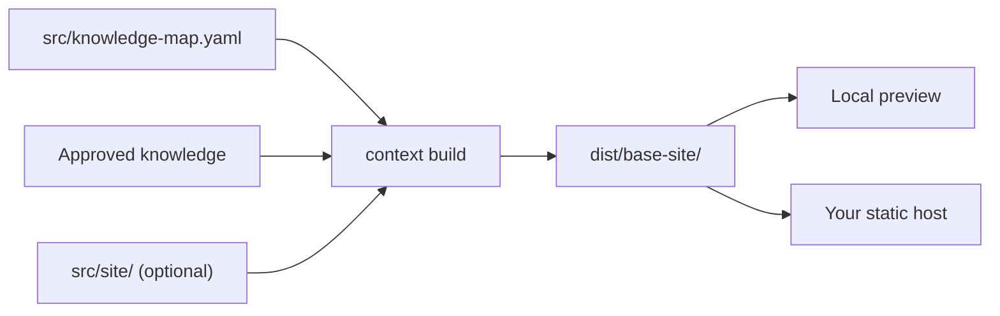

# Documentation Sites

<!-- context:section id="goal" -->
A Context documentation site is a static website built from the same approved knowledge as your knowledge package. Turn it on with a `site` option on the package; every `context build` then writes the package and a sibling `dist/<base>-site/` folder you can preview locally and upload to any static host.


<!-- /context:section -->

<!-- context:section id="enable" -->
## Turning it on

```ts
kbPackage({
  name: "project-kb",
  template: "src/package-templates/kb",
  site: {
    title: "Project knowledge",
    lang: "en-US",
    base: "/",
    home: {
      slogan: "Find the context behind the work",
      resources: [{
        title: "Project workspace",
        description: "Open the repository that maintains this knowledge.",
        href: "https://example.com/project",
        featured: true,
      }],
    },
  },
});
```

| Option | Meaning |
| --- | --- |
| `title`, `description` | Site title (defaults to the package name) and description |
| `lang` | Primary language, default `en-US` |
| `base` | URL prefix, default `/`; use `/docs/` when hosted under that path. It does not change output folders |
| `home` | Landing-page title, slogan, description and resource cards; each card needs a safe `href`, a copyable `command`, or both; `featured` also places it among the hero actions |

The output folder drops one trailing `-kb` from the package name: `project-kb` builds `dist/project-kb/` and `dist/project-site/`. Resource cards come from confirmed settings, repository remotes or real deployment results; unknown destinations are omitted, never filled with placeholders.
<!-- /context:section -->

<!-- context:section id="features" -->

## What the site offers

- **Homepage** — every first-level knowledge-map section as a card with a bounded preview of its pages, plus LLM Docs and Changelog.
- **Navigation** — top-bar sections; the left sidebar shows only the current section's descendants. Each section's landing page shows its first-level groups as cards, two per row and one on narrow screens. Pages outside every section — More menu targets, LLM Docs and the Changelog — show no sidebar and highlight no section.
- **Search** — local search, opened with the search button or Cmd/Ctrl+K; no search service.
- **Theme** — light and dark. Sites open in light mode regardless of the system color scheme; the reader's choice is remembered under the origin-wide `context-theme` key, so sites on one origin share it, and it is applied from the first paint, so pages do not flash the other scheme while loading.
- **Missing pages** — an unknown address shows a centred 404 page in the reader's language with a link back to the site home.
- **Diagrams** — Mermaid rendered in the browser with fit, 100%, zoom, full-screen and source controls. Invalid diagrams keep their source with a notice instead of blocking publication.
- **Provenance** — each article ends with its sources: repository entries link to the recorded revision, document entries to their registered URL. Inline code in article prose that names a cited repository file, one of its directories or the unique name of such a directory (for example a Skill name) links to that path at the recorded revision; uncited or ambiguous names stay plain code.

Code samples and raw HTML are displayed as content, never executed.

<!-- /context:section -->

<!-- context:section id="navigation" -->

## Navigation comes from the knowledge map

`src/knowledge-map.yaml` decides the sidebar: each entry binds to an article by its identity, so labels and parent groups never change an article's URL, and one article can appear in several places while keeping one URL. Every selected article needs a valid place before packaging; missing bindings block the build and the CLI returns the list to place. Category entries may stay empty while articles are still planned.

| Setting | Adds |
| --- | --- |
| `site.nav` | Links after the reading sections in the top bar, or before them with `position: "start"` — for example a documentation home link; a nav link to the current page is highlighted |
| `site.more` | Items in the More menu, before LLM Docs and Changelog; an item may target an approved article kept outside the map, such as release notes |
| `socialLinks` | Icon links in the top bar (`https` only) |
| `titleLink` | Where the site title leads; a root-relative link such as `/` addresses the origin, not `base` |

Links starting with `/` are origin paths, which lets a site under `/docs/` link to a sibling application on the same domain. `locales` on a nav or More item translates its label.

<!-- /context:section -->

<!-- context:section id="build" -->

## Building and previewing

The site is generated in a staging folder before anything is replaced, so a failed website build keeps the previous package and site. Removing `site` deletes the old site on the next successful build. `dist/<base>-site/context-site-map.json` records each article's approved path, package path and site path, plus the menu and any unresolved targets.

Builds do not compare cited source regions, so a publishing build does not need the registered source checkouts; `context verify` still reports changed, moved or missing regions, so run it before publishing.

Preview it through a local HTTP server:

```sh
python3 -m http.server 8000 --bind 127.0.0.1 --directory dist/project-site
```

The Agent's completion report lists the package folder, website folder and LLM text separately, each as generated, failed or not selected, with navigation coverage and the verified preview URL.

<!-- /context:section -->

<!-- context:section id="deploy" -->
## Deploying

Deploy the **contents of `dist/<base>-site/`** with your chosen static hosting tool. Context's build includes no hosting SDK, login or deployment step; after every successful website build the Agent tells you which folder to deploy and, if you have authorized a target, uses a compatible deployment Skill. Only the website folder is published — never sources, private workspace state or the whole package — and success is reported only after the hosted URL is checked.

Once deployed, record the public root so query Skills can link to pages:

```bash
context package site-url project-kb https://example.com/docs/
```

The address is an access hint, not proof of publication; rebuilds keep it.

| You ask for | The Agent does |
| --- | --- |
| Package and website | One `kbPackage` with `site` |
| Package only | Removes `site` and rebuilds; the old site is deleted |
| Add a website later | Adds `site`, places any unplaced articles, rebuilds |
| Website only for sharing | Builds the package too, shares only the website folder |

To change pages, slots and colors, see [Page and Theme Customization](page-and-theme-customization.md); for other languages, [Multilingual Sites](multilingual-sites.md).
<!-- /context:section -->
