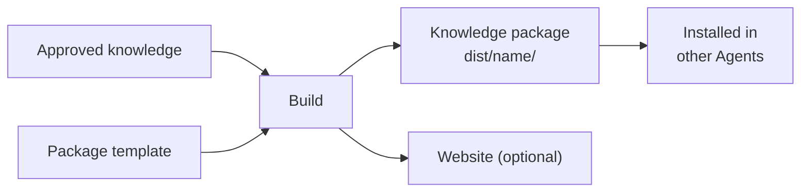

# Knowledge Packages

<!-- context:section id="goal" -->
A **knowledge package** is the Agent-facing output of a Context knowledge workspace: a folder under `dist/` that turns approved knowledge into something another Agent can install and query. It carries the approved pages in reader-facing form, a query Skill that knows how to search them, and an inventory that maps every file back to its approved source. The same build can also produce a documentation website and LLM Docs.

This subsection, Outputs and Sites, covers everything that happens after pages are approved: the package (this page), [Documentation Sites](documentation-sites.md), [LLM Docs](llm-docs.md), [Customizing Pages and Themes](page-and-theme-customization.md), [Multilingual Sites](multilingual-sites.md) and [Custom Output Templates](custom-output-templates.md).


<!-- /context:section -->

<!-- context:section id="choose" -->
## Choosing outputs

You pick outputs in the [work-start report](../planning-and-production/start-reports.md), as one multi-select list; later steps reuse your choice:

- [x] Agent knowledge package — the default for a new knowledge workspace.
- [x] Documentation website — the default together with the package, for local preview or later hosting.
- [ ] LLM text — optional input for model context or retrieval; see [LLM Docs](llm-docs.md).

You can also stop at approved Markdown, and no build runs. Selecting an output is all the permission it needs.

To change your choice later, just tell the Agent, for example:

> Add a documentation website to this knowledge package, and leave out everything under `internal/`.

The Agent updates the workspace's package declaration for you; you never need to write it by hand. If you want to see the options it sets, such as which pages a package selects, how directory indexes fold and how images are shipped, they are listed in [Project API](../../product/reference/context/project-api.md) and [Package Templates](../../product/reference/context/package-templates.md).
<!-- /context:section -->

<!-- context:section id="contents" -->
## What is inside

```text
dist/<package-name>/
├── AGENTS.md
├── skills/
│   └── knowledge-query/
│       ├── SKILL.md
│       └── scripts/search.mjs
├── wikis/
│   ├── index.md          # package entry page
│   ├── codeindex/ ...
│   ├── business/ ...
│   └── product/ ...
├── guides/ ...           # architecture, sop, faq, decision, incident
├── rules/ ...            # standards, test
├── feats/ ...
├── others/assets/ ...    # bundled images and resources
└── context-build-inventory.json
```

The package name already names the folder, so roots inside are flat: `wikis/`, `guides/`, `rules/`, `feats/`. Each page lands under the root for its collection — `sop` pages under `guides/sop/`, `codeindex` pages under `wikis/codeindex/` — as listed in [Knowledge Collections](../../product/reference/context/knowledge-collections.md). `wikis/` is the structured entity-and-relationship layer; `guides/` and `rules/` explain, operationalize or constrain it.

Pages in the package are written for consumers: they keep their reader-facing front matter, drop internal markers, and end with a readable Sources section generated from the page's citations — repository links with file and line ranges, document links with their captured attribution. Exact section-level evidence stays in the knowledge workspace.
<!-- /context:section -->

<!-- context:section id="query" -->
## How Agents read it

The bundled `knowledge-query` Skill is a complete, generic query entry. It works structure first:

1. Start from the generated directory indexes in each root.
2. Use the relationships recorded in the inventory for connections between pages.
3. Read the most likely pages and cite their visible headings and passages.
4. Report a gap when the package does not cover the fact asked for.

When the indexes do not narrow the scope, or a page is too large to read directly, a bundled search script ranks Markdown chunks by relevance. Search results are leads; page bodies and recorded relationships establish what the package says. An Agent reading only the package must not claim to have read the original sources.
<!-- /context:section -->

<!-- context:section id="build" -->
## Building and assets

The build uses only approved knowledge. A newly generated package template must be accepted or edited before the first build; see [Custom Output Templates](custom-output-templates.md).

Images and resources referenced by approved pages are bundled into `others/assets/` by default. Each packaged image is kept at or below 1 MiB and all images together at or below 40 MiB; oversized images are compressed into new WebP files inside `dist/` only, never touching your sources or approved knowledge. Source audit files and capture reports are never shipped as reader assets.
<!-- /context:section -->

<!-- context:section id="checks" -->
## What the build checks

- **Template honesty.** Template prose that describes coverage, scope or known gaps must be backed by approved knowledge or the package's own structure data.
- **Index links.** Every generated directory index is checked so relative links resolve inside the package.
- **Path collisions.** A template file may not land on the same path as a selected page.
- **Relationship coverage.** The inventory records whether code index pages carry current relationship data, so an empty list of dependencies means "none found", not "not checked".

When a check fails, the Agent fixes the template, the approved knowledge or the package declaration and rebuilds; it never patches `dist/` as the fix. The exact rules live in [Custom Output Templates](custom-output-templates.md).
<!-- /context:section -->

<!-- context:section id="install" -->
## Using the package

A package can be used where it was built or copied to any directory your Agent host can read. To point Claude Code, Codex or Cursor at a package and query it, see [Using a Package in Your Agent](../querying-knowledge/using-packages-in-agents.md).
<!-- /context:section -->
