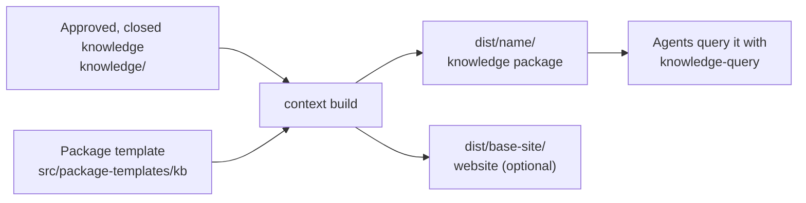

# Knowledge Packages

<!-- context:section id="goal" -->
A **knowledge package** is the Agent-facing output of a Context knowledge workspace: a folder under `dist/` that turns approved knowledge into something another Agent can install and query. It carries the approved articles in reader-facing form, a query Skill that knows how to search them, and an inventory that maps every file back to its approved source. The same build can also produce a documentation website and LLM text; this page covers the package itself.


<!-- /context:section -->

<!-- context:section id="contents" -->
## What is inside

```text
dist/<package-name>/
├── AGENTS.md
├── skills/
│   └── knowledge-query/
│       ├── SKILL.md
│       └── scripts/search.mjs
├── wikis/
│   ├── index.md          # package entry page
│   ├── codeindex/ ...
│   ├── business/ ...
│   └── product/ ...
├── guides/ ...           # architecture, sop, faq, decision, incident
├── rules/ ...            # standards, test
├── feats/ ...
├── others/assets/ ...    # bundled images and resources
└── context-build-inventory.json
```

The package name already names the folder, so roots inside are flat: `wikis/`, `guides/`, `rules/`, `feats/`. Each article lands under the root for its collection — `sop` pages under `guides/sop/`, `codeindex` pages under `wikis/codeindex/` — as listed in [Knowledge Collections](../../product/reference/context/knowledge-collections.md). `wikis/` is the structured entity-and-relationship layer; `guides/` and `rules/` explain, operationalize or constrain it.

Pages in the package are written for consumers: they keep their reader-facing frontmatter, drop lifecycle comments, section markers and fingerprints, and end with a readable Sources section generated from the article's references — repository links with file and line ranges, document links with their captured attribution. Exact section evidence stays in the mapped page of the knowledge workspace.
<!-- /context:section -->

<!-- context:section id="query" -->
## How Agents read it

The default `knowledge-query` Skill is a complete, generic query entry. It works structure first:

1. Start from the generated directory indexes in each root.
2. Use relationship records in `context-build-inventory.json` for package-visible connections.
3. Read the candidate pages and cite their visible headings and passages.
4. Report a gap when the package does not cover the fact asked for.

When the indexes do not narrow the scope, or a page is too large to read directly, its bundled `scripts/search.mjs` ranks bounded Markdown chunks with BM25. Search results are leads; page bodies and typed relationship records establish what the package says. A package-only reader must not claim to have read the original sources. See [Using Packages in Agents](../querying-knowledge/using-packages-in-agents.md) for installing a package into an Agent.
<!-- /context:section -->

<!-- context:section id="declare" -->
## Declaring a package

Packages are declared in the knowledge workspace's `src/index.ts`. The Agent edits this for you when you choose outputs in the work-start report; you never need to write it by hand.

```ts
kbPackage({
  name: "project-kb",
  template: "src/package-templates/kb",
  select: { exclude: ["**/internal/**"] },
  site: { title: "Project knowledge", lang: "en-US", base: "/" },
});
```

| Field | Meaning |
| --- | --- |
| `name` | Lowercase, path-safe package name; output goes to `dist/<name>/` |
| `template` | Template directory, or `{ path, vars }` |
| `select` | Optional selection by `collections`, OKF `okfRoots`, or `include` / `exclude` paths under `knowledge/`; omitted means all approved knowledge |
| `navigation` | Directory-index policy; defaults to folding indexes with up to 50 inline entries |
| `assets` | Resource delivery: bundled by default, Git raw links or omission when explicitly configured |
| `site` | Also build a [documentation website](documentation-sites.md) |

Full details are in [Package Templates](../../product/reference/context/package-templates.md).
<!-- /context:section -->

<!-- context:section id="choose" -->
## Choosing outputs

Outputs can be combined. The work-start report shows them as one multi-select list and later steps reuse your choice:

- [x] Agent knowledge package — the default for a new knowledge workspace.
- [x] Documentation website — the default together with the package, for local preview or later hosting.
- [ ] LLM text — optional input for model context or RAG; see [LLM Docs](llm-docs.md).

You can also stop at approved Markdown: keep `packages: []` and no build runs. There is no separate website Skill and no second permission per selected output.
<!-- /context:section -->

<!-- context:section id="build" -->
## Building and assets

`context build` consumes only approved and closed knowledge; if close is pending, the workflow runs it first. A newly initialized generic template must be edited or explicitly accepted before the first build — `context status` shows this as a package template review step.

Images and resources referenced by approved pages are bundled into `others/assets/` by default. Each packaged image is kept at or below 1 MiB and all images together at or below 40 MiB; oversized images are compressed into new WebP files inside `dist/` only, never touching `sources/` or `knowledge/assets/`. Source audit files and capture reports are never shipped as reader assets.
<!-- /context:section -->

<!-- context:section id="checks" -->
## What the build checks

- **Template boundary.** Template prose that describes coverage, scope or known gaps must cite approved knowledge, the inventory or rendered structure data; otherwise the build reports a diagnostic.
- **Index links.** Every generated directory index is checked so relative links resolve inside the package.
- **Path collisions.** A rendered template path may not collide with a selected knowledge path; rename the template file or exclude the knowledge path with `select.exclude`.
- **Relationship coverage.** The inventory's `structure.relationship_coverage` records whether code index pages carry current relationship data, so an empty edge list is evidence of coverage, not permission to invent a dependency.

Fix problems in the template, the approved knowledge or the package declaration and rebuild. Never patch `dist/` as the durable fix. To change the template itself, see [Custom Output Templates](custom-output-templates.md).
<!-- /context:section -->
