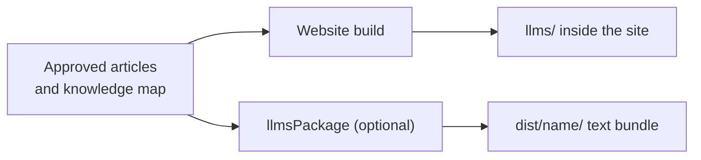

# LLM Docs

<!-- context:section id="goal" -->
**LLM Docs** are plain-text exports of your approved knowledge for models: an index, the complete text in one file, and each article as raw Markdown. Every Context documentation site includes them automatically under **LLM Docs** in the top bar. If you need the text without a website — to paste into a model's context or import into a retrieval system — declare a standalone LLM text package.


<!-- /context:section -->

<!-- context:section id="files" -->
## What you get

| File | Content |
| --- | --- |
| `llms.txt` | Index that preserves the knowledge map's grouping, order and repeated placements |
| `llms-full.txt` | All selected approved text, each article once, in first-placement order |
| `llms/pages/<identity>.txt` | One raw Markdown file per approved article |
| `llms/index.html` | Landing page on the website: index and full-text links followed by the knowledge map |

On a website these files sit inside the site folder and use the configured `base`; no extra declaration or command is needed. They stay in the primary language even when the site has translations. Text files carry a UTF-8 byte-order mark so browsers detect the encoding when a host omits the charset; serve them as `text/plain; charset=utf-8`.
<!-- /context:section -->

<!-- context:section id="standalone" -->
## A standalone text package

Choose an LLM text package when you want one consolidated file that is easy to copy, index or upload, without Agent Skill packaging:

```ts
llmsPackage({ name: "project-llms", template: "src/package-templates/llms" });
```

It produces `llms.txt` from its template, plus `llms-full.txt` and the per-article files, organized by the same knowledge map. It can sit alongside a knowledge package in the same declaration; ask the Agent to add it in the work-start report or later.
<!-- /context:section -->

<!-- context:section id="freshness" -->
## Freshness

Only approved, selected content is exported. Any change to the map or an article invalidates both the website and its LLM Docs, and a failed build keeps the previous output. For packages built for Agents with a query Skill, see [Knowledge Packages](knowledge-packages.md).
<!-- /context:section -->
