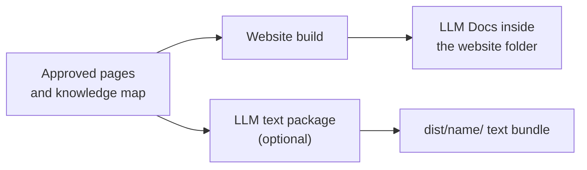

# LLM Docs

<!-- context:section id="goal" -->
**LLM Docs** are plain-text exports of your approved knowledge for models: an index, the complete text in one file, and each page as raw Markdown. They are a build output under `dist/`: every documentation site build writes them into the website folder, and the site can link them for readers. If you need the text without a website — to paste into a model's context or import into a retrieval system — ask for a standalone LLM text package.

<!-- /context:section -->

<!-- context:section id="files" -->
## What you get

| File | Content |
| --- | --- |
| `llms.txt` | Index that keeps the knowledge map's grouping, order and repeated placements |
| `llms-full.txt` | All selected approved text, each page once, in first-placement order |
| `llms/pages/<identity>.txt` | One raw Markdown file per approved page |
| `llms/index.html` | Landing page on the website: index and full-text links followed by the knowledge map |

With a website, these files sit inside the website folder and follow its address prefix; nothing extra needs to be asked for. They stay in the primary language even when the site has translations. Text files carry a UTF-8 byte-order mark so browsers detect the encoding when a host omits the charset; serve them as `text/plain; charset=utf-8`.
<!-- /context:section -->

<!-- context:section id="standalone" -->
## A standalone text package

Choose an LLM text package when you want one consolidated file that is easy to copy, index or upload, without the Agent Skill packaging. Ask for it in the [work-start report](../planning-and-production/start-reports.md) or later:

> Also build an LLM text package for this knowledge.

It produces `llms.txt` from its own template, plus `llms-full.txt` and the per-page files, organized by the same knowledge map, and it can sit alongside a knowledge package. The declaration the Agent adds is described in [Project API](../../product/reference/context/project-api.md).
<!-- /context:section -->

<!-- context:section id="freshness" -->
## Freshness

Only approved, selected content is exported. Any change to the map or a page rebuilds both the website and its LLM Docs, and a failed build keeps the previous output. For packages built for Agents with a query Skill, see [Knowledge Packages](knowledge-packages.md).
<!-- /context:section -->
