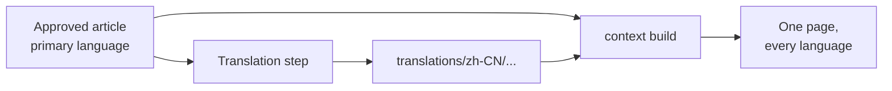

# Multilingual Sites

<!-- context:section id="goal" -->
A Context site can show every page in several languages at the same address. You declare the reader languages; the Agent translates approved articles and navigation titles during delivery; the site shows each reader their language and falls back to the original where a translation is missing. Approved knowledge in the primary language stays the only source of truth: translations are a reader projection and never change Review, verification or the knowledge package.


<!-- /context:section -->

<!-- context:section id="declare" -->

## Declaring languages

```ts
site: {
  lang: "en-US",
  locales: { "zh-CN": { title: "项目知识" } },
}
```

Each locale may override `label`, `title`, `description` and `home`. Set only the homepage fields that differ: an unset `home` title, slogan, description, hero actions or resources falls back to the site's own `home` setting, and then to the built-in default, so a translated title alone keeps the primary language's actions and resource cards. Links, navigation and custom pages need no per-language routes, because every page carries all languages. A reader's saved choice wins, then the browser's languages, then `site.lang`; the choice is remembered under `site.localePreferenceKey` (default `context-locale`), which sites on one origin share unless configured otherwise. Without `site.locales` the language button still switches the interface between Chinese and English.

<!-- /context:section -->

<!-- context:section id="storage" -->
## Where translations live

| Path | Content |
| --- | --- |
| `translations/<tag>/<approved-path>.md` | Translated article; frontmatter holds `title`, optional `description` and a `translation` record with locale, article identity, source digest and time |
| `translations/<tag>/knowledge-map.yaml` | Translated navigation titles keyed by knowledge-map entry |

Translations are formal content of the Context knowledge workspace: they are committed, included in versions and package fingerprints, and changing one rebuilds the website.
<!-- /context:section -->

<!-- context:section id="freshness" -->
## Freshness

Each translation records the digest of the approved title, description and body it was made from:

| State | Meaning | On the site |
| --- | --- | --- |
| `current` | Digest matches | Translation shown |
| `stale` | Approved article changed since | Translation shown with an outdated notice and a button to switch to the original |
| `missing` | No translation file | Original shown with a notice |

Runtime metadata changes do not make a translation stale. Translations whose article no longer exists are reported as orphans and removed on the next submission. `context-site-map.json` lists translated, stale and missing counts per locale.
<!-- /context:section -->

<!-- context:section id="workflow" -->

## The translation step

When a package declares locales and anything is not current, the workflow adds a translation step after package template approval and before the knowledge workspace version is recorded. The Agent runs it:

```bash
context translate status --format json
context translate prepare --format json
context translate submit --input <file> --format json
context translate skip --digest <expected_digest> --format json
```

`prepare` lists pending articles and navigation titles with an `expected_digest`, writes a draft for each pending article and a submission file. A stale article's draft is its current translation; a missing article's draft is the approved source. When Git history holds the approved version a translation was made from, `source_diff` names the diff from that version to the current article, so the Agent updates only what changed; without that history it is `null` and the Agent compares the draft with the whole article. History is missing, for example, when several approve-and-translate rounds ran without a commit in between, so commit approved knowledge and translations after a round. An already edited draft is kept (`draft: kept`, no diff) and must be aligned with the whole current article; successful submission removes the drafts. `submit` takes the translated files and titles:

```yaml
expected_digest: <from prepare>
articles:
  - locale: zh-CN
    approved_path: knowledge/sop/example.md
    file: .tmp/agent-payloads/translations/zh-CN/sop/example.md
map_entries:
  - locale: zh-CN
    key: getting-started
    title: 入门
```

A translation must keep every section marker, id and order, every fenced code block with its language marker, and every link target. Inside code blocks only Mermaid labels and the prose of `text`, `txt` and `plaintext` blocks may change; commands, paths and placeholders such as `<repository>` stay as they are. The submission is validated as a whole and saves nothing if any item fails; a digest from before an approved change is rejected. `skip` publishes the current pending items in the primary language for this iteration only — the next approved change asks again.

<!-- /context:section -->

<!-- context:section id="reading" -->

## What readers see

Each page is published once with every language and the reader's language selects what is visible. Navigation titles without a translation use the translated article title, then the original. Search covers every language, and opening a result in another language switches to it. In-page and cross-page anchors keep the reader's language and scroll to the matching heading, including repeated clicks and back/forward navigation. LLM Docs and the Changelog stay in the primary language. For other site options, see [Documentation Sites](documentation-sites.md).

<!-- /context:section -->
