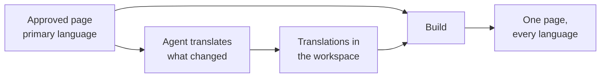

# Multilingual Sites

<!-- context:section id="goal" -->
A Context site can show every page in several languages at the same address. You declare the reader languages; the Agent translates approved pages and navigation titles during each round; the site shows each reader their language and falls back to the original where a translation is missing. Approved knowledge in the primary language stays the only source of truth: translations are for readers and never change review, verification or the knowledge package.


<!-- /context:section -->

<!-- context:section id="declare" -->
## Declaring languages

Ask the Agent, for example:

> Add a Simplified Chinese version of the site, titled 项目知识.

It adds the language to the site settings:

```ts
site: {
  lang: "en-US",
  locales: { "zh-CN": { title: "项目知识" } },
}
```

Each language may override the site's label, title, description and homepage. Set only what differs: unset homepage fields fall back to the primary language's homepage and then to the built-in default, so a translated title alone keeps the primary language's actions and resource cards. Links, navigation and custom pages need no per-language routes, because every page carries all languages.

A reader's saved choice wins, then the browser's languages, then the site's primary language. The choice is remembered for the whole origin, so sites on one origin share it unless configured otherwise. Without extra languages, the language button still switches the interface between Chinese and English. All language options are in [Project API](../../product/reference/context/project-api.md).
<!-- /context:section -->

<!-- context:section id="workflow" -->
## How translation fits each round

Once a language is added, the Agent translates during each round, after the pages are approved and before the version is recorded:

- **First round** — every approved page and navigation title is translated.
- **Later rounds** — only what changed since the last translation is updated, starting from the existing translation. This works best when each round's approved pages and translations are committed, which the Agent does when a round ends.
- **Skipping a round** — tell the Agent "skip translation this round". Pending pages are published in the primary language for now, and the next round asks again.

Translations keep the page's structure, code blocks, commands, paths and link targets unchanged; only prose, titles and diagram labels are translated. If any translated page fails these checks, nothing from that batch is saved. The underlying commands are listed in [CLI Commands](../../product/reference/context/cli-commands.md).
<!-- /context:section -->

<!-- context:section id="storage" -->
## Where translations live

Translations are stored per language in the workspace's `translations/` folder, next to translated navigation titles. They are formal content of the knowledge workspace: they are committed, included in versions, and changing one rebuilds the website.
<!-- /context:section -->

<!-- context:section id="freshness" -->
## Freshness

Each translation remembers which version of the approved page it was made from:

| State | Meaning | On the site |
| --- | --- | --- |
| Current | Matches the approved page | Translation shown |
| Outdated | The approved page changed since | Translation shown with an outdated notice and a button to switch to the original |
| Missing | Not translated yet | Original shown with a notice |

Changes that don't touch a page's title, description or body don't make its translation outdated. Translations of pages that no longer exist are removed the next time translations are saved. The build report lists translated, outdated and missing counts per language.
<!-- /context:section -->

<!-- context:section id="reading" -->
## What readers see

Each page is published once with every language, and the reader's language selects what is visible. Navigation titles without a translation use the translated page title, then the original. Search covers every language, and opening a result in another language switches to it. Links to headings, on the same page or another, keep the reader's language and scroll to the matching heading, including with the browser's back and forward buttons. LLM Docs and the Changelog stay in the primary language. For other site options, see [Documentation Sites](documentation-sites.md); for language-aware custom components, see [Customizing Pages and Themes](page-and-theme-customization.md).
<!-- /context:section -->
