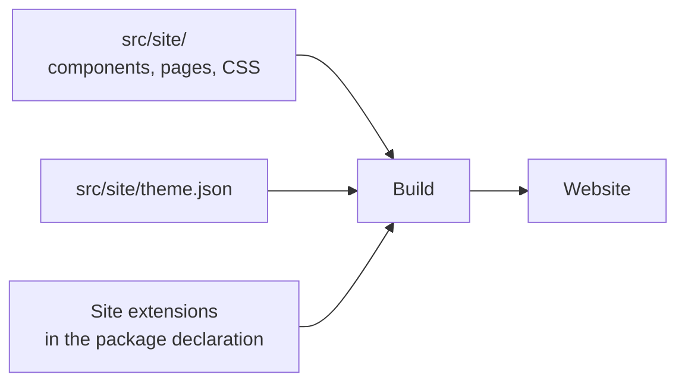

# Customizing Pages and Themes

<!-- context:section id="goal" -->
A Context site works without any frontend code, but site authors can tailor it: replace parts of the homepage, add a logo, float a chat widget on every page, publish website-only pages and change the color palette. All of this lives in your knowledge workspace — presentation code under `src/site/`, colors in `src/site/theme.json` — and is applied by the normal build. Approved knowledge and generated output are never edited by hand.

You can write these files yourself or ask the Agent, for example:

> Add our logo to the top bar and a support page linked from the sidebar.


<!-- /context:section -->

<!-- context:section id="extensions" -->
## Declaring extensions

```ts
site: {
  title: "Engineering handbook",
  extensions: {
    root: "src/site",
    slots: {
      banner: "components/Banner.vue",
      floating: "components/Chat.vue",
    },
    pages: { support: "pages/support.md" },
  },
}
```

Paths are relative to `root`. The folder may contain Vue components, CSS, Markdown and imported assets; use relative imports within it and declare external dependencies in the knowledge workspace's package manifest. Hidden files, `node_modules` and `dist` are not copied, and symbolic links are rejected. Never put credentials or private configuration in frontend files. All site options are in [Project API](../../product/reference/context/project-api.md).
<!-- /context:section -->

<!-- context:section id="slots" -->
## Homepage and page slots

| Slot | Default | Customization |
| --- | --- | --- |
| `banner` | Homepage hero and actions | Replace with a component |
| `knowledge` | Knowledge-map card group | Replace with a component |
| `resources` | Resource card group | Replace with a component |
| `footer` | Homepage footer | Replace with a component |
| `floating` | Empty | Client-only component fixed bottom right on all pages |
| `brand` | Site title text | Component at the start of the top bar, such as a logo |

Omit a slot to keep its default, or set it to `false` to hide it. A component replaces only its slot — never the global navigation, language switch or page provenance. Components can use VitePress `useData()` and `useRoute()` and import scoped CSS.

To show the right language from the first paint, render each language and mark it with `data-context-locales="<tag>"`; the site stylesheet hides the others. `useData().lang` gives the reader's language after mount. See [Multilingual Sites](multilingual-sites.md).
<!-- /context:section -->

<!-- context:section id="floating" -->
## A chat or Bot widget

The `floating` component owns its button, panel and open/close behavior. Keep the panel inside the viewport, preserve keyboard focus and a close control, and load heavy chat SDKs only when opened. The static site provides no chat backend or secret storage: send requests to an authorized service of your own, and make sure a service failure never prevents reading the documentation. Other components must render statically; use `onMounted` for browser APIs.
<!-- /context:section -->

<!-- context:section id="pages" -->
## Custom pages

Each `pages` key becomes `/custom/<key>.html` under the site's address prefix. A page is trusted Markdown and may import Vue components:

```md
# Support

<script setup>
import SupportPanel from '../components/SupportPanel.vue'
</script>

<SupportPanel />
```

Place it in navigation with an ordinary knowledge-map entry whose target is `artifact_ref: "site:support"`, setting `parent`, `title` and `order` as for any entry. Pages without an entry are still reachable directly, and several entries can point to one page. Custom pages are website-only: they are not approved pages and do not enter the knowledge package or LLM Docs. Change formal pages through [revision](../review-and-revision/revising-a-page.md), not with a custom page.
<!-- /context:section -->

<!-- context:section id="theme" -->
## Colors and light/dark mode

The first website build creates `src/site/theme.json` with the default light and dark palettes if it is missing; builds never overwrite your values, and deleting the file restores the defaults. Each `light` and `dark` object accepts `brand`, `accent`, `background`, `surface`, `text`, `mutedText` and `border` as hexadecimal colors; missing keys inherit defaults.

A package can override the shared file:

```ts
kbPackage({ site: { theme: {
  light: { brand: "#6750a4" }, dark: { brand: "#d0bcff" },
} } })
```

Precedence is built-in defaults, then `theme.json`, then the package's own theme. Offline [review reports](../review-and-revision/reading-review-reports.md) and Mermaid diagrams use the same colors. Custom components should read `--context-brand`, `--context-accent`, `--context-background`, `--context-surface`, `--context-text`, `--context-muted-text` and `--context-border` instead of hard-coding colors.

Sites open in light mode regardless of the reader's system color scheme. A reader's light or dark choice is remembered for the whole origin, so all Context sites on one origin share it, and it is applied from the first paint, so pages don't flash the other scheme while loading.
<!-- /context:section -->

<!-- context:section id="check" -->
## Building and checking

Customization needs no new sources, Indexer work or review: edit and rebuild. A failed build keeps the previous output. Before publishing, preview the homepage, custom pages and floating panel on desktop and mobile, under a non-root address prefix, in dark mode and with keyboard navigation. Deploy only the website folder. For the base site options and deployment, see [Documentation Sites](documentation-sites.md).
<!-- /context:section -->
