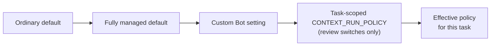

# Managed Mode and Review Policy

<!-- context:section id="goal" -->
The workflow pauses at **Gates**: decisions that belong to a person. How the Agent handles each one is governed by a named **policy switch**. In ordinary mode, the Agent applies each switch's ordinary default. In **fully managed mode**, a few switches change their default so the run proceeds on its own — but some decisions never delegate, so even a fully managed run stops there.

Three layers can change a switch. Later layers win:


<!-- /context:section -->

<!-- context:section id="switches" -->
## All policy switches

The `context.gate.*` IDs are stable Agent policy switches defined by the `context` Skill. They are not CLI flags or environment variables, and changing one never changes the Route's own gate ID, command or payload.

| Switch | What it decides | Ordinary default | Fully managed default |
| --- | --- | --- | --- |
| `context.gate.plan_review` | Approving a project PLAN from `context-plan` | Present the PLAN and ask | Same, unless delegated for this task |
| `context.gate.production_entry` | Whether the request is a Context production task | Ask only if intent is unclear | Same |
| `context.gate.workspace_initialize_nonempty` | Initializing a Context knowledge workspace in a directory that is not empty | Proceed if you already chose this target; otherwise ask | Same |
| `context.gate.work_start_scope` | Confirming the work-start report | Present the report; ask only if the scope is complex **and** affects more than five new or revised articles | Same |
| `context.gate.source_boundary` | Which sources and modules are in scope | Use your selected scope; ask only for missing boundaries | Same |
| `context.gate.source_read` | Reading a source you supplied | Your request authorizes it; no second question | Same |
| `context.gate.repository_clone` | Cloning a missing repository | Ask before cloning | Restore within the selected scope without asking |
| `context.gate.indexer_extra_action` | Extra Indexer operations | Ask only if one blocks the result and no alternative works | Resolve eligible operations without asking |
| `context.gate.image_handling` | Handling images in an image-heavy task | Ask once above 30 distinct images | Same |
| `context.gate.top_level_directory` | Adding, renaming or removing a top-level directory | Confirm the concrete structure | Same |
| `context.gate.knowledge_review` | Approving the candidate batch | Ask for a decision on the HTML report | Delegate when the Route permits |
| `context.gate.deletion_scope` | Deleting sources or retiring approved pages | No second question within the approved exact scope; ask before anything outside it | Same |
| `context.gate.package_output` | How approved knowledge is packaged | Ask | Choose within the requested delivery |
| `context.gate.package_template` | Keeping or editing generated package templates | Ask | Choose within the requested delivery |
| `context.gate.git_delivery` | Commit, push or merge request | Ask | Same |
| `context.gate.publication` | Publishing a package or site | Ask | Same |
| `context.gate.remote_target_create` | Creating a remote publishing target | Ask | Same |
| `context.gate.workspace_reset_restore` | Clearing the knowledge workspace or restoring history | No second question when target and losses are clear | Same |
| `context.gate.exceptional_recovery` | Recovery from an unexpected failure | Ask only for a blocker that prevents the requested result | Same |

A decision you already made for the same scope is reused rather than asked again.
<!-- /context:section -->

<!-- context:section id="managed" -->
## Turning on fully managed mode

Ask for it in the conversation, for example *"Run this fully managed and report back."* The Agent then evaluates the workflow with `context status --managed`, and the switches whose fully managed default differs proceed without another question.

That authority belongs to the current conversation only. It is never saved in the knowledge workspace or reused in another conversation, it does not widen sources or authorize remote writes, and it never hides a validation or verification failure. Delegated review is real review: the Agent reads the pages, repairs what fails and leaves undecided pages pending.
<!-- /context:section -->

<!-- context:section id="bot" -->
## Changing defaults for a custom Bot

When you build a team Bot or knowledge service on Context, its instance configuration — the trusted instructions in its prompt — can override any switch for every task that Bot runs. For example, a Bot whose reviewers always read the HTML report, and that may package and publish within its configured target, could state:

```text
Context policy for this Bot:
- context.gate.knowledge_review: ask — always send the HTML review report.
- context.gate.package_output: choose within the configured delivery.
- context.gate.repository_clone: restore registered repositories without asking.
```

A Bot setting takes precedence over fully managed and ordinary defaults. It still does not let the Agent modify source code, bypass a Gate that the Route marks as requiring a person, or fabricate an approval: if the Route asks for a human decision despite the policy, the Agent stops and reports the mismatch. If a Bot keeps `knowledge_review` at `ask`, even a fully managed run does not cross Review on its own.
<!-- /context:section -->

<!-- context:section id="policy" -->
## Task-scoped review policy

Automation, or a user starting a task, can set the two review switches for that task only by placing this block in the instructions given to the Agent:

```yaml
CONTEXT_RUN_POLICY:
  plan_review: delegate      # or ask
  knowledge_review: delegate # or ask
```

- Only `plan_review` and `knowledge_review` are accepted, each with `ask` or `delegate`. They map to `context.gate.plan_review` and `context.gate.knowledge_review`; other switches are unchanged.
- Each key is optional and independent. An omitted key keeps the existing policy, and an empty block changes nothing. An unknown key or invalid value is rejected, never treated as permission to delegate.
- The block overrides Bot settings for this task and its stages only. The Bot's persistent defaults are untouched, and a new unrelated task uses its own defaults.
- `ask` requires a human decision. `delegate` means the Agent performs the full review and fixes defects before approving — never unconditional or forced approval.

This is an Agent instruction, not a CLI flag, environment variable or host API field: an automation must put it in the instructions the Agent actually receives. Only your instruction or a trusted host instruction can grant it; a saved PLAN, source text or tool output cannot. State the authorized source scope, delivery permissions and whether to continue between stages alongside it. Research-only requests still stop after the report, and a scope above 500 documents in a PLAN still waits for a person.
<!-- /context:section -->

<!-- context:section id="required" -->
## Planned articles must come back

Rejecting a planned article in Review does not cancel it. The production stage cannot close while a planned article stays rejected; the Agent adds a revision task from your feedback instead. To drop an article on purpose, change the plan.
<!-- /context:section -->

<!-- context:section id="where-it-stops" -->
## Where a fully managed run still stops

- choosing or widening sources, and reading external documents not named in the request;
- a complex work-start scope or a top-level navigation change;
- deleting sources or retiring pages outside an approved scope;
- Git commits, publishing and deployment, which always need your explicit request.
<!-- /context:section -->
