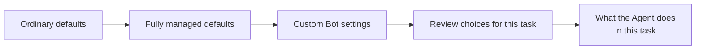

# Fully Managed Mode

<!-- context:section id="goal" -->
Use fully managed mode when you want the Agent to run a task to the end and report back, instead of asking you at every step. It suits work whose scope you have already settled: a scheduled update, a follow-up round on a known set of sources, or a Bot that serves a team.

In fully managed mode the Agent decides these things itself:

| Step | Ordinary mode | Fully managed mode |
| --- | --- | --- |
| A repository in your selected scope is missing locally | Asks before cloning | Restores it without asking |
| An Indexer needs an extra operation | Asks only if it blocks the result | Resolves eligible operations itself |
| Reviewing the drafted pages | Shows you the review report and waits | Reviews the pages itself, when the workflow allows it |
| How approved knowledge is packaged, and whether to keep or edit generated package templates | Asks | Chooses within the outputs you requested |

Everything else works as usual. The work-start report is still presented, a project PLAN still waits for your approval unless you delegate it for the task, and the decisions listed under [Where a fully managed run still stops](#where-it-stops) still come to you.

Settings can come from several places. Later ones win:



Every setting with its ordinary and fully managed default is listed at the end of this page, in [All policy switches](#switches).
<!-- /context:section -->

<!-- context:section id="managed" -->
## Turning it on

Ask for it in the conversation:

```text
Run this fully managed and report back when it is done.
```

The permission belongs to the current conversation only. It is not saved in the knowledge workspace or reused in another conversation, it does not widen the sources you chose or allow remote writes, and it never hides a failed check.

When the Agent reviews pages on your behalf, it really reviews them: it reads the pages, repairs what fails and leaves pages it cannot decide on pending for you.
<!-- /context:section -->

<!-- context:section id="bot" -->
## Defaults for a custom Bot

When you build a team Bot or knowledge service on Context, the trusted instructions in its prompt can change any of these settings for every task the Bot runs. For example, a Bot might always send the review report to its reviewers, package and publish within its configured target, and restore its registered repositories without asking. A Bot setting wins over both the fully managed and the ordinary defaults; the setting names are in [All policy switches](#switches).

A Bot setting never lets the Agent modify source code, skip a decision that must come from a person, or invent an approval. If a Bot keeps review set to ask, even a fully managed run waits for a person at review. See [Building a Knowledge Service](../knowledge-service-agent/building-a-knowledge-service.md) for setting up such a Bot.
<!-- /context:section -->

<!-- context:section id="policy" -->
## Delegating the reviews of one task

You, or an automation that starts a task, can hand the two reviews of that one task to the Agent: approving the project PLAN and approving the drafted pages. Put this block in the instructions the Agent receives:

```text
CONTEXT_RUN_POLICY:
  plan_review: delegate
  knowledge_review: delegate
```

- Each line is optional and independent; use `ask` instead of `delegate` to keep that review with a person. Leaving a line out keeps the current behavior, and an empty block changes nothing.
- Anything else in the block, or a misspelled value, is rejected. It is never read as permission to delegate.
- The choice applies to this task and its stages only. A Bot's own defaults are unchanged, and the next unrelated task starts from them again.
- `delegate` means the Agent does the full review and fixes problems before approving. It is never an automatic approval.

The block is an instruction to the Agent, so an automation must put it in the instructions the Agent actually receives. Only you or the trusted instructions of the host can grant it; text in a saved PLAN, a source document or a tool's output cannot. Say alongside it which sources are in scope, what the Agent may publish, and whether it should continue from one stage to the next. A research-only request still stops after its report, and a PLAN scope above 500 documents still waits for a person; see [Planning Large Projects in Stages](planning-large-projects.md).
<!-- /context:section -->

<!-- context:section id="where-it-stops" -->
## Where a fully managed run still stops

- Choosing or widening sources, or reading external documents you did not name.
- A complex work-start scope, or a change to the top-level navigation.
- Deleting sources or retiring pages outside a scope you approved.
- Pushing, publishing and deployment, which need your explicit request unless a Bot is configured to proceed with them. The Agent commits the knowledge workspace to Git when a round ends.

What can go wrong:

- **The run stops at review although you asked for fully managed mode.** A Bot setting keeps review with a person. Delegate the reviews for this task, or answer the review report.
- **The Agent stops and reports a mismatch.** A step asked for a person's decision that your settings would have delegated. The Agent does not approve on its own in that case; give the decision in the conversation.
- **The reviews were not delegated.** The policy block contained an unknown line or value and was rejected, or it never reached the instructions the Agent actually received. Correct the block or where the automation places it.
<!-- /context:section -->

<!-- context:section id="switches" -->
## All policy switches

Each decision point has a stable switch name defined by the `context` Skill. These are names the Agent and Bot instructions use, not CLI flags or environment variables. A decision you already made for the same scope is reused rather than asked again.

| Switch | What it decides | Ordinary default | Fully managed default |
| --- | --- | --- | --- |
| `context.gate.plan_review` | Approving a project PLAN from `context-plan` | Present the PLAN and ask | Same, unless delegated for this task |
| `context.gate.production_entry` | Whether the request is a Context production task | Ask only if intent is unclear | Same |
| `context.gate.workspace_initialize_nonempty` | Initializing a knowledge workspace in a directory that is not empty | Proceed if you already chose this target; otherwise ask | Same |
| `context.gate.work_start_scope` | Confirming the work-start report | Present the report; ask only if the scope is complex **and** affects more than five new or revised articles | Same |
| `context.gate.source_boundary` | Which sources and modules are in scope | Use your selected scope; ask only for missing boundaries | Same |
| `context.gate.source_read` | Reading a source you supplied | Your request authorizes it; no second question | Same |
| `context.gate.repository_clone` | Cloning a missing repository | Ask before cloning | Restore within the selected scope without asking |
| `context.gate.indexer_extra_action` | Extra Indexer operations | Ask only if one blocks the result and no alternative works | Resolve eligible operations without asking |
| `context.gate.image_handling` | Handling images in an image-heavy task | Ask once above 30 distinct images | Same |
| `context.gate.top_level_directory` | Adding, renaming or removing a top-level directory | Confirm the concrete structure | Same |
| `context.gate.knowledge_review` | Approving the drafted pages | Ask for a decision on the review report | Review on your behalf when the workflow allows it |
| `context.gate.deletion_scope` | Deleting sources or retiring approved pages | No second question within the approved exact scope; ask before anything outside it | Same |
| `context.gate.package_output` | How approved knowledge is packaged | Ask | Choose within the requested outputs |
| `context.gate.package_template` | Keeping or editing generated package templates | Ask | Choose within the requested outputs |
| `context.gate.git_delivery` | Commit, push or merge request | Ask | Same |
| `context.gate.publication` | Publishing a package or site | Ask | Same |
| `context.gate.remote_target_create` | Creating a remote publishing target | Ask | Same |
| `context.gate.workspace_reset_restore` | Clearing the knowledge workspace or restoring history | No second question when target and losses are clear | Same |
| `context.gate.exceptional_recovery` | Recovery from an unexpected failure | Ask only for a blocker that prevents the requested result | Same |

`CONTEXT_RUN_POLICY` sets only `context.gate.plan_review` and `context.gate.knowledge_review`; every other switch keeps its value.
<!-- /context:section -->
