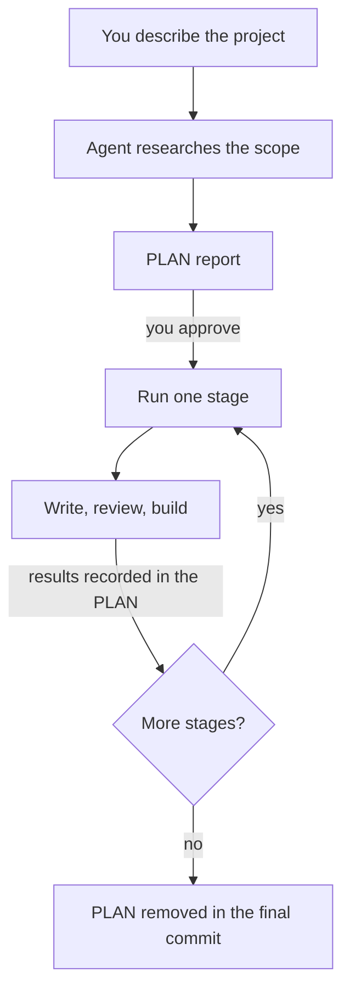

# Planning Large Projects in Stages

<!-- context:section id="goal" -->
A large knowledge project is easier to get right in bounded pieces. **Plan mode**, the `context-plan` Skill, researches the whole scope, proposes a **PLAN report** that divides the work into **stages**, and then runs one stage at a time through the ordinary workflow. Each stage still gets its own [work-start report](start-reports.md), writing and review.


<!-- /context:section -->

<!-- context:section id="when" -->
## When a task is large

Plan in stages when the scope has **more than 30 source documents, or at least two repositories that need real investigation**, or for a broad update across source versions. Starting a new knowledge project whose scope still needs research is also a good reason to plan first. Small bounded tasks go straight through `/c4a:context`.

Ask for it explicitly, continue an existing PLAN, or let `/c4a:context` hand over when an authorized task crosses the threshold:

```text
/c4a:context-plan Build a knowledge base for our three payment services and the
design folder. Readers are new backend engineers. Plan it in stages and report
after each stage.
```

In Cursor the command is `/c4a-context-plan`. A very large monorepo with several business directions may be better served by one knowledge workspace per direction; plan mode does not split or migrate existing knowledge workspaces on its own.
<!-- /context:section -->

<!-- context:section id="research" -->
## What happens during research

The Agent works in scratch space that stays out of Git. It starts from directory listings, versions and existing coverage, reads representative material and code entry points, and expands only as far as needed to divide the work. A branch or "latest" is pinned to an exact commit before it is used as evidence, and the PLAN keeps enough about each source to resume even if the scratch files disappear.

Before proposing any article, it reads how the knowledge workspace is organized today and the relevant approved pages, and decides per topic: **reuse unchanged**, **revise or extend**, **consolidate**, **add**, or **investigate** an unresolved conflict or access gap. Research never changes approved knowledge.

For a broad source update, each repository is compared between the version the knowledge was built from and the new one, looking only at the files the approved articles actually cite. A changed file is a reason to investigate, not proof that an article must be rewritten.
<!-- /context:section -->

<!-- context:section id="report" -->
## Reading the PLAN report

The report is ordinary Markdown at the project's Git root. Check each part:

| Section | What to check |
| --- | --- |
| Outcome and current position | The readers and requested outcome are yours; the knowledge workspace and repository are right |
| Research scope and findings | Every source you meant is listed with an exact version; access gaps are named, not hidden |
| Existing knowledge and material relationships | Overlaps with pages you already have are reused or revised, not duplicated |
| Proposed stages | Each stage has a clear reader outcome, its sources and versions, and sensible prerequisites |
| Approval and execution choices | Review, progress reporting, publishing destination and Git process match what you intend |
| Current stage | What the next stage covers and which decisions it must preserve |
| Results | What each finished stage actually produced, reviewed, published and committed |
| Resume notes | The exact position and next action if work is interrupted |

To change it, say so — *"split S03 into references and guides"*, *"drop the legacy folder"*. Approving the PLAN does not approve any article, source permission, Git operation or publication.
<!-- /context:section -->

<!-- context:section id="limits" -->
## Stage size and large scopes

This is the one place these limits are kept:

| Boundary | Default |
| --- | --- |
| Source documents per stage | Recommended 30; never more than 50, with the reason recorded in the PLAN for groups above 30 |
| New repository investigation | One repository per stage; repositories studied earlier may support later stages |
| Revision stage | At most 30 target articles |
| More than 100 documents | The Agent checks with you whether bounded research can establish a useful scope |
| More than 500 documents | The whole task pauses until a person narrows the scope or explicitly keeps all of it |

These are planning boundaries the Agent follows, not hard stops in the tool. Filters you may be offered include selected directories or domains, excluding archives, a recent-update cutoff with its date, or durable documentation only. Nothing is excluded silently. The 500-document pause cannot be lifted by delegation, fully managed mode or a scheduled trigger.
<!-- /context:section -->

<!-- context:section id="review" -->
## Who reviews the PLAN

The Agent asks you to review the PLAN by default, including in fully managed mode. You can hand this review to the Agent for one task (see [Fully Managed Mode](managed-mode-and-review-policy.md)); it then reads the whole report, checks scope, stage limits, dependencies, overlaps, evidence gaps and publishing settings, and fixes what is missing before recording its decision. Article review is separate: delegating the PLAN review does not change how pages are reviewed.

The Agent also settles how you want to hear about progress: once after all stages, or after each stage — and for stage reports, whether to continue automatically or wait for your reply. A research-only request stops at the report; running the plan needs your explicit go-ahead.
<!-- /context:section -->

<!-- context:section id="steer" -->
## Steer early

On a large task, preview the work-start report and the first changed pages as soon as they exist. If the wording, examples or style are off, say so with counter-examples. Corrections made in the first stage carry into every later stage; the earlier you correct, the higher the final quality.
<!-- /context:section -->

<!-- context:section id="stages" -->
## Running the stages

Each stage runs the ordinary workflow for its own scope only, carrying the sources, target articles, reuse and revision decisions, and the review, reporting and publishing choices from the approved PLAN.

After each stage the Agent records what actually happened — research, writing, review, merge and publishing — in the PLAN and commits it before the next stage begins. A stage that must be published counts as done only after publication succeeds; a local build or an open merge request is not publication. Before the next stage, the Agent rechecks the affected knowledge, including pages from earlier stages, so nothing is recreated or overwritten.
<!-- /context:section -->

<!-- context:section id="resume" -->
## Interruptions and finishing

If a session ends, the PLAN keeps the current position and next action. Open a new conversation in the same knowledge workspace and invoke `/c4a:context-plan`; it resumes the current stage instead of repeating the project-wide research. A delegated PLAN review saved in the PLAN is only a record: on resume, the Agent honors it only if your instructions for the task still grant it.

When every agreed stage is finished and merged, the PLAN is removed in the final commit. Its history stays in Git.
<!-- /context:section -->
