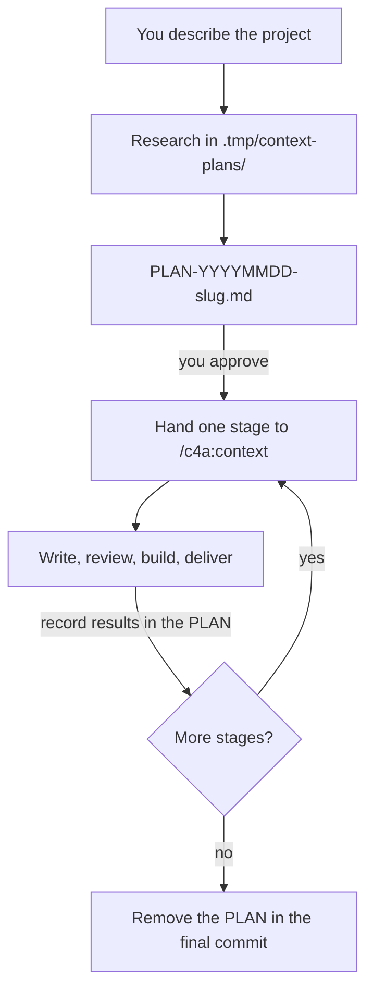

# Planning a Large Project

<!-- context:section id="goal" -->
**Plan mode** is the `context-plan` Skill. It turns a large knowledge project into a reviewed **PLAN report** and a series of bounded **stages**, then hands one stage at a time to the ordinary Context workflow. It is a research and coordination layer, not a second workflow engine: each stage still gets its own work-start report, writing and Knowledge Review.


<!-- /context:section -->

<!-- context:section id="when" -->
## When plan mode applies

Use it when the scope has **more than 30 source documents, or at least two repositories that need real investigation**, or for a broad update across source versions. Invoke `/c4a:context-plan` (Cursor: `/c4a-context-plan`) explicitly, continue an existing `PLAN-*.md`, or let `/c4a:context` hand over when an authorized task crosses the threshold. Small bounded tasks continue through `/c4a:context` directly.

```text
/c4a:context-plan Build a knowledge base for our three payment services and the
design folder. Readers are new backend engineers. Plan it in stages and report
after each stage.
```

A very large monorepo with several business directions may be better served by one Context knowledge workspace per direction; plan mode does not migrate existing knowledge workspaces on its own.
<!-- /context:section -->

<!-- context:section id="research" -->

## What happens during research

The Agent works in scratch space under the project's Git root:

```text
<project-git-root>/
  PLAN-YYYYMMDD-slug.md
  .tmp/context-plans/YYYYMMDD-slug/
    repos/          # new checkouts, when existing local ones cannot be reused
    documents/      # retrieved document bodies and resources
    research/       # inventory and investigation notes
    stage-inputs/   # the current stage's production handoff
```

It starts from directory metadata, versions and existing coverage, reads representative material and code entry points, and expands only as far as needed to divide the work. Repository `latest` or a branch is resolved to an exact commit before it is used as evidence. Scratch data stays out of Git; the committed PLAN keeps enough source identity to resume if scratch files disappear.

Before proposing any article, it reads the knowledge workspace's current organization and the relevant approved pages, and decides per topic: **reuse unchanged**, **revise or extend**, **consolidate**, **add**, or **investigate** an unresolved conflict or access gap. Research is read-only for approved knowledge.

For a broad source update, each repository gets its own baseline and target commit, and only the files the approved articles actually cite are compared. The Agent first compares their Git object IDs at both commits — an unchanged ID needs no content read — and, in a partial clone, fetches the objects it still needs in one batch instead of letting each read download files one at a time. A changed file is a candidate for investigation, not proof that an article must be rewritten.

<!-- /context:section -->

<!-- context:section id="report" -->
## Reading the PLAN report

The report is ordinary Markdown at the Git root. Check each part:

| Section | What to check |
| --- | --- |
| Outcome and current position | The readers and requested outcome are yours; the knowledge workspace and Git root are right |
| Research scope and findings | Every source you meant is listed with an exact version; access gaps are named, not hidden |
| Existing knowledge and material relationships | Overlaps with pages you already have are reused or revised, not duplicated |
| Proposed stages | Each stage has a clear reader outcome, its sources and pinned refs, and sensible prerequisites |
| Approval and execution choices | Review policy, reporting, delivery destination and Git process match what you intend |
| Current stage handoff | The next stage's sources, targets and decisions to preserve |
| Results and synchronization | Actual production, review, delivery, commits and merge state per stage |
| Resume notes | The exact position and next action if work is interrupted |

To change it, say so — *"split S03 into references and guides"*, *"drop the legacy folder"*. Approving the PLAN does not approve any article, source permission, Git operation or publication.
<!-- /context:section -->

<!-- context:section id="limits" -->
## Stage size and large scopes

| Boundary | Default |
| --- | --- |
| Source documents per stage | Recommended 30; never more than 50, with a reason recorded for groups above 30 |
| New repository investigation | One repository per stage; previously studied repositories may support later stages |
| Revision stage | At most 30 target articles |
| More than 100 documents | The Agent checks whether bounded research can establish a useful scope and confirms it with you |
| More than 500 documents | The whole task pauses until a person narrows the scope or explicitly keeps all of it |

Filters you may be offered include selected directories or domains, excluding archives, a recent-update cutoff with its date, or durable documentation only. Nothing is excluded silently. The 500-document pause cannot be resolved by delegation, managed mode or a scheduled trigger.
<!-- /context:section -->

<!-- context:section id="review" -->
## Who reviews the PLAN

PLAN review asks you by default, including in fully managed mode. A task can hand it to the Agent with `plan_review: delegate` in a [`CONTEXT_RUN_POLICY` block](managed-mode-and-review-policy.md); the Agent then reads the whole report, checks scope, stage limits, dependencies, overlaps, evidence gaps and delivery settings, and repairs deficiencies before recording its decision. Article review is independent: delegating PLAN review leaves Knowledge Review unchanged.

The Agent also settles how you want to hear about progress: once after all stages, or after each stage — and for stage reports, whether to continue automatically or wait for your reply. A research-only request stops at the report; executing the plan needs your explicit go-ahead.
<!-- /context:section -->

<!-- context:section id="stages" -->
## Running the stages

For each stage, the Agent hands the ordinary `context` Skill the PLAN path, stage ID, selected sources and pinned refs, target articles, reuse and revision decisions, and the inherited review, reporting and publishing settings. Production then follows its fresh Route for that scope only.

After each stage it records the actual research, production, review, merge and delivery results. A stage that must be published is marked delivered only after publication succeeds — a local build or an open merge request is not publication. Before the next stage, it rechecks the affected knowledge, including pages delivered by earlier stages, so nothing is recreated or overwritten.
<!-- /context:section -->

<!-- context:section id="resume" -->
## Interruptions and finishing

If a session ends, the PLAN keeps the current position and next action. Open a new conversation in the same knowledge workspace and invoke `/c4a:context-plan`; it resumes the current stage instead of repeating the project-wide research. A saved review policy in the PLAN is only a record: on resume, delegation is honored only if trusted task instructions still grant it.

When every agreed stage is delivered and integration is resolved, the PLAN is removed in the authorized final commit. Its history stays in Git.

For the short overview, see [Large Projects](../../product/getting-started/large-projects.md).
<!-- /context:section -->
