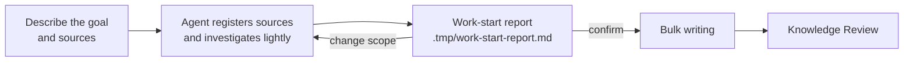

# Start Reports

<!-- context:section id="goal" -->
Before the Agent writes pages in bulk, it shows you a **work-start report**: what it found in the sources, which articles it plans, and how they will be organized. This is your cheapest moment to steer. Changing a plan costs a sentence; changing thirty written pages costs a revision round.

<!-- /context:section -->

<!-- context:section id="before" -->
## How you get there

Start by talking freely: what the knowledge should cover, where it comes from (repositories, modules, document links) and what form you expect — a package for Agents, a site, or both. The Agent researches representative material and asks only about gaps that would change the scope or the output. It does not run a fixed questionnaire, and fully managed mode does not authorize guessing your answers.

For a first build, the Agent registers and captures the confirmed sources, takes a code skeleton and document outlines, and only then writes the report. It does not deep-read every implementation first; broad scope calls for a horizontal survey.
<!-- /context:section -->

<!-- context:section id="contents" -->
## What the report contains

The report is written in your language, under `.tmp/`, and adapts to the task. Typical sections:

| Section | What to look for |
| --- | --- |
| Readers, goal and current delivery | Who uses the knowledge, the whole outcome, and what this first batch delivers |
| What the materials support | Checked topics versus provisional ones, and what is still uninvestigated |
| Articles and batches | Each reader topic, new or existing article, supporting sources, and its depth: an entry point, an explanation or a procedure |
| Reading organization | Proposed navigation; for a new site, a sketch of top-level groups, a representative menu and page outlines |
| Indexing guidance | Which Indexer Skills are used on which sources |
| Decisions and gaps | Confirmed choices versus recommendations, conflicts, exclusions and unchecked coverage |

Material counts, article counts and investigated scope are kept separate, and unknown totals are never shown as zero. A first batch is not presented as the whole goal.
<!-- /context:section -->

<!-- context:section id="answer" -->
## Answering it

Reply in plain language: confirm, or say what to change. Requested changes are made before the Agent records your confirmation.

You are asked when the scope is complex and touches more than five articles, or when a separate decision is open — most often a **top-level navigation change**, which always shows a before/after tree and needs its own explicit answer. When a task exceeds 30 distinct images without a policy, the report also asks how to handle them. Small bounded tasks — a few documents, one module, a revision — get a short proposal instead, and a specific earlier request can already cover it.

Silence, elapsed time, questions and objections are never approval. Approval of an unchanged plan carries across batches and retries; material changes or scope expansion bring the plan back to you.
<!-- /context:section -->

<!-- context:section id="large" -->
## Large projects

For work spanning more than 30 source documents or substantive investigation of two or more repositories, the `context-plan` Skill first produces a project PLAN that splits the work into stages. Each stage then gets its own work-start report within the approved plan. See [Large Projects](../../product/getting-started/large-projects.md).
<!-- /context:section -->
