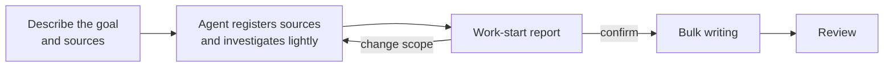

# Confirming the Work-Start Report

<!-- context:section id="goal" -->
Before the Agent writes pages in bulk, it shows you a **work-start report**: what it found in the sources, which articles it plans, and how they will be organized. This is your cheapest moment to steer. Changing a plan costs a sentence; changing thirty written pages costs a revision round.


<!-- /context:section -->

<!-- context:section id="before" -->
## How you get there

Start by talking freely: what the knowledge should cover, where it comes from (repositories, modules, document links) and what form you expect — a package for Agents, a site, or both. The Agent researches representative material and asks only about gaps that would change the scope or the output. It does not run a fixed questionnaire, and [Fully Managed Mode](managed-mode-and-review-policy.md) does not authorize guessing your answers.

```text
/c4a:context Build knowledge for ../billing-service and ../docs/billing for
on-call engineers. Investigate first, then give me the work-start report.
```

For a first build, the Agent registers and captures the confirmed sources, takes a code skeleton and document outlines, and only then writes the report. It surveys broadly rather than deep-reading every implementation first.
<!-- /context:section -->

<!-- context:section id="contents" -->
## What the report contains

The report is written in your language and adapts to the task. Typical sections:

| Section | What to look for |
| --- | --- |
| Readers, goal and this batch | Who uses the knowledge, the whole outcome, and what this first batch delivers |
| What the materials support | Checked topics versus provisional ones, and what is still uninvestigated |
| Articles and batches | Each reader topic, new or existing article, supporting sources, and its depth: an entry point, an explanation or a procedure |
| Reading organization | Proposed navigation; for a new site, a sketch of top-level groups, a representative menu and page outlines |
| Indexing guidance | Which Indexer Skills are used on which sources |
| Decisions and gaps | Confirmed choices versus recommendations, conflicts, exclusions and unchecked coverage |

Material counts, article counts and investigated scope are kept separate, and unknown totals are never shown as zero. A first batch is not presented as the whole goal.
<!-- /context:section -->

<!-- context:section id="answer" -->
## Full report or short proposal

How much you are shown depends on the size of the task:

| Task | What you get |
| --- | --- |
| A first build, or a scope that is complex and touches more than five articles | The full work-start report; nothing is written until you confirm it |
| A separate open decision, most often a **top-level navigation change** | Its own question with a before/after tree, needing its own explicit answer |
| More than 30 distinct images with no policy yet | A question in the report about how to handle them |
| A small, bounded task — a few documents, one module, a revision | A short proposal to confirm; if your request already said exactly what to do, the Agent proceeds on it |

Reply in plain language: confirm, or say what to change — for example "merge the two API pages" or "add a troubleshooting page". Requested changes are made before the Agent records your confirmation.

Silence, elapsed time, questions and objections are never approval. Approval of an unchanged plan carries across batches and retries; material changes or a wider scope bring the plan back to you.
<!-- /context:section -->

<!-- context:section id="large" -->
## Large projects

For work spanning more than 30 source documents or real investigation of two or more repositories, the Agent first proposes a project plan that splits the work into stages. Each stage then gets its own work-start report within the approved plan. See [Planning Large Projects in Stages](planning-large-projects.md).
<!-- /context:section -->
