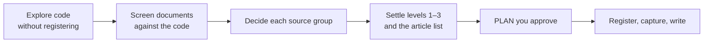

# Cold-Starting a Knowledge Base

<!-- context:section id="goal" -->
A first knowledge base rarely starts from a clean source list. There are hundreds or thousands of wiki pages, some current, some years old, some only weekly reports, and nobody is sure which ones still hold. Registering all of them and asking for articles produces a large, uneven site that copies the noise along with the knowledge.

The approach that works is: **screen the sources first, settle the structure next, write last.** Everything on this page is something you ask the Agent to do in the first conversation; the Agent then researches, reports and stops for your decision before any article is written.


<!-- /context:section -->

<!-- context:section id="explore" -->
## Explore before registering

1. Let the Agent load the Context Skill first, so it knows what the work is and how the workflow runs.
2. Give it the code repositories to explore. A plain read-only clone is enough; nothing needs to be registered or captured yet.
3. Then give it a batch of documents or a wiki range, and ask it to find which documents relate to the code, and to screen them by relevance and how recently they were updated.
4. Once the scope is clear, discuss what the result should look like: the first, second and third levels of the site, and which articles go where.

You end up with a **source** description and a **target** description — what goes in and what should come out. That pair is the prompt for the rest of the work, and you adjust it as you see results.

For scopes above 30 documents or across two or more repositories the Agent works in [planning mode](../planning-and-production/planning-large-projects.md): research happens in temporary storage, a `PLAN-*.md` report waits for your approval, and above 100 or 500 documents it confirms the scope with you before going further. Large wiki trees are covered in [Lark Documents](../registering-sources/lark-documents.md).
<!-- /context:section -->

<!-- context:section id="screen" -->
## Screen and decide each source group

Ask the Agent to judge each group of sources on the same dimensions:

| Dimension | What to look at |
| --- | --- |
| Relevance | Does it answer the readers' questions, and does the code have a matching module, interface or configuration? |
| Reader fit | Is it written for the same readers and the same scope as this knowledge base? |
| Authority | Is it a baseline or formal document, or a second-hand summary, personal note or process record? |
| Recency | When was it last updated? A signal only, never a verdict on its own. |
| Verifiability | Can its key claims be checked against code or another formal source? |
| Conflict | Does it contradict the baseline document or the code, and if so which one wins and why? |

Each group then gets one decision: **adopt**, **supporting**, **evidence only**, **exclude** or **to confirm**. Exclusions are listed with their reason; nothing is dropped silently.

Dates, titles, archive locations and polished writing do not prove that a document is authoritative or obsolete. The Agent compares substance, audience and applicability, and an old decision or procedure may still answer a reader's question. When you offer filters such as "updated within the last one or two years", state the cutoff date and keep exceptions explicit, for example "except top-level designs".
<!-- /context:section -->

<!-- context:section id="baseline" -->
## Name a baseline and record conflicts

If one document is the current, authoritative description of the domain, say so. Within its scope it takes precedence. When another document, or the code, disagrees with it, ask for the decision and its reason to be recorded instead of letting the newest date win.

When an article keeps a historical practice next to the current one, it states where each applies — version, period or region — and which replaced which. It does not merge the two silently.
<!-- /context:section -->

<!-- context:section id="structure" -->
## Settle the structure before writing

Before any article is written, agree on the reader-facing structure: the first-, second- and third-level directories and the list of articles in each. Ask for it in the PLAN, or in the [work-start report](../planning-and-production/start-reports.md) for a smaller task. An existing site whose structure already works can serve as the model.

Keep source and result separate. Originals, diagrams and version information stay as evidence; articles are organized around reader tasks. Articles should not overlap: each covers its own question and links to the others, rather than one article per source document.
<!-- /context:section -->

<!-- context:section id="raw" -->
## Where raw material goes

During research it is natural to collect originals in a `raw/` folder with a YAML list of document links. That is a useful evidence inventory, but do not let it become a second source system:

- material whose conclusions must stay traceable is registered as a Context source and captured with a snapshot;
- content readers only need to jump to is declared in `imports.yaml` as an [external entrance](../registering-sources/external-entrances.md);
- a `raw/` folder keeps only hand-collected evidence that cannot be captured reliably, labelled with its origin, retrieval time, version, status and what it replaces.

Code depth follows the same idea: index terms, locations and contracts, and read implementation on demand. See [Knowledge for Agents](../../architecture/knowledge/knowledge-for-agents.md).
<!-- /context:section -->

<!-- context:section id="case-business" -->
## Example 1: adding business knowledge to an engineering knowledge base

A frontend team's knowledge base already had more than two hundred engineering articles. The team wanted a layer of business rules that cannot be read from code, taken from a document space with thousands of nodes. The opening message:

```text
Look at every document under the <area A>, <area B>, <onboarding> and <technical designs> subtrees of the
<space> document space and cross-check them against the 5 registered repositories. Keep only business
definitions, rules, processes and boundaries that cannot be read from the code.

Recency:
- skip documents not updated in 500 days, except top-level designs such as one-pagers, overviews and architecture guides;
- skip SOPs and conventions not updated in 365 days;
- always skip daily and weekly reports, surveys, tests, on-call notes, archives and templates.

Do not add repositories; use the code only to check the rules in the documents.
Write me a research plan first: the screening steps, the decision and destination for each document, the
relation to existing knowledge and how the directory should change. Do not start production before I approve it.
```

The PLAN that came back recorded the screening funnel — thousands of nodes in the space, several hundred in the named subtrees, under two hundred after excluding by title, type, update time and content type, and nearly all of those retrieved and read. Each document was then judged *full text* (business definitions, rules or states not visible in code), *key rules only* (designs or SOPs, keeping only conclusions backed by code or constraints missing from it), *index only* (navigation pages or content covered elsewhere, linked as further reading) or *excluded* with a reason. The PLAN also spot-checked two conclusions against code — one "currently effective" rule was computed differently in code — graded sources from originals down to earlier LLM inferences, set the rule that code wins on a conflict with the old wording noted, proposed a navigation-only restructuring, split the work into seven stages of at most 30 sources, and listed the decisions it needed. The reply:

```text
The directory proposal is fine, but keep the top-level name and split "events" and "incentives" at the
second level. For the threshold conflict, write both versions and mark it "to confirm with the business";
I will ask them. Leave the personal notes out for now. Run the rest as planned, and wait for my review after each stage.
```
<!-- /context:section -->

<!-- context:section id="case-domain" -->
## Example 2: a new domain knowledge base

An infrastructure direction — traffic access, in this example — needed a knowledge base for the engineers of XXXX business first, later backing a knowledge Bot and operations Skills. The sources were several wiki ranges of mixed age, operations docs in the project, a team-maintained LLM Wiki, installed operations Skills, and infrastructure background scattered across all of them. The opening message:

```text
I want a knowledge base for traffic access. The first readers are XXXX business engineers; later it will
back a knowledge Bot, operations Skills and operations capabilities such as queries and attribution.

Sources:
- every article under wiki range A, including diagrams and embedded tables;
- range B is the focus; document C is the core and the latest baseline;
- weigh other documents by update date; where they conflict with C, C and the code win, with the reason recorded;
- the operations docs under docs/ in the project;
- the team's LLM Wiki is also a baseline; use it but keep references, it will be linked later;
- the first few XXXX business services and their repositories: <list>.

Requirements:
- do not repeat what installed operations Skills cover; write the glossary, key facts and preconditions and link the Skill;
- fill in infrastructure facts that are not tools (data centres, deployment architecture, network and compliance boundaries);
- keep articles orthogonal and link them to each other.

Research thoroughly: retrieve the originals and summarize the evidence, then propose topics, a three-level
structure and each article's content as a PLAN. I will review it before anything is written. Use <existing site> as a structural reference.
```

Expect the PLAN to contain the retrieved scope and counts; each source's role and its relation to the baseline, the code and the LLM Wiki, with the reason for every conflict decision; a three-level structure and article list — for example domain overview and terms, access paths, infrastructure and deployment constraints, a catalog of the first services and access and troubleshooting guides; the boundary with the operations Skills; stages and open decisions. The reply:

```text
The structure is mostly fine. Do the service catalog for the first 3 services only and move the rest to a
later stage. The deployment architecture article must state the constraints it puts on XXXX business access,
not just the concepts. Organize troubleshooting by the problems users hit, not by source; give each guide its
preconditions, decision path and stop conditions, and leave the queries to the Skills. Where the LLM Wiki
conflicts with the baseline in two places, the baseline wins; note it in the articles.
```

After approval the stages run through the normal workflow, each with its own review. The habits that keep the result on track are in [Best Practices](best-practices.md).
<!-- /context:section -->
