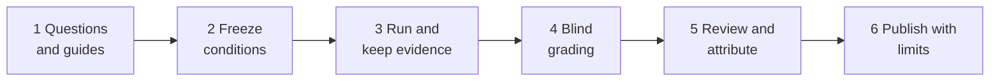

# Evaluating Your Knowledge Base

<!-- context:section id="goal" -->
Answer quality and speed depend on the knowledge — its accuracy, completeness and links to evidence — but also on the model, the runtime, retrieval planning and how tools are executed. A good evaluation compares your knowledge base against an alternative, or against its own earlier version, on real questions, and then uses the run traces to find out *why* answers were slow or wrong.

This page is the design guide: follow it, or hand it to an Agent, to plan an evaluation for your own business. The exact grading, statistics and timing rules are in [Evaluation Scoring and Timing Standard](./evaluation-standard.md); a complete worked run is [Knowledge Retrieval Benchmark](../../architecture/benchmark/knowledge-retrieval.md).


<!-- /context:section -->

<!-- context:section id="scope" -->
## Decide what you are measuring

- **Grade the final answer the user received.** Ask two things: is the core conclusion correct, and did it deliver what the question asked? Traces explain retrieval, tools and time; the Agent does not have to show its reasoning or retell how it checked.
- **Report quality, end-to-end time and visible tool calls separately.** Do not merge them into one score with arbitrary weights.
- **You are comparing whole setups.** Even with the same model, knowledge organization, system prompt, tools, permissions and runtime can differ, so not every difference belongs to the knowledge base.
- **Say what is out of scope.** Answering with deployed knowledge is one thing; producing and updating the knowledge — its quality, time, review effort and cost — is another, and needs its own evaluation.
<!-- /context:section -->

<!-- context:section id="questions" -->
## Build and freeze the question set

1. **Sample real user questions.** Keep their wording, necessary context and terms. Follow-ups that belong together can be merged into one frozen input, but never add answer hints, source paths, extra locating words or grading requirements.
2. **Give every question a stable ID and keep its origin.** The input sent to an Agent contains only the user's question — no ID, earlier answer, rubric or reference evidence.
3. **Turn images into faithful text** when they cannot be sent identically to every setup; mark unreadable parts as unknown. Leave out questions that cannot be answered without the missing image, and add them in a later version.
4. **Separate rule explanations, code lookups and live troubleshooting.** Do not quietly add online permissions, deployment versions or real requests the user never gave.
5. **Freeze the list and record its hash.** Questions already used to tune prompts or fill knowledge gaps are a *regression set*; keep unseen *held-out* questions to check that improvements generalize.
6. **Cover the questions people actually ask** — for example locating interfaces and pages, interaction rules, parameters, permissions and roles, versions and call relationships, debugging and environments.
<!-- /context:section -->

<!-- context:section id="guides" -->
## Write a guide for every question

Each question gets its own file with:

- the exact test input;
- the date it was checked, the source version (a pinned commit) and what is still unchecked;
- the confirmed reference facts and the conditions under which the conclusion holds;
- what the answer must deliver;
- acceptable equivalent wordings, other valid approaches, and what is **not** required;
- concrete criteria for each of the four grades, and counterexamples that would overturn a wrong claim;
- where the evidence is, which fact it supports, and known gaps.

The reference answer is for checking facts. It does not prescribe length, headings, number of citations, tool order or a full chain of proof, and it is not a template to reproduce. A conclusion that stayed inside the Agent's process and never reached the user does not count. When a deciding fact cannot be verified, mark it pending rather than borrowing an earlier assistant's answer or a knowledge page as proof. If a guide later turns out to be incomplete, record the correction with evidence instead of failing every answer that disagrees with the old guide.
<!-- /context:section -->

<!-- context:section id="freeze" -->
## Freeze the comparison conditions

Fix, and write down, everything that could change the result:

- question text, model and reasoning settings, knowledge and source-code scope, system prompt, tool permissions, region and dates;
- whether a setup answers from **knowledge only** or **knowledge plus source checks** — never let only one side read sources without saying so;
- cache and long-term memory state, concurrency, run order and number of repeats.

Start a new task for every question and send every setup exactly the same text. Grading guides never enter the answering context. The default recommendation is **three runs per question, concurrency one, alternating setup order**, with the order or random seed recorded; state it plainly when you choose otherwise. Each change to the questions, guides or configuration gets a new version and a new results directory; old material is kept, and re-runs never overwrite earlier results.
<!-- /context:section -->

<!-- context:section id="run" -->
## Run and keep the evidence

For every attempt, keep the start and end timestamps with time zone, task or session IDs and links, the complete final answer, the raw tool events, the status, timing precision and any anomaly. The first progress message is not the answer; even when a platform marks a task done, check that the answer was actually delivered.

Keep the original receipts of platform failures, timeouts, cancellations, quota refusals and retries. An extra run is linked to the attempt it repeats; never replace a result with the best of several. If a question needs the user to supply more information, define one multi-turn protocol for every setup and label any ad hoc follow-up or resume.

If the Agent under test is configured for a chat channel — for example it assembles reply cards — a direct-call evaluation may still run channel checks and card preparation. To measure answering alone, switch to a reply policy suited to direct calls, or record that overhead separately.
<!-- /context:section -->

<!-- context:section id="grade" -->
## Grade blind, then review

- Give each answer a random alias per question and record the seed. First-pass graders see neither the setup nor the time, tool count or earlier scores. Links or wording inside an answer can still reveal its origin, so call this *limited* anonymity.
- Check material errors first, then whether the question was fully answered, and assign one of four grades — or *pending verification* when a deciding fact cannot yet be checked. The rules are in the [standard](./evaluation-standard.md).
- Review every material error, pending item, partial resolution and borderline call, and spot-check full resolutions. Graders must give reasons someone else can check; length, style, tool order and whether the process is shown are not reasons on their own.
- Check grader consistency with separate calibration samples: the same facts in a short and a long version, as a paragraph and as a table, and the same pair shown in swapped order should get the same grade. Without human-labelled samples, call it *internal consistency review*, not human calibration.
<!-- /context:section -->

<!-- context:section id="causes" -->
## Find the causes

Numbers say *that* something is slow or wrong; traces say *why*. Only after grading, reveal which setup produced which answer, then read the raw tool trace and classify each gap:

- **Wrong or missing knowledge** — the knowledge base does not cover the fact, or states it wrongly.
- **A key condition left out** — for example a component's branch condition, leading to an over-generalized answer. Turn such gaps into revision tasks.
- **Search scope misjudged** — for example concluding "nothing calls this" from a partial checkout.
- **Inference or generalization error**, or **delivery gap** — the Agent knew it but did not tell the user.
- **Evidence unreachable**, **repeated searching**, **channel overhead** or **waiting for startup**.

A log supports only the behaviour it actually shows, and correlation is not cause. More tool calls do not mean more care, and faster does not mean more accurate.
<!-- /context:section -->

<!-- context:section id="disclose" -->
## Publish results with their limits

Show the four grade counts with their denominator, mean, P50 and P90 time, visible tool calls, and the sample and protocol. Compare on all questions *and* on the subset every setup fully resolved. Link each question to its answer, guide, grading, timings and evidence, and seal the raw package with a manifest and hashes.

State everything a reader needs to interpret the numbers: how many times each question ran (a single run says nothing about stability), differences between environments, system prompts, models, versions, dates, concurrency and timeouts, whether the questions had been seen before, how many graders there were and whether they were calibrated, what the timings include, and how any cost figure was estimated. Label every improvement figure as measured, conditional estimate (with its formula and assumptions) or untested direction.
<!-- /context:section -->

<!-- context:section id="deliverables" -->
## What the evaluation should produce

For the target business: a question document with origins, a separate scoring standard, one guide per question, a collection plan (configurations, repeats, order, timeout, recorded fields), a raw-records directory and a summary report. Freeze the questions and criteria before running any Agent. A new business checks its own sources, question scope, required conditions and counterexamples; it does not reuse another business's factual judgements.
<!-- /context:section -->

<!-- context:section id="agent-prompt" -->
## Have an Agent design it

An Agent can draft the whole plan if it reads this page and the standard first. Copy the prompt below, fill in the brackets, and review the result before any run:

```text
Read the "Evaluation" group of the Context documentation at
https://context4ai.org/context/llms.txt — "Evaluating Your Knowledge Base",
"Evaluation Scoring and Timing Standard" and "Knowledge Retrieval Benchmark".
Then design an evaluation of [knowledge base or assistant] against [baseline or
earlier version] for [business area].

Produce, without running anything yet:
1. A question document: 20–30 real user questions sampled from [where], each
   with a stable ID, its origin, the frozen input text and its question type.
2. A scoring standard adapted from the documented one: two primary metrics,
   material errors, four grades and pending verification.
3. One guide per question: checked facts with the pinned source version,
   required deliverables, acceptable alternatives, what is not required, grade
   criteria, counterexamples and evidence locations. Mark anything unverified.
4. A collection plan: configurations to freeze, repeats, order or seed,
   concurrency, timeout, timing events and every field to record.
5. A blind-grading and review plan, and the report outline with its limits.

Do not reuse facts from the documentation's examples, do not add hints to the
questions, and list every decision you need from me.
```
<!-- /context:section -->
