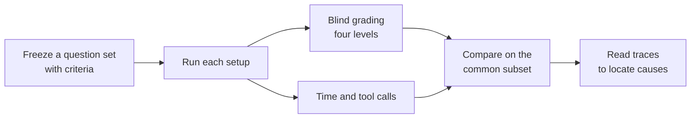

# Evaluating Your Knowledge Base

<!-- context:section id="goal" -->
Answer quality and speed depend on the knowledge — its accuracy, completeness and links to evidence — but also on the model, the runtime, retrieval planning and how tools are executed. A good evaluation compares your knowledge base against an alternative, or against its own earlier version, on real questions, and then uses the run traces to find out *why* answers were slow or wrong.

<!-- /context:section -->

<!-- context:section id="questions" -->
## Build the question set

- Use **real developer questions**, covering the kinds of question people actually ask — locating an interface or page, interaction rules, parameters, permissions, version differences, debugging and environments.
- **Freeze the set before running** anything, so it cannot drift toward what a setup happens to answer well.
- **Write the grading criteria for each question in advance.**
<!-- /context:section -->

<!-- context:section id="measure" -->
## Grade and measure

- Grade each answer against its criteria on **four levels**: fully resolved, partially resolved, materially wrong, not answered.
- Keep grading **blind** — the reviewer, a model or a person, should not know which setup produced the answer. A model reviewer that has not been calibrated against people is a limitation to state.
- Measure **end-to-end time** as the caller sees it, until the complete answer arrives. Report the mean, P50 and P90 (nearest-rank).
- Count the **tool calls** visible to the Agent.
<!-- /context:section -->

<!-- context:section id="compare" -->
## Compare fairly

- To remove differences in question difficulty, also compare on the **common subset** — the questions every setup fully resolved.
- Change one thing at a time where you can. When a comparison changes both the knowledge setup and the model, add a **same-model control** to isolate each effect.
<!-- /context:section -->

<!-- context:section id="causes" -->
## Find the causes

Numbers say *that* something is slow or wrong; traces say *why*. Read the run traces and classify what you see:

- **Missing knowledge** — the knowledge base does not cover the fact at all.
- **A key condition left out** — for example a component's branch condition, leading to an over-generalized answer. Turn such gaps into revision tasks.
- **Repeated searching** — the Agent keeps exploring instead of reading.
- **Waiting for startup** — environment preparation dominates the time.
- **Tool overhead** — many calls spent preparing repositories, running shells and reading files. Reading code remotely at a fixed version can replace much of this.
<!-- /context:section -->

<!-- context:section id="disclose" -->
## Publish the limits with the numbers

State the conditions any reader needs to interpret the results: how many times each question ran (a single run says nothing about stability), differences between environments, system prompts, models, versions, dates and timeouts, whether the questions had been seen before, how many reviewers graded, what the timings include, and how any cost figures were estimated.

A worked example with its own limits is [Knowledge Retrieval Benchmark](../../architecture/benchmark/knowledge-retrieval.md).
<!-- /context:section -->
