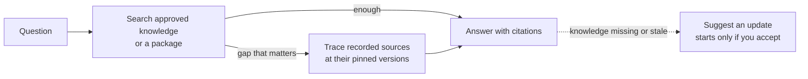

# Asking Questions

<!-- context:section id="goal" -->
`/c4a:context-inspect-search` answers questions from approved knowledge and traces answers back to their sources. It reads the knowledge first, because that is where conclusions are already worked out; only when the knowledge leaves a gap that could change the answer does it read the original documents or code. Every answer cites what was actually read.


<!-- /context:section -->

<!-- context:section id="ask" -->
## Ask

```text
/c4a:context-inspect-search Why does a refund stay pending after the
provider confirms it? Cite the code.
```

A knowledge workspace is optional: the Skill can answer from installed or supplied knowledge packages alone. Querying is read-only — it never changes source registrations, snapshots, tasks, approvals or your checkouts, and it never builds just to answer.
<!-- /context:section -->

<!-- context:section id="search" -->
## How it searches

- It searches approved `knowledge/` with business terms, symbols and synonyms, chooses articles from match excerpts rather than filenames, and reads the relevant sections with their conditions.
- Zero hits lead to relaxed or equivalent terms; noisy results lead to a narrower path. A miss alone does not establish that something is absent.
- When the knowledge leaves a gap that could change the conclusion, it traces the recorded sources directly, at the commit or snapshot the knowledge cites — never the default branch in its place. One failed source affects only the claims that depend on it.
- If the knowledge already answers the question, it does not restore code or check every associated source.
<!-- /context:section -->

<!-- context:section id="modes" -->
## Retrieval order and access

The host or Bot configuration can set two independent policies:

| Setting | Values | Effect |
| --- | --- | --- |
| `CONTEXT_QUERY_SOURCE_MODE` | `repo-first` (default), `package-first`, `dual` | Read the knowledge workspace's approved knowledge first, a package first, or both at once and reconcile differences |
| `CONTEXT_QUERY_ACCESS_MODE` | `auto` (default), `remote`, `local` | Whether knowledge and code are read through a remote read-only code service or local checkouts |

They change the order and access path, not what counts as evidence. With `remote`, see [Reading Code Evidence Remotely](reading-code-evidence-remotely.md).
<!-- /context:section -->

<!-- context:section id="answer" -->
## What an answer looks like

The answer comes first, with the conditions that change it right beside it. Complex questions also get the mechanism behind the result, with a short excerpt when it helps you verify. Implementation, declared contracts, tests, runtime observations and inferences are kept distinct.

Citations link to what was read: source files at the inspected commit, knowledge site articles and original documents. When no reliable link exists, you get checkable paths, symbols and short excerpts instead. Site links come from the package's `context-site-map.json`; a link is not a claim that the site has deployed that version.
<!-- /context:section -->

<!-- context:section id="gaps" -->
## When the knowledge is missing

The Skill scopes any gap to what it inspected — an unanswered question in one article is not absence across the knowledge base. With supporting evidence it may suggest an update: the affected page or gap, the proposed change and the source scope. Nothing starts until you accept; then it hands over to the production entry in the selected knowledge workspace. See [Capturing from Conversations](../updates-and-versions/capturing-from-conversations.md).
<!-- /context:section -->
