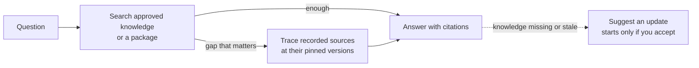

# Asking Questions

<!-- context:section id="goal" -->
`/c4a:context-inspect-search` (Cursor: `/c4a-context-inspect-search`) answers questions from approved knowledge and traces answers back to their sources. It reads the knowledge first, because that is where conclusions are already worked out; only when the knowledge leaves a gap that could change the answer does it read the original documents or code. Every answer cites what was actually read.


<!-- /context:section -->

<!-- context:section id="ask" -->
## Ask

```text
/c4a:context-inspect-search Why does a refund stay pending after the
provider confirms it? Cite the code.
```

Asking never changes anything: it does not touch your sources, approved pages, tasks or checkouts, and it never builds just to answer.
<!-- /context:section -->

<!-- context:section id="modes" -->
## Asking in a workspace or from a package

You can ask in two places:

- **In a knowledge workspace** — the folder where the knowledge is produced. The Agent reads the approved pages there and, when needed, the sources they were written from.
- **From an installed package** — no workspace is needed. The Agent reads the package you installed or were given, and can still follow its source citations back to the original documents and code. See [Using a Package in Your Agent](using-packages-in-agents.md).

Which one is read first, and whether code is read through a remote read-only service or local checkouts, can be set by the host or the Bot; see [Building a Knowledge Service](../knowledge-service-agent/building-a-knowledge-service.md#configuring-the-bot). These settings change the order and the access path, not what counts as evidence. To read code without local checkouts, see [Reading Code Evidence Remotely](reading-code-evidence-remotely.md).
<!-- /context:section -->

<!-- context:section id="good-questions" -->
## Asking good questions

- **Be specific.** Name the behavior, error or decision you care about rather than a whole area.
- **Name the module or task.** "In the refunds module…" or "I am adding a retry to…" narrows the search and the answer.
- **Ask for citations** when you will act on the answer — "cite the code" or "link the page".
- **Follow up on gaps.** If the answer says the knowledge does not cover something, ask the Agent to check the sources, or to suggest an update.

```text
/c4a:context-inspect-search In billing-service's invoicing module, what
happens when a tax lookup times out during invoice creation? Cite the code
and the relevant knowledge pages.
```
<!-- /context:section -->

<!-- context:section id="search" -->
## How it searches

- It searches the approved pages with business terms, symbols and synonyms, chooses articles from what matched rather than from file names, and reads the relevant sections with their conditions.
- No results lead to broader or equivalent terms; too many lead to a narrower search. A miss alone does not mean something is absent.
- When the knowledge leaves a gap that could change the conclusion, it reads the recorded sources directly, at the version the knowledge cites — not whatever is newest on the default branch. One unreadable source affects only the claims that depend on it.
- If the knowledge already answers the question, it does not fetch code or check every related source.
<!-- /context:section -->

<!-- context:section id="answer" -->
## What an answer looks like

The answer comes first, with the conditions that change it right beside it. Complex questions also get the mechanism behind the result, with a short excerpt when it helps you verify. Implementation, declared contracts, tests, runtime observations and inferences are kept distinct.

Citations link to what was read: source files at the inspected version, knowledge site articles and original documents. When no reliable link exists, you get checkable paths, symbols and short excerpts instead. A site link does not mean the site has already deployed that version.
<!-- /context:section -->

<!-- context:section id="gaps" -->
## When the knowledge is missing

A gap is scoped to what was inspected — an unanswered question in one article is not absence across the knowledge base. With supporting evidence, the Agent may suggest an update: the affected page or gap, the proposed change and the sources involved. Nothing starts until you accept. See [Capturing from Conversations](../updates-and-versions/capturing-from-conversations.md).
<!-- /context:section -->
