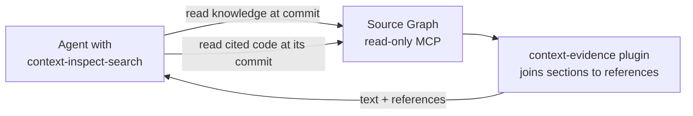

# Reading Code Evidence Remotely

<!-- context:section id="goal" -->

Answering from knowledge sometimes needs the code behind it. Cloning repositories into every Agent sandbox is slow; instead, the query Skill can read both the Context knowledge workspace and the source code through a read-only code service, Source Graph, at exactly the commit the knowledge cites. The optional **context-evidence** plugin, a WebAssembly module that runs inside that service, attaches each knowledge section's recorded source references to the text the Agent reads.

> **Source Graph is optional.** You do not need to install or configure it. Without a service, the query Skill still works well by reading code locally: it makes a shallow, sparse partial clone of the recorded commit and searches it with grep or rg. In the default `auto` mode it prefers Source Graph only when an authorized instance is available.

<!-- /context:section -->

<!-- context:section id="enable" -->
## Turn it on

1. Connect your Agent host to a read-only Source Graph MCP service that covers the knowledge workspace and its source repositories. Endpoints and credentials belong to the host configuration, never to the Skill or the knowledge.
2. Choose the access policy with `CONTEXT_QUERY_ACCESS_MODE`:

| Value | Behavior |
| --- | --- |
| `auto` (default) | Reuse suitable local material, otherwise prefer the remote service before any local checkout |
| `remote` | Read knowledge and code only through the service; never clone automatically, even on failure |
| `local` | Local retrieval only; no service required |

An explicit request to work locally or offline always wins.
<!-- /context:section -->

<!-- context:section id="read" -->
## What happens on a read

- The Agent reads knowledge pages from the configured knowledge workspace at one pinned commit, searching within `knowledge/**`.
- With the plugin enabled — it is on by default for `read` and `read_many` where the service supports that — each returned file carries a `references:` list: the recorded sources of the sections in that range, as commit-specific URLs where the remote supports it. The Agent reuses them instead of looking up the structure and source registries.
- For code, the Agent passes the exact repository and the recorded full commit as the revision, with repository-root-relative paths, and reads only the ranges that decide the answer.
- The knowledge workspace's commit and each source's recorded commit are kept separate; neither is replaced by a default branch.
<!-- /context:section -->

<!-- context:section id="limits" -->
## What it does not do

The plugin joins existing section markers, `knowledge/structure.yaml` and source registrations. It does not verify source contents, search code, restore sources or modify knowledge, and a reference is not proof that the source was reread in this query. It has no network, filesystem or process access; the host binds every read to the invocation's repository, immutable revision and readable scope.

When the service or plugin is unavailable, the Agent keeps the readable text and continues; in `auto` it may fall back to local retrieval, in `remote` it qualifies the affected claims instead of cloning.
<!-- /context:section -->

<!-- context:section id="next" -->
## Running the service

Deploying and connecting Source Graph itself — repositories, monorepo path groups, authentication and operations — is covered in the Source Graph guides. On the Context side, nothing else needs configuring: the evidence plugin ships compiled with the CLI.
<!-- /context:section -->
