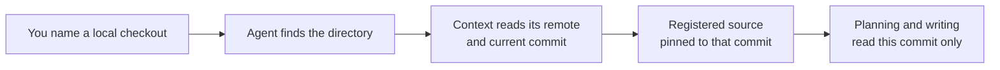

# Code Repositories

<!-- context:section id="goal" -->
A registered repository is a **source boundary**: the code the Agent may read and cite while writing knowledge. Registration pins the repository to one commit, so every citation points at code that will not shift underneath it. It does not decide what to write; that comes later, in the [work-start report](../planning-and-production/start-reports.md).


<!-- /context:section -->

<!-- context:section id="ask" -->
## Ask the Agent

Name the checkout and the part of it the readers need. Plain language is enough:

```text
Use ../payments-service as a code source. Readers need the refund flow;
skip the legacy admin module.
```

When your request already names exact local modules, the Agent does not ask you to repeat them or to supply remote URLs: it finds each one on disk and reads the repository's remote and current commit from the checkout. It asks only when a name is ambiguous, nothing matches, or picking a match would widen the scope you gave.
<!-- /context:section -->

<!-- context:section id="recorded" -->
## What gets recorded

Context records the repository, the module you chose and the commit it read. Every citation in the resulting pages points at that commit, so readers can open exactly the code a statement was based on. Code needs no separate capture step: the Agent reads the checkout at the pinned commit. Several repositories and documents added together share one registration date.

The options behind this are listed in the [CLI Commands](../../product/reference/context/cli-commands.md) reference.
<!-- /context:section -->

<!-- context:section id="monorepo" -->
## Monorepos: pick packages, not the whole tree

Context never widens a boundary on its own from the current directory, package names or Git remotes. When a monorepo has several packages, the Agent shows their paths and asks which ones should become sources, then registers each chosen package separately.

Choose the packages explicitly; filtering files later cannot select a package. Discuss obsolete or unrelated areas before indexing them — unnecessary code costs reading time and tokens — but do not drop a directory merely because its name looks old.
<!-- /context:section -->

<!-- context:section id="parsers" -->
## How the code is read

You do not configure parsing per repository; it is part of the selected Indexer. The Indexer looks at languages, manifests, entry points, routes and contracts, then uses the smallest set of parsers that answers the readers' questions. Community parsers cover TypeScript/JavaScript, Go, Rush monorepos, Thrift, Protobuf, Markdown/MDX, API contracts, stylesheets and SQL schemas. See [Code Extraction](../../architecture/knowledge/code-extraction.md) for how parser results become pages.
<!-- /context:section -->

<!-- context:section id="clones" -->
## Checkouts on another machine

Git keeps only what is needed to find the code again — the remote, the pinned commit and the module paths — not the checkout itself. When the knowledge workspace is opened elsewhere and a task needs that code, the Agent offers three choices:

1. point it at an existing local checkout;
2. name a bounded directory it may search for a matching checkout; or
3. let Context clone the registered repository into the workspace's temporary area.

A clone always uses the registered commit, so existing knowledge stays reproducible. In ordinary mode the Agent asks before cloning (in [Fully Managed Mode](../planning-and-production/managed-mode-and-review-policy.md) it restores repositories within your selected scope without asking); it never searches an unspecified disk root or substitutes another branch or a similar repository.
<!-- /context:section -->

<!-- context:section id="later" -->
## When the code moves on

Registration keeps its commit until you decide otherwise. To bring knowledge up to a newer commit, ask for an update: the Agent prepares the new version, compares it with what existing pages cite, and asks which pages need changes. The knowledge moves to the new commit only after the selected revisions are approved and the outputs rebuilt. See [Updating Knowledge](../updates-and-versions/updating-knowledge.md).
<!-- /context:section -->
