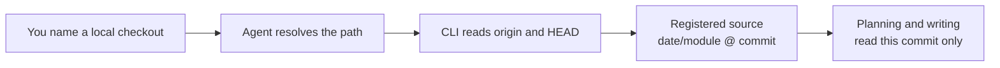

# Code Repositories

<!-- context:section id="goal" -->
A registered repository is a **source boundary**: the code the Agent may read and cite while writing knowledge. Registration pins the repository to one commit, so every citation points at code that will not shift underneath it. It does not decide what to write; that comes later, in the work-start report.


<!-- /context:section -->

<!-- context:section id="ask" -->
## Ask the Agent

Name the checkout and the part of it the readers need. Plain language is enough:

```text
Use ../payments-service as a code source. Readers need the refund flow;
skip the legacy admin module.
```

When your request already names exact local modules, the Agent does not ask you to repeat them or to supply remote URLs: it resolves each name to one local directory and lets the CLI read that checkout's Git root, `origin` and current commit. It asks only when a name is ambiguous, nothing matches, or picking a match would widen the scope you gave.
<!-- /context:section -->

<!-- context:section id="recorded" -->
## What gets recorded

The Agent registers the module with a command like this:

```bash
context source add repo 20261012 --module payments-service --local ../payments-service --configure
```

| Option | Meaning |
| --- | --- |
| `20261012` | The capture batch date. Several repositories and documents can share one date. |
| `--module` | Required. The concrete repository or package name. |
| `--local` | Local checkout path; may point at a monorepo subdirectory. |
| `--remote` / `--ref` | Remote URL and pinned commit. Inferred from the local `origin` and `HEAD` when omitted. |
| `--configure` | Also selects the source in a simple `src/index.ts`. It never captures anything. |

The source is addressed as `date/module`, for example `20261012/payments-service`. That name appears in source references; stable code knowledge paths use the module name without the date. Code sources need no capture phase: the Agent reads the checkout at the pinned commit.
<!-- /context:section -->

<!-- context:section id="monorepo" -->
## Monorepos: pick packages, not the whole tree

Context never widens a boundary from the current directory, package names or Git remotes. When a monorepo has several package boundaries, the Agent shows their paths and asks which ones should become sources. Point `--local` at each chosen package.

Filtering files inside a source cannot select a monorepo package, so choose the packages explicitly. Discuss obsolete or unrelated areas before indexing them — unnecessary code costs reading time and tokens — but do not drop a directory merely because its name looks old.
<!-- /context:section -->

<!-- context:section id="parsers" -->
## How the code is read

Parsing is a detail of the selected Indexer, not something you configure per repository. The Indexer inspects languages, manifests, entries, routes and contracts, then uses the smallest parser set that answers the reader's questions. Community parsers cover TypeScript/JavaScript, Go, Rush monorepos, Thrift, Protobuf, Markdown/MDX, API contracts, stylesheets and SQL schemas. See [Code Extraction](../../architecture/knowledge/code-extraction.md) for how parser facts become pages.
<!-- /context:section -->

<!-- context:section id="clones" -->
## Checkouts on another machine

Git stores only the recovery recipe for a repository source: remote, pinned commit and module paths. It does not store the checkout. When a Context knowledge workspace is opened elsewhere and a task needs that code, the Agent offers three choices:

1. point it at an existing local checkout;
2. name a bounded directory it may scan for a matching checkout; or
3. allow Context to clone the registered repository into `.tmp/repo/`.

A recovery clone always uses the registered commit, so existing knowledge stays reproducible. In ordinary mode the Agent asks before cloning; it never scans an unspecified disk root or substitutes another branch or nearby repository.
<!-- /context:section -->

<!-- context:section id="later" -->
## When the code moves on

Registration keeps its commit until you decide otherwise. To bring knowledge up to a newer commit, ask for an update: the Agent prepares the new version, compares it with what existing pages cite, and asks which pages need changes. The processed baseline advances only after the selected revisions are approved and built. See [Updating Knowledge](../updates-and-versions/updating-knowledge.md).
<!-- /context:section -->
