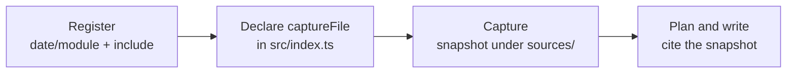

# Document Directories

<!-- context:section id="goal" -->
Use a file source when the material is local Markdown: one file, several files, or a documentation folder. Unlike a code repository, a document source is **captured**: Context takes a reproducible snapshot under `sources/file/`, and pages cite that snapshot rather than the live folder.


<!-- /context:section -->

<!-- context:section id="ask" -->
## Ask the Agent

Say which documents to ingest, not just which folder you happen to be in:

```text
Ingest ../docs/user-guide as product documentation. Only the getting-started
and billing chapters.
```

Run instructions, handbooks, plans or batch lists you hand the Agent are treated as task guidance, not as sources, unless you explicitly ask to ingest them. If the documents to capture are unclear, the Agent asks once instead of capturing the instructions themselves.
<!-- /context:section -->

<!-- context:section id="register" -->
## Register and declare capture

```bash
context source add file 20261012 --module user-guide --local ../docs/user-guide \
  --include "getting-started/**" --include "billing/**" --configure
```

| Option | Meaning |
| --- | --- |
| `--local` | Required. A local Markdown directory or file, used as the refresh location. |
| `--module` | Document module name; derived from `--local` when omitted. |
| `--include` | Markdown include glob relative to `--local`; repeat it for several patterns. |
| `--include-list` | A file of include globs, one per line; blank lines and `#` comments are ignored. |
| `--configure` | Also declares the source and a default capture phase in a simple `src/index.ts`. It does not capture. |

Registration reads no content. With `--configure`, the project gains a declaration like:

```ts
const docs = source("20261012/user-guide", { type: "file" });

export default defineProject({
  sources: [docs],
  phases: [captureFile({ source: docs })],
});
```

If `src/index.ts` already has custom entries, the configuration result is `manual` and the Agent makes a focused edit instead of retrying.
<!-- /context:section -->

<!-- context:section id="capture" -->
## Capture

Capture is an external read, so it needs your permission in the current conversation. Asking to capture, ingest or read the named documents grants it; merely mentioning them or asking to register does not. The Agent then runs the capture command returned by the workflow, reports the outcome and continues until every document in the batch is done.

Capture creates the snapshot; it does not classify, summarize or approve anything. The CLI owns normalization, hashes and manifests, and the Agent never edits a captured snapshot by hand.
<!-- /context:section -->

<!-- context:section id="sites" -->
## Documentation sites (MDX)

Default capture handles `.md`. If the folder turns out to be a documentation site — `.mdx` pages, `_meta.json`, sidebars or a docs config — the Agent stops and confirms before changing the configuration. For MDX sites that use `_meta.json`, the capture phase gains the MDX processor:

```ts
captureFile({ source: docs, processor: mdxJsonDocs() });
```

The processor keeps route metadata and static component text as evidence. If a page is only a shell that mounts runtime-rendered content, the Agent tells you and asks for the rendered site or its data source instead of inventing the body.
<!-- /context:section -->

<!-- context:section id="later" -->
## When the documents change

Pages keep citing the snapshot they were written from. When the folder changes, ask for an update: the Agent captures the new version and asks which pages need changes. See [Updating Knowledge](../updates-and-versions/updating-knowledge.md).
<!-- /context:section -->
