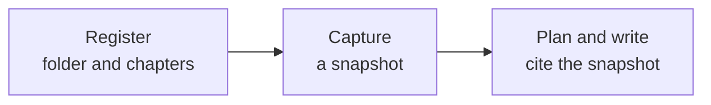

# Document Directories

<!-- context:section id="goal" -->
Use a document source when the material is local Markdown: one file, several files or a documentation folder. Unlike a code repository, a document source is **captured**: Context takes a reproducible snapshot, and pages cite that snapshot rather than the live folder.


<!-- /context:section -->

<!-- context:section id="ask" -->
## Ask the Agent

Say which documents to ingest, not just which folder you happen to be in:

```text
Ingest ../docs/user-guide as product documentation. Only the getting-started
and billing chapters.
```

Run instructions, handbooks, plans or lists of tasks you hand the Agent are treated as guidance for the task, not as sources, unless you explicitly ask to ingest them. If it is unclear which documents to capture, the Agent asks once instead of capturing your instructions.
<!-- /context:section -->

<!-- context:section id="register" -->
## What the Agent confirms

Registering reads no content yet. The Agent records the folder or files you named and, when you limit the scope, only the chapters or patterns you asked for — in the example above, `getting-started` and `billing`. It then sets the source up for capture and tells you what was registered.

If the knowledge workspace already has custom source settings, the Agent makes a focused change to include the new folder and tells you what it changed. For the full set of registration options, see the [CLI Commands](../../product/reference/context/cli-commands.md) reference.
<!-- /context:section -->

<!-- context:section id="capture" -->
## Capture

Capture reads the documents, so it needs your permission in the current conversation. Asking to capture, ingest or read the named documents grants it; merely mentioning them or asking only to register them does not, so in that case expect a question first. The Agent then captures the documents, reports the outcome and continues until every document in the request is done.

Capture creates the snapshot; it does not classify, summarize or approve anything. Context keeps the snapshot intact, and the Agent never edits it by hand.
<!-- /context:section -->

<!-- context:section id="sites" -->
## Documentation sites

Capture reads plain Markdown by default. If the folder turns out to be a documentation site — MDX pages, sidebars or a site configuration — the Agent tells you and asks before changing how it reads the folder. Route metadata and static component text are kept as evidence.

If a page is only a shell that loads its content at runtime, the Agent says so and asks for the rendered site or its data source instead of inventing the body.
<!-- /context:section -->

<!-- context:section id="later" -->
## When the documents change

Pages keep citing the snapshot they were written from. When the folder changes, ask for an update: the Agent captures the new version and asks which pages need changes. See [Updating Knowledge](../updates-and-versions/updating-knowledge.md).
<!-- /context:section -->
