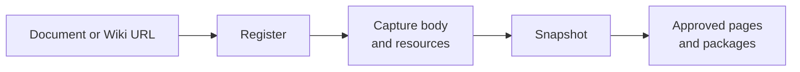

# Lark Documents

<!-- context:section id="goal" -->
A Lark source is a remote document that Context captures into a local snapshot, together with the evidence embedded in it: images, attachments, sheets, Base tables, whiteboards and synced blocks. Pages then cite the snapshot. The Agent never reconstructs resources or substitutes a summary for them; capture handles them as they are.


<!-- /context:section -->

<!-- context:section id="register" -->
## Add a document

Give the Agent the document or Wiki URL; the title is fetched together with the body, so you do not need to look it up:

```text
Ingest this Wiki page as our operations handbook:
https://example.larkoffice.com/wiki/example-token
```

Several documents named in one request are added together, and independent documents do not have to become independent articles. For a whole Wiki subtree, the Agent can first list the tree and its pages without reading their bodies, so you can choose which pages to add.

If research has already fetched a document, the Agent can reuse that copy instead of reading it again; the reuse keeps the original capture time, so it does not make the content any fresher. See the [CLI Commands](../../product/reference/context/cli-commands.md) reference for details.
<!-- /context:section -->

<!-- context:section id="large-wiki-trees" -->
## Very large Wiki trees

Do not expect a large Wiki tree to be produced in one go: above 30 source documents the Agent plans the work in stages, and for very large scopes it confirms or narrows the scope with you first, as described in [Planning Large Projects in Stages](../planning-and-production/planning-large-projects.md).
<!-- /context:section -->

<!-- context:section id="authorization" -->
## Permission to read

Capture reads the documents, so it needs your permission in the current conversation. Asking the Agent to capture, ingest or read the named documents grants it; merely mentioning a document or asking only to register it does not, so in that case expect a question before capture.
<!-- /context:section -->

<!-- context:section id="identity" -->
## Read identity

Each document, with all its resources, is read under **one** identity: yours by default, or a Bot's. The choice is the `CONTEXT_LARK_IDENTITY` setting (`user` or `bot`) in the environment where Context runs; a line in a Bot prompt does not change it.

- **As you**, Context reads only as you.
- **As a Bot**, Context may fall back once to reading as you when the Bot cannot read the body. The fallback restarts the whole document, so a page is never assembled from reads under two identities.

Once the body is read, every resource uses the same identity. A failed image or sheet never triggers a request for someone else's credentials, and network, rate-limit or format errors do not switch identity.
<!-- /context:section -->

<!-- context:section id="resources" -->
## What happens to embedded resources

| Resource | Captured as |
| --- | --- |
| Image | The original; if download is denied, one preview, marked as a preview |
| Attachment | The original file, linked from the document |
| Sheet | A Markdown table plus a CSV snapshot |
| Base | The selected table or view as a Markdown table plus a data snapshot |
| Whiteboard, diagram | A readable preview plus the raw structured export |
| Synced block | The source block's body |
| Bookmark, sub-document, chat, embed | A stable navigation reference |
| Video | A reference; downloaded only when you ask to bundle videos |

A required resource that cannot be obtained stops capture. Two cases are recorded and capture continues with a warning: a whiteboard or diagram that Lark confirms was deleted, and an explicit permission denial for one embedded resource. Both leave a visible "unavailable resource" notice; neither is reported as downloaded.

Captured resources are part of the evidence and are kept with the knowledge workspace in Git, so keep the workspace private when the documents or screenshots are access-controlled.
<!-- /context:section -->

<!-- context:section id="images" -->
## Image choices for larger tasks

Image handling is decided once for the whole task, not per document. You can tell the Agent to include images, to keep image references only, or to switch based on how many documents the task covers. By default the switch is at 10 documents: up to 10, images are included; above that, documents are captured with image references only.

The number of images matters separately. When a task would bring in more than 30 distinct images and you have not made a choice, the [work-start report](../planning-and-production/start-reports.md) asks you to pick one: intelligent conversion and inclusion (recommended), including all images, or placeholders only.

If the same choice should hold for every task in a knowledge workspace, ask the Agent to set it for the project, for example "keep image and GIF references only for the handbook".
<!-- /context:section -->
