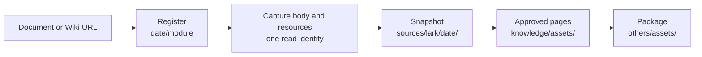

# Lark Documents

<!-- context:section id="goal" -->
A Lark source is a remote document that Context captures into a local snapshot, together with the evidence embedded in it: images, attachments, sheets, Base tables, whiteboards and synced blocks. Pages then cite the snapshot. The Agent never reconstructs resource bytes or substitutes a summary for them; capture handles resources mechanically.


<!-- /context:section -->

<!-- context:section id="register" -->
## Register a document

Pass the document or Wiki URL directly; capture fetches the title with the body, so no separate lookup is needed:

```bash
context source add lark 20261012 --module handbook \
  --url https://example.larkoffice.com/wiki/example-token --configure
```

`--doc-token` and `--wiki-token` accept an identity token instead of a URL, and `--title` records a title you already know. Register every requested document under the same date. For several documents with the same settings, the Agent declares capture once from the source registry instead of repeating a phase per document; independent documents do not mean independent articles.

For a whole Wiki subtree, the Agent can first run `context source discover lark <url>` to save the directory tree and page identities without reading bodies, so you can choose which pages to register.
<!-- /context:section -->

<!-- context:section id="identity" -->
## Read identity

Capture reads the body and every resource under **one** identity. `CONTEXT_LARK_IDENTITY=user|bot` selects it, and the default is `user`. Export it in every shell that runs Context commands; a setting in a Bot prompt is not an environment variable.

- **User** reads only as the current user.
- **Bot** may fall back once to the current user when reading the body fails on credentials, scope or access. The fallback restarts the whole body, so pages from two identities are never combined.

Once the body is read, all resources use that identity. A resource failure never asks for another identity's credentials, and network, rate-limit and format errors do not switch identity.
<!-- /context:section -->

<!-- context:section id="resources" -->
## What happens to embedded resources

| Resource | Captured as |
| --- | --- |
| Image | The original; if download is denied, one same-identity preview, marked as a preview |
| Attachment | The original file, linked from the Markdown |
| Sheet | A Markdown table plus a CSV snapshot |
| Base | The selected table or view as a Markdown table plus a JSON snapshot |
| Whiteboard, diagram | A readable preview plus the raw structured export |
| Synced block | The source block's body plus a Markdown evidence snapshot |
| Bookmark, sub-document, chat, embed | A stable navigation reference |
| Video | A reference; downloaded only with `resources.videos: "bundle"` |

A required resource that cannot be obtained stops capture. Two cases are recorded and continue with a warning: a whiteboard or diagram the API confirms was deleted, and an explicit permission denial for one embedded resource. Both leave a visible "unavailable resource" notice; neither is reported as downloaded.
<!-- /context:section -->

<!-- context:section id="images" -->
## Image choices for large tasks

Image handling for a task is decided once, not per document. The task instruction `DOCUMENT_IMAGE_CAPTURE` accepts `ON` (include images), `OFF` (references only) or a document-count threshold, default `10`: above it, bodies are captured with image references only. When a task would acquire more than 30 distinct images without a policy, the work-start report asks you to choose between intelligent conversion and inclusion (recommended), including all images, or placeholders only.

To fix the choice in the project instead:

```ts
captureLark({ source: handbook, resources: { images: "reference-only" } });
captureLark({ source: handbook, resources: { gifs: "reference-only" } });
```
<!-- /context:section -->

<!-- context:section id="storage" -->
## Where the files live

```text
sources/lark/<date>/
├── <module>.md               # captured body
├── manifest.json             # compact inventory with hashes
└── assets/<module>/
    ├── source.xml            # structured source
    ├── capture-report.json   # fidelity and resource handling
    └── materialized/**       # downloaded files and exports
knowledge/assets/<kind>/<sha256>.<ext>   # only resources approved pages use
```

Source assets are part of the evidence snapshot, so keep them in Git; repositories with many binaries can store `materialized/` in Git LFS. Keep the Context knowledge workspace private when the documents or screenshots are access-controlled.
<!-- /context:section -->

<!-- context:section id="prefetched" -->
## Reusing a fetch you already have

If research already fetched a document, `context source fetch lark <url> --output <dir>` saves a portable snapshot before any knowledge workspace exists. After registering the matching source, `context source import` with `snapshot_dir` imports it without reading the document again. Import checks integrity and keeps the original capture time; it does not make the snapshot any fresher.
<!-- /context:section -->
