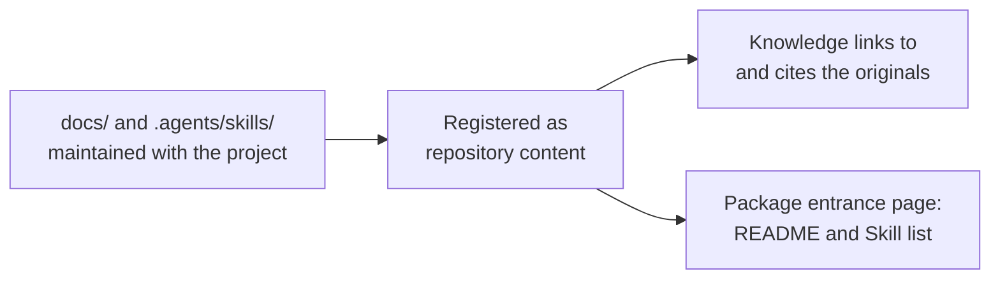

# Linking Existing Docs and Skills

<!-- context:section id="goal" -->
Many projects already keep documentation and Agent Skills next to their code, for example under `docs/` and `.agents/skills/`, and update them with every change. When the knowledge workspace lives in the same Git repository, there is no need to produce that material again as knowledge. Register it as **repository content** instead: the originals stay where they are and keep evolving with the project, and Context references them directly — knowledge links to them and can cite them as evidence — without copying their text.


<!-- /context:section -->

<!-- context:section id="boundaries" -->
## When to use something else

- **Another repository or an externally installed Skill** is not repository content. Declare it as an [External Entrance](external-entrances.md).
- **Rewriting selected documents for a particular audience** is ordinary production: register those documents as a [document source](document-directories.md) and let the Agent write and you review the pages. Repository content is never mirrored wholesale into knowledge.
<!-- /context:section -->

<!-- context:section id="register" -->
## Register

Ask in your Agent:

```text
/c4a:context-repo-content Register docs/ and .agents/skills as repository content.
```

In Cursor, use `/c4a-context-repo-content`. The `context-repo-content` Skill looks only at the project's tracked README, `docs/` and Skill directories. It proposes the useful directories rather than every Markdown file, skips installed third-party Skills, and records your choice in the knowledge workspace. A file added later inside a registered directory needs no new registration. Registering does not start production, update knowledge, build, publish or commit. The same Skill can also create or edit those project documents in place.
<!-- /context:section -->

<!-- context:section id="cite" -->
## How knowledge uses it

- **Links.** A page can link to an original. The build turns the link into a link to the file in the code repository when one is available, otherwise a plain location.
- **Evidence.** A page can cite an original like any other source. The citation records the commit, path and line range it read; text that was not yet committed is marked as such.
- **Production.** Document Indexers read registered content as bounded supporting evidence; they do not turn it into a parallel set of pages.
<!-- /context:section -->

<!-- context:section id="page" -->
## What the package and site contain

The package does not contain the registered documents or Skill scripts. It can carry an entrance page (one per group when groups are used) with:

- the group's README, its relative links rewritten to the repository's web address;
- a table of the registered Skills, with their names, descriptions and links to the originals.

A new knowledge workspace that already has registered repository content includes this page in the package. Ask the Agent if you also want it shown on the website, and review the README before exposing it.

Agents working in the same repository read the originals directly. People and Agents who install the package elsewhere see the entrance page and its links, and need access to the repository to read the full text.
<!-- /context:section -->

<!-- context:section id="updates" -->
## When the originals change

The originals keep evolving with the project, and editing them never starts a knowledge update by itself. When pages that link to or cite them may be affected, ask `/c4a:context` to check the impact of the changed repository content. The update compares the cited regions of documents and the whole directory of each Skill, and reopens only the affected sections.
<!-- /context:section -->

<!-- context:section id="registry" -->
## Where the registration lives

The Skill keeps the registration in `repo-content.yaml` at the knowledge workspace root, with paths relative to the Git root, and you can ask it to group entries or skip files inside one. Next to it, `repo-content/` is a view of the originals, not a second place to edit; edit the originals. Where these files sit among the other workspace files is shown in [The Context Knowledge Workspace](../../product/getting-started/knowledge-workspace.md); what the Skill does and does not do is listed in the [Skills](../../product/reference/context/skills.md) reference.
<!-- /context:section -->

<!-- context:section id="fix" -->
## When something is wrong

- If the registration is invalid, the Agent reports it when it checks the workspace, and the build stops before replacing existing outputs. Ask the Agent to correct the registration rather than repair the view again.
- Repairing the view is suggested only when it is missing or points to the wrong place.

Registering repository content does not authorize installing, running or publishing anything.
<!-- /context:section -->
