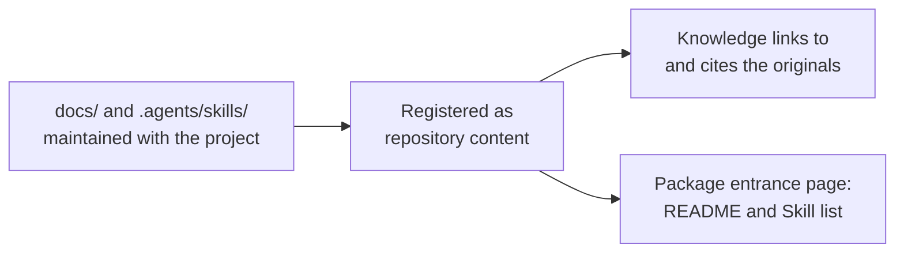

# Referencing Same-Repository Docs and Skills

<!-- context:section id="goal" -->
Many projects already keep documentation and Agent Skills next to their code, for example under `docs/` and `.agents/skills/`, and update them with every change. When the Context knowledge workspace lives in the same Git repository, there is no need to produce that material again as knowledge. Register it as **repository content** instead: the originals stay where they are and keep evolving with the project, and Context references them directly — knowledge links to them and can cite them as evidence — without copying their bodies.


<!-- /context:section -->

<!-- context:section id="boundaries" -->
## When to use something else

- **Another repository or an externally installed Skill** is not repository content. Declare it as an [External Entrance](external-entrances.md).
- **Rewriting selected documents for a particular audience** is ordinary production: register those documents as a document source and let the workflow produce and review the pages. Repository content never mirrors the whole registry into knowledge.
<!-- /context:section -->

<!-- context:section id="register" -->
## Register

Ask in your Agent:

```text
/c4a:context-repo-content Register docs/ and .agents/skills as repository content.
```

The `context-repo-content` Skill looks only at the project's tracked README, `docs/` and Skill directories. It proposes the useful directories rather than every Markdown file, skips installed third-party Skills, and records the choice in `repo-content.yaml` at the knowledge workspace root. A file added later inside a registered directory needs no new entry. Registration does not start production, update knowledge, build, publish or commit. The same Skill can also create or edit those project documents in place.
<!-- /context:section -->

<!-- context:section id="cite" -->
## How knowledge uses it

- **Links.** A page links to an original with `[Guide](context:repo/docs/guide.md)`. The build turns it into a link to the file in the code repository when one is available, otherwise a plain location.
- **Evidence.** A page can cite an original like any other source. The reference records `repo-content:docs@<commit>` with the real path, line range and digest; uncommitted text is recorded as `<commit>+worktree`.
- **Production.** Document Indexers read registered content as bounded supporting evidence; they do not turn it into a parallel set of pages.
<!-- /context:section -->

<!-- context:section id="page" -->
## What the package and site contain

The package does not contain the registered documents or Skill scripts. It can carry an entrance page, `wikis/repo-content.md` (one page per group when groups are used), with:

- the group's README, its relative links rewritten to the repository's web address;
- a table of the registered Skills, with their names, descriptions and links to the originals.

A new knowledge workspace that already has a registry enables this page; the package declaration in `src/index.ts` carries `repoContentPage: true`. The website shows it only when the declaration says `repoContentPage: { site: true }`. Review the README before exposing it.

Agents working in the same repository read the originals directly. People and Agents who install the package elsewhere see the entrance page and its links, and need access to the repository to read the full text.
<!-- /context:section -->

<!-- context:section id="updates" -->
## When the originals change

The originals keep evolving with the project, and editing them never starts a knowledge update by itself. When pages that link to or cite them may be affected, ask `/c4a:context` to check the impact of the changed repository content. The update compares the cited regions of documents and the whole directory of each Skill, and reopens only the affected sections.
<!-- /context:section -->

<!-- context:section id="registry" -->
## The registration file

The Skill writes `repo-content.yaml` for you; it looks like this:

```yaml
protocol: context.repo-content/v1
entries:
  docs:
    kind: docs
    path: docs
  tools:
    kind: skills
    path: .agents/skills
```

Paths are relative to the Git root, not the knowledge workspace. Kinds are `docs`, `document`, `skills` and `skill`. Optional `group` adds one module level, `mount` overrides the default mount name, and `exclude` globs skip files inside an entry (they are not access control). Overlapping entries, targets outside the repository, nested repositories and cycles are rejected. The `repo-content/` directory holds relative symlinks to the originals; it is a view, not a second place to edit.
<!-- /context:section -->

<!-- context:section id="fix" -->
## When something is wrong

- An invalid `repo-content.yaml` is reported by `status`, and the build stops before replacing existing outputs. Correct the file rather than repairing the symlinks again.
- Repairing the symlinks is suggested only when they are missing or point to the wrong place.

Registering repository content does not authorize installing, running or publishing anything.
<!-- /context:section -->
