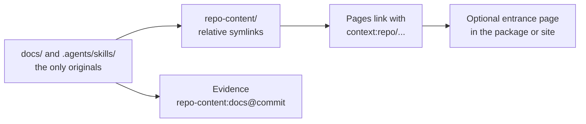

# Same-Repository Docs

<!-- context:section id="goal" -->
When the Context knowledge workspace sits inside a project repository, that repository usually already has documentation and Agent Skills. They should stay where they are and keep being edited there. `repo-content.yaml` registers them as **same-repository content**: Context links to the originals instead of copying their bodies into knowledge or source snapshots.



Use the `context-repo-content` Skill to choose and edit these entries; it does not start knowledge production.
<!-- /context:section -->

<!-- context:section id="register" -->
## Register

At the knowledge workspace root:

```yaml
protocol: context.repo-content/v1
entries:
  docs:
    kind: docs
    path: docs
  tools:
    kind: skills
    path: .agents/skills
```

Paths are relative to the Git root, not the knowledge workspace. Kinds are `docs`, `document`, `skills` and `skill`. Optional `group` adds one module level, `mount` overrides the default mount name, and `exclude` globs skip files inside an entry (they are not access control). Overlapping entries, targets outside the repository, nested repositories and cycles are rejected.

`context source ensure repo-content --format json` maintains the relative symlinks under `repo-content/`; `context status` reports problems without repairing them. Ordinary files are never overwritten, and no Git configuration or index changes.
<!-- /context:section -->

<!-- context:section id="cite" -->
## Link and cite

A page links to an original with `[Guide](context:repo/docs/guide.md)`; build turns it into an upstream link when one is available, otherwise a plain location. Evidence records `repo-content:docs@<full-commit>` with the real path, line range and digest; uncommitted text is recorded as `<commit>+worktree`.
<!-- /context:section -->

<!-- context:section id="page" -->
## Optional entrance page

```ts
kbPackage({ name: "project-kb", template: { path: "src/package-templates/kb" }, repoContentPage: true });
```

This projects each group's README and the Skill names and descriptions into `wikis/repo-content.md`; it does not copy all docs or Skill scripts. `{ site: true }` adds the entrance to a configured website. Review README sensitivity before exposing it.
<!-- /context:section -->

<!-- context:section id="fix" -->
## When something is wrong

- An invalid `repo-content.yaml` is reported by `status`, and `context build` stops before replacing existing outputs. Correct the file rather than rerunning `ensure`.
- `ensure` is suggested only for missing or misdirected symlinks.
- Other repositories and externally installed Skills are not same-repository content; declare them as [External Entrances](external-entrances.md).

Registering an entrance does not authorize installing, running or publishing anything.
<!-- /context:section -->
