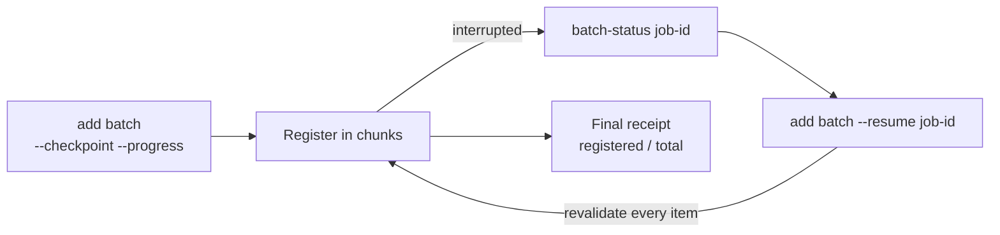

# Source Batches

<!-- context:section id="goal" -->
When a task involves many sources — a dozen services, a folder of handbooks, a Wiki section — register them as one batch rather than one command at a time. A batch is one serial registry write under one date, so sources do not race each other, and with checkpoints a long registration survives interruption.

Registering many sources is not the same as producing a large knowledge base. For work spanning more than 30 documents or substantive investigation of two or more repositories, the Agent first plans the project in stages; see [Large Projects](../../product/getting-started/large-projects.md).
<!-- /context:section -->

<!-- context:section id="payload" -->
## The payload

```yaml
sources:
  - type: repo
    module: billing-service
    local: ../billing-service
  - type: file
    local: ../docs/user-guide.md
  - type: lark
    url: https://example.larkoffice.com/wiki/example-token
```

```bash
context source add batch 20261012 --input .tmp/sources.yaml --configure --format json
```

- `repo.module` is required; `file` and `lark` modules are derived from the path or URL when omitted, and duplicates in the batch are rejected.
- `repo.local` is resolved from the Context project root. A valid checkout supplies its remote and commit, so `remote`/`ref` are needed only when they cannot be read.
- `--configure` also declares the sources and default capture phases in a simple `src/index.ts`. Without it, the batch only registers.
<!-- /context:section -->

<!-- context:section id="checkpoint" -->
## Long batches: checkpoints and resume



```bash
context source add batch 20261012 --input .tmp/sources.yaml --checkpoint --progress --format json
context source batch-status <job-id> --format json
context source add batch --resume <job-id> --progress --format json
```

The saved input stays under `.tmp/context-runtime/source-batches/`, so resuming does not need the original file. Resume replays and revalidates every item against the current registry; the saved cursor is only a hint. Do not combine `--resume` with a date or a new input. Progress goes to stderr as bounded JSON; stdout keeps the final receipt.
<!-- /context:section -->

<!-- context:section id="failure" -->
## Partial failure and locks

A batch keeps what succeeded: entries before a failed item stay registered, and the error names the completed entries and the failed position. Lark entries are validated in memory and committed in bounded atomic chunks.

Only one writer runs in a Context knowledge workspace at a time. Wait for an active command rather than starting another or deleting its lock. If a forced stop leaves a stale lock, run `context task recover --format json` before resuming.
<!-- /context:section -->
