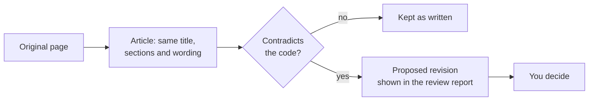

# Keeping Pages as Written

<!-- context:section id="goal" -->
Sometimes pages must keep their wording: an on-call procedure a team relies on, a policy, a runbook whose authors stay responsible for it. You still want them in your knowledge base — placed in your sections, in your packages, and checked against the code they describe. A requirement marked **keep as written** does exactly that: each page comes in with its title, sections, order and wording, and only passages that contradict the code are proposed for correction, for you to decide.


<!-- /context:section -->

<!-- context:section id="ask" -->
## Ask for it

Register the collection as a [document source](../registering-sources/document-directories.md) — keeping its folders, and with its repository and version as origin when it keeps changing; see [Following Versioned Content and Archived Collections](../registering-sources/versioned-external-content.md). Then ask:

```text
Bring the on-call pages from the ops wiki in as written. Keep titles, sections
and wording; check them against the order and billing services.
```

The Agent records this on the requirement (`preserve_original: true`) and lists the repositories the pages describe as its supporting sources, so the writer can cite and check that code. Without them, the article can cite only the original page and contradictions cannot be found.
<!-- /context:section -->

<!-- context:section id="writing" -->
## What the writer does

Each original page becomes one article with the same title, section headings and order of content, and the same wording. Every section cites the lines of the original it reproduces, and the code a passage describes. Wording, style or structure the code does not contradict is left alone.

Where a passage contradicts the code, or describes behavior the code no longer has, the writer puts the corrected text in the article and proposes the revision. Context reads the original passage itself, so the proposal shows exactly what was there. Each proposal says whether the original was **wrong** from the start or **went stale** because the code changed since, and names the code it rests on.
<!-- /context:section -->

<!-- context:section id="decide" -->
## Deciding in the review report

The [review report](reading-review-reports.md) shows the proposals above the article: the original passage, the revised text, the reason and the evidence. For each one you choose:

| Choice | The article | The original |
| --- | --- | --- |
| Accept and fix the original too | Keeps the revision | The correction is proposed to the page's owners; see [Writing Back Upstream](../updates-and-versions/writing-back-upstream.md) |
| Revise here only | Keeps the revision | Unchanged |
| Keep the original | Gets the original passage back, still citing the code | Unchanged |

The Agent applies your choice to the article, records it in the batch's changelog entry, and removes the proposal. Proposals exist only while the batch is under review; afterwards the article, its changelog and its Git history carry the decision.

In a [fully managed](../planning-and-production/managed-mode-and-review-policy.md) run or a [routine update](../updates-and-versions/scheduled-updates.md), the Agent revises the knowledge base only and lists each revision in its report, so you can change any of them later.
<!-- /context:section -->

<!-- context:section id="later" -->
## When the code changes later

Because each kept passage still cites its code, a later code change reaches the article through the ordinary [update flow](../updates-and-versions/updating-knowledge.md). A contradiction you chose to keep is not raised again unless the code it cites has changed since your decision.
<!-- /context:section -->
