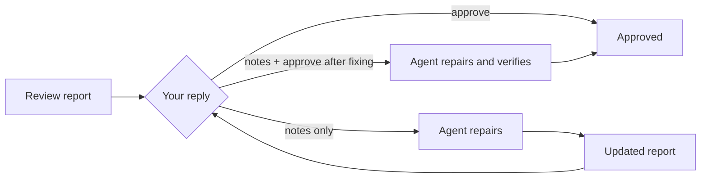

# Reading Review Reports

<!-- context:section id="goal" -->
Nothing the Agent writes becomes knowledge until you approve it in review. The Agent opens one HTML report for the whole current batch of drafted pages and waits for your answer. This report decides both the scope and the quality of what gets published, so it is worth reading with three questions in mind.
<!-- /context:section -->

<!-- context:section id="layout" -->

## What is in the report

| Part | What it shows |
| --- | --- |
| Change overview | The batch at a glance, with the existing navigation and the expected file tree of the knowledge workspace |
| Navigation | Where each page will sit, and every navigation change the batch makes — including menu entries for pages outside the batch. Pages without a placement are flagged so the Agent can place them before asking you |
| Planned retirement | When the batch also retires pages: which pages go, how the menu changes, and any draft that still links to them (those drafts are revised before you are asked to approve) |
| Pages | Each draft's title, path, summary and full rendered content, including diagrams and source citations. New pages are marked *New*; changed pages show the changed blocks next to the previous text |
| Revision notes | A note box per page; typing in it marks the page for revision |

**Previous** and **Next** (or the `-` and `+` keys) step from one page to the next. Opening a page marks it READ in your browser. Read counts and notes are local conveniences, not approval. The revision counter lists every page with notes, and **Copy** exports them as plain text with article IDs and titles for pasting into the conversation.

The report opens in your workspace's language; switch with the language button, and your browser remembers the choice. Every approved batch keeps its own copy of the report under `.tmp/review-reports/` in the knowledge workspace — whether you confirmed it or, in a [fully managed](../planning-and-production/managed-mode-and-review-policy.md) run, the Agent reviewed instead of you — so earlier batches can still be read after later batches and after delivery.

<!-- /context:section -->

<!-- context:section id="three-checks" -->
## Three things to judge

1. **Structure**: Are the topics, directories and pages divided the way readers will look for them?
2. **Content**: Do the pages carry the intended purpose, depth and style? Can a reader actually complete the promised task with them?
3. **Scope**: Is related material missing that should be included, or is something here that should be dropped?

Citations and placements alone do not prove a page is useful. Spot-check a few pages against their sources, especially defaults, conditions and steps.
<!-- /context:section -->

<!-- context:section id="answer" -->
## Answering

Reply in the conversation; no review code or magic phrase is needed.

| You say | What happens |
| --- | --- |
| Approve, or continue | The presented batch is approved |
| Revision notes only | The Agent repairs those pages, checks the result and shows an updated report |
| Notes plus "approve after fixing" | The Agent repairs, verifies the fix, and approves only the agreed pages without asking again |
| "Fix it and show me" | Editing only; it waits for your decision on the new report |

Silence, an ignored card or read progress is never approval. Rejecting a page leaves it out of this batch; it does not retire an already approved article.
<!-- /context:section -->

<!-- context:section id="required" -->
## Planned articles must come back

Rejecting a page that was part of the agreed plan does not cancel it. The current stage cannot finish while a planned article stays rejected; the Agent turns your feedback into a revision and brings the page back to review. To drop an article on purpose, ask the Agent to change the plan instead.
<!-- /context:section -->

<!-- context:section id="partial" -->
## Taking part of a batch now

You can approve the pages that are ready while others go back for repair. Approval alone does not rebuild the outputs; to see the approved pages published before the rest are finished, ask for them to be published early. The Agent applies the approved pages and rebuilds the outputs for them, as long as they do not link to pages still pending, and then returns to the remaining review.
<!-- /context:section -->

<!-- context:section id="after" -->
## After approval

Approval writes the pages into the knowledge workspace. The approved pages are then applied and checked, without rewriting their prose, and the outputs (package and site) are rebuilt. Nothing is published before approval.
<!-- /context:section -->
