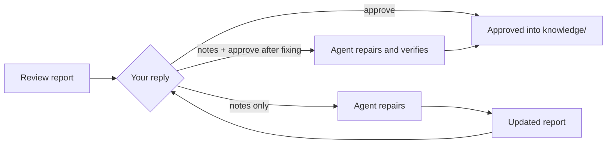

# Reading Review Reports

<!-- context:section id="goal" -->
Nothing the Agent writes becomes knowledge until it passes **Knowledge Review**. The Agent opens one HTML report for the whole current batch of candidate pages and waits for your answer. This report decides both the scope and the quality of what gets published, so it is worth reading with three questions in mind.
<!-- /context:section -->

<!-- context:section id="layout" -->
## What is in the report

| Part | What it shows |
| --- | --- |
| Change overview | The batch at a glance, with the existing navigation and the expected file tree of the Context knowledge workspace |
| Navigation | Where each page will sit; pages without a placement are flagged so the Agent can bind them before asking you |
| Pages | Each candidate's title, path, summary and full rendered content, including diagrams and source citations. New pages are marked *New*; changed pages show the changed blocks next to the previous text |
| Revision notes | A note box per page; typing in it marks the page for revision |

Opening a page marks it READ in your browser. Read counts and notes are local conveniences, not approval. The revision counter lists every page with notes, and **Copy** exports them as plain text with article IDs and titles for pasting into the conversation.
<!-- /context:section -->

<!-- context:section id="three-checks" -->
## Three things to judge

1. **Structure** — Are the topics, directories and pages divided the way readers will look for them?
2. **Content** — Do the pages carry the intended purpose, depth and style? Can a reader actually complete the promised task with them?
3. **Scope** — Is related material missing that should be included, or is something here that should be dropped?

Citations and placements alone do not prove a page is useful. Spot-check a few pages against their sources, especially defaults, conditions and steps.
<!-- /context:section -->

<!-- context:section id="answer" -->
## Answering

Reply in the conversation; no review code or magic phrase is needed.

| You say | What happens |
| --- | --- |
| Approve, or continue | The presented batch is approved |
| Revision notes only | The Agent repairs those pages, checks the result and shows an updated report |
| Notes plus "approve after fixing" | The Agent repairs, verifies the fix, and approves only the agreed pages without asking again |
| "Fix it and show me" | Editing only; it waits for your decision on the new report |

Silence, an ignored card or read progress is never approval. Rejecting a page leaves it out of this batch; it does not retire an already approved article.
<!-- /context:section -->

<!-- context:section id="partial" -->
## Taking part of a batch now

You can approve the pages that are ready while others go back for repair. Approval alone does not build; to see the approved pages published before the rest are finished, ask for an early delivery. The Agent runs close and build for them, as long as they do not link to pages still pending, and then returns to the remaining review.
<!-- /context:section -->

<!-- context:section id="after" -->
## After approval

Approval writes the pages to `knowledge/`. Close then rebuilds `knowledge/structure.yaml` and verifies the approved knowledge without rewriting its prose, and build produces the package and site. Nothing is published before approval.
<!-- /context:section -->
