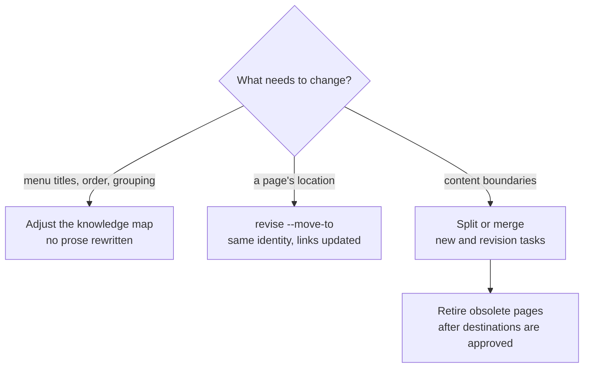

# Reorganizing at Scale

<!-- context:section id="goal" -->
First-round titles tend to be abstract, and the first directory structure is rarely ideal. Once the knowledge base has reached a useful size, the Agent can survey what is already approved and propose a more readable, direct structure — and at that point its proposal is better than anything possible during planning, because the content exists. Apply it, then observe for another round. Reorganizing is a series of revisions, far cheaper than producing again.

```text
Survey the approved knowledge and propose a more direct directory and title
structure. Show me the before/after, then revise once I confirm.
```
<!-- /context:section -->

<!-- context:section id="tools" -->
## Pick the lightest tool



| Change | Tool | What stays |
| --- | --- | --- |
| Rename a directory, reorder, regroup, place a page in a second location | Knowledge-map adjustment | Article identity, URL and prose |
| Move a page to another path | `context revise <page> --move-to <path>` | Identity and section IDs; incoming Markdown links are updated on approval |
| Split one page, or merge several | Ordinary new and revision tasks | Useful detail, until its destination is approved |
| Remove pages now covered elsewhere | `context task retire` | Sources and shared assets |
<!-- /context:section -->

<!-- context:section id="map" -->
## Knowledge-map adjustments

The knowledge map controls the website navigation and the LLM Docs organization together. Ask in conversation to move a topic, rename a directory, change the order or organize the same articles for another reader task; this works during production or after it, without recapturing sources. Each entry keeps a stable key, so a renamed menu needs no new article and moving a menu entry does not change the article URL.

Prefer, in this order: revise an existing article, add a page to a matching category, add a coherent child category. A **top-level** addition, rename or removal is proposed with a before/after tree and needs your explicit approval.
<!-- /context:section -->

<!-- context:section id="split" -->
## Splits and merges

The Agent reads the affected pages and current sources before deciding what to keep, deepen, split, merge or retire. Destination content is approved first; only then are the original page and its incoming links revised. Useful conditions, steps and explanations must have a destination before anything is removed — omitting a page in Review rejects the candidate, it does not retire the approved article.
<!-- /context:section -->

<!-- context:section id="retire" -->
## Retiring pages

```yaml
reason: These reader tasks are now covered by the approved guide.
targets:
  - path: architecture/old-guide.md
    replacement: sop/current-guide.md
```

`context task retire --input <file>` previews the retirement; it does not go through the HTML Review, and once you have approved the deletion the Agent applies the returned command without asking again. Retirement removes the Markdown and structure entries together, points incoming page links at the replacement, and returns a restore input for rollback. Links into a specific paragraph of a split page are repaired first, because the CLI cannot infer where a paragraph went.

Pages with continuing value — such as documentation for an older version — normally stay. A shorter new text or a changed menu is not a reason to retire.
<!-- /context:section -->

<!-- context:section id="record" -->
## Make the new structure stick

Before delivery, check that each page sits under its main reader task, titles match bodies, siblings are ordered deliberately and no directory is empty or an accidental duplicate. Record the lasting intent of each category briefly in the `AGENTS.md` of the Context knowledge workspace, so later updates place new pages the same way.
<!-- /context:section -->
