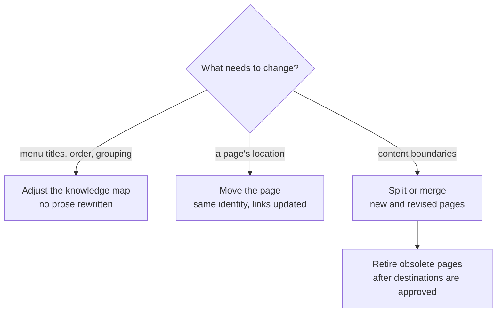

# Reorganizing at Scale

<!-- context:section id="goal" -->
First-round titles tend to be abstract, and the first directory structure is rarely ideal. Plan to restructure once the first round is approved: the Agent can then survey what already exists and propose a more readable, direct structure. That proposal is better than anything possible during planning, because the content is there to look at. Apply it, then observe for another round. Reorganizing is a series of revisions, far cheaper than producing again.

```text
Survey the approved knowledge and propose a more direct directory and title
structure. Show me the before/after, then revise once I confirm.
```
<!-- /context:section -->

<!-- context:section id="tools" -->
## Pick the lightest change



| Change | What to ask the Agent | What stays |
| --- | --- | --- |
| Rename a directory, reorder, regroup, place a page in a second location | *"Rename the Operations menu to Runbooks and put Alerts first."* | Article identity, URL and prose |
| Move a page to another path | *"Move the deployment page under Source Graph."* | Identity and section IDs; links from other pages are updated on approval |
| Split one page, or merge several | *"Split the setup page into install and configure; merge the two FAQ pages."* | Useful detail, until its destination is approved |
| Remove pages now covered elsewhere | *"Retire the old guide; point readers to the current guide."* | Sources and shared assets |
<!-- /context:section -->

<!-- context:section id="map" -->
## Knowledge-map adjustments

The knowledge map controls the website navigation and the LLM Docs organization together. Ask in conversation to move a topic, rename a directory, change the order or organize the same articles for another reader task. This works during production or after it, without capturing sources again. Each entry keeps a stable key, so a renamed menu needs no new article and moving a menu entry does not change the article URL.

Prefer, in this order: revise an existing article, add a page to a matching category, add a coherent child category. A **top-level** addition, rename or removal is shown to you as a before/after tree and needs your explicit approval.
<!-- /context:section -->

<!-- context:section id="split" -->
## Splits and merges

The Agent reads the affected pages and current sources before deciding what to keep, deepen, split, merge or retire. Destination content is approved first; only then are the original page and the links pointing to it revised. Useful conditions, steps and explanations must have a destination before anything is removed. Leaving a page out in review only rejects that draft; it does not retire the approved article.
<!-- /context:section -->

<!-- context:section id="retire" -->
## Retiring pages

Ask the Agent to retire the pages, and say which page replaces each one and why. The Agent first shows you what will be removed. Retirement is confirmed in the conversation, not in the review report, and once you have approved it the Agent applies it without asking again. The page and its navigation entries are removed together, links from other pages are pointed at the replacement, and the Agent can roll the retirement back if you change your mind. Links into a specific paragraph of a split page are repaired first, because Context cannot infer where a paragraph went.

Pages with continuing value, such as documentation for an older version, normally stay. A shorter new text or a changed menu is not a reason to retire.
<!-- /context:section -->

<!-- context:section id="record" -->
## Make the new structure stick

Before you publish, check that each page sits under its main reader task, titles match bodies, siblings are ordered deliberately and no directory is empty or an accidental duplicate. Ask the Agent to record the lasting intent of each category briefly in the `AGENTS.md` of the knowledge workspace, so later updates place new pages the same way.
<!-- /context:section -->
