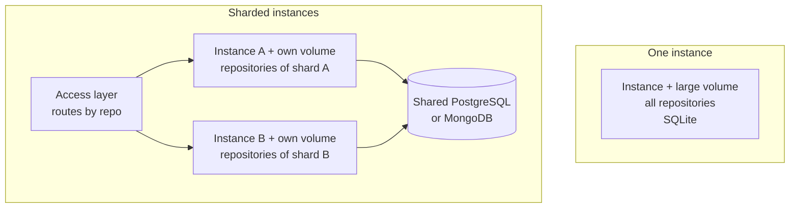

# Deployment Recommendations

<!-- context:section id="goal" -->
Source Graph supports two deployment shapes. Each instance owns its Git mirrors, search indexes and data directory on local disk, and a database holds the shared application state. The choice between the shapes is therefore about disk and repository ownership, not about adding replicas.

This page helps you pick a shape and avoid the mistakes that break it. For building the image, choosing a database and backing up, see [Self-Hosting](self-hosting.md).
<!-- /context:section -->

<!-- context:section id="choose" -->
## Choose a shape

| Question | One instance with a large disk | Sharded instances |
| --- | --- | --- |
| Repositories | Fit on one persistent volume, with Git mirrors plus indexes | More than one volume can hold, or you want to spread indexing load |
| Database | SQLite (default) is enough | PostgreSQL or MongoDB shared by every instance; SQLite cannot be shared |
| Routing | None; every request goes to the one instance | An access layer routes each request to the instance that owns its repository |
| Operations | One machine, one volume, one backup | One volume per instance, a stable repository mapping and a shared credential key |

Start with one instance unless you already know the repositories will not fit. Moving to sharding later means adding a shared database and an access layer; repositories moved to a new instance are fetched and indexed again there.

In both shapes, place instances in the same region as the Agents and services that call them. Search speed comes from local indexes, so cross-region calls add latency that a larger machine does not remove.


<!-- /context:section -->

<!-- context:section id="single" -->
## One instance

- **Size the volume for bare Git repositories plus their indexes.** Keep free space above `SOURCEGRAPH_MIN_FREE_BYTES`, 1 GiB by default, which is the floor below which fetching and indexing stop.
- **Run exactly one machine for the volume.** Two processes must never serve the same repositories or share one data directory, because index ownership is per process.
- **Keep the default SQLite database** unless you already operate PostgreSQL or MongoDB. An external database does not replace the persistent volume, which still holds Git, indexes and the credential key.
- **Measure before resizing.** Index memory and disk needs depend on repository size, so observe real indexing before changing capacity.
- **Expect brief interruptions on redeploy.** Restarting a single instance may interrupt requests and indexing for a moment; persisted tasks recover after the restart.
<!-- /context:section -->

<!-- context:section id="sharded" -->
## Sharded instances

- **Share one PostgreSQL or MongoDB database** across all instances, and give each instance its own data volume.
- **Set the same `SOURCEGRAPH_CREDENTIAL_KEY` on every instance.** Otherwise each instance generates its own key on its volume and cannot decrypt credentials stored by the others.
- **Give each repository exactly one owner.** Assign repositories to instances with consistent hashing or an explicit repository-to-instance table, and keep that mapping stable.
- **Route by the repository named in the request:** the `repo` query parameter over HTTP and the `repo` argument of an MCP tool call, in `owner/repository` form. Requests not tied to one repository, such as listing repositories, may go to any instance.
- **Scale by adding shards, never replicas.** On Fly.io this means one App per shard behind your routing layer, not several Machines in one App, because Machines of one App would share repositories.
<!-- /context:section -->

<!-- context:section id="demo" -->
## Example: the public demo

The Source Graph behind this documentation site is a demo, not a capacity recommendation. It runs as two Fly.io Apps in the `sin` region:

| App | Role | Machine |
| --- | --- | --- |
| Portal | nginx serving the home page, the Context documentation site and `llms.txt`, and reverse-proxying `/sourcegraph/` | One shared CPU, 256 MB, auto-stop off, health check `/healthz` |
| Source Graph | One instance deployed from the repository's `fly.toml` | One shared CPU, 1 GB, auto-stop off, volume `sourcegraph_data` at `/data`, SQLite, demo seeding on, health check `/sourcegraph/healthz` |

The Portal forwards the whole `/sourcegraph/` prefix to the Source Graph App over the Fly private network, so the instance is reachable under the site's own domain without a second public hop. The same instance therefore has two public entrances:

- [https://context4ai-portal.fly.dev/sourcegraph/](https://context4ai-portal.fly.dev/sourcegraph/), through the Portal
- [https://context4ai-sourcegraph.fly.dev/sourcegraph/](https://context4ai-sourcegraph.fly.dev/sourcegraph/), on the Source Graph App itself

The MCP endpoint is `/sourcegraph/mcp` under either entrance. The demo serves `context4ai/context` and `context4ai/sourcegraph` anonymously and read-only, synchronizing the `main` branch every 60 minutes. Agent Graph is not registered there, so the knowledge service reads it with local retrieval instead.

To reproduce the Source Graph half, create the App and a volume of at least 20 GB, then deploy once:

```bash
fly apps create <app-name>
fly volumes create sourcegraph_data --region <region> --size 20 --app <app-name>
fly deploy --remote-only --ha=false
```

If you put it behind another site, proxy the whole prefix while preserving query strings, cookies and authorization, keep the configured external origin fixed, and do not cache sign-in, API or MCP responses. The demo repository's own pipeline deploys to Fly after a successful build of `main`.
<!-- /context:section -->
