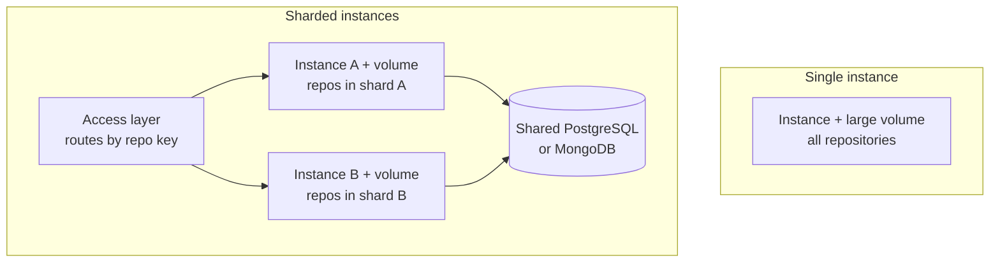

# Self-Hosting

<!-- context:section id="goal" -->
A Source Graph instance is one container or one process with a persistent data directory. The fastest way to try it is the Docker image built from the repository:

```bash
docker build -t context-sourcegraph .
docker volume create sourcegraph-data
docker run --rm -p 8080:8080 -v sourcegraph-data:/data \
  -e SOURCEGRAPH_ORIGIN=http://localhost:8080 \
  -e SOURCEGRAPH_SEED_DEMO=true \
  context-sourcegraph
```

Open `http://localhost:8080/sourcegraph/`. With `SOURCEGRAPH_SEED_DEMO=true` it registers two public example repositories; public GitHub repositories need no token. Without sign-in providers the site is anonymous and read-only — add Google or GitHub sign-in to administer it, as described in [Authentication and Access Control](authentication-and-access-control.md).

The image contains four binaries — the service `repo-service`, the command-line client `sourcegraph-cli`, the Git credential helper and the Zoekt search server — and runs as an unprivileged user with `/data` as its data root and port 8080 exposed.
<!-- /context:section -->

<!-- context:section id="source" -->
## Build from source

Building locally needs Go 1.26 or later, Bun 1.3.9 and Git:

```bash
bun install --frozen-lockfile
bun run build:web
bun run build
SOURCEGRAPH_DATA_ROOT="$PWD/.tmp/data" SOURCEGRAPH_ORIGIN=http://localhost:8080 output/bin/repo-service
```

`output/bin` then holds the same four binaries. The service starts the search server itself and manages background indexing; there is nothing else to run. Every setting is an environment variable, listed in [Configuration](../../product/reference/source-graph/configuration.md). Put credentials only in environment variables or your platform's secret store, never in the deployment JSON, source code or images.
<!-- /context:section -->

<!-- context:section id="topology" -->
## Choose a topology

Each instance owns its Git mirrors, search indexes and data directory on local disk; the database holds shared application state. Search speed comes from that locality, so size instances by disk rather than CPU, and place them in the same region as the Agents and services that call them.



- **One instance with a large disk** is the simplest choice for a team or a moderate number of repositories. Size the volume for the bare Git repositories plus indexes, and keep headroom above `SOURCEGRAPH_MIN_FREE_BYTES` (1 GiB by default), below which fetching and indexing stop with `INSUFFICIENT_STORAGE`.
- **Sharded instances with repository-sticky routing** scale further. Several instances share one PostgreSQL or MongoDB database, and each serves a disjoint set of repositories from its own volume. The access layer routes every request by its repository key — the `repo` query parameter over HTTP, the `repo` argument of an MCP tool call — using consistent hashing or an explicit table. Requests not tied to one repository, such as listing repositories, may go to any instance.

For sharding, set the same `SOURCEGRAPH_CREDENTIAL_KEY` on every instance so they can decrypt each other's stored credentials, and keep the repository-to-instance mapping stable; moving a repository means it is fetched and indexed again.

Never let two instances serve the same repository or share a data directory. Index ownership is per process: scale by sharding repositories, not by adding replicas.
<!-- /context:section -->

<!-- context:section id="database" -->
## Choose a database

| Database | `SOURCEGRAPH_DATABASE` | Use when |
| --- | --- | --- |
| SQLite (default) | `sqlite` | One instance. The file defaults to `/data/sourcegraph.db`, with write-ahead logging and full synchronous commits |
| PostgreSQL | `postgres` | Shared state for sharded instances, or an existing managed database. Uses serializable transactions |
| MongoDB | `mongodb` | Shared state on MongoDB. Sign-in admission needs transactions, so use a replica set or a managed cluster |

Pass the connection in `DATABASE_URL`: a SQLite file path, a PostgreSQL DSN or a MongoDB URI. Changing the database does not migrate data — start with an empty destination or run a separately reviewed export and import. An external database never replaces the instance's persistent volume, which still holds Git, indexes and the credential key.
<!-- /context:section -->

<!-- context:section id="fly" -->
## Example: Fly.io

The repository's `fly.toml` deploys one machine with 1 GB of memory, a single shared CPU, automatic stopping disabled, a volume named `sourcegraph_data` mounted at `/data`, and a health check on `/sourcegraph/healthz`:

```bash
fly apps create <app-name>
fly volumes create sourcegraph_data --region <region> --size 20 --app <app-name>
fly deploy --remote-only --ha=false
```

Start with a volume of at least 20 GB and observe real indexing before changing capacity. Do not scale one app to several machines — they would share repositories; for sharding, deploy one app per shard behind a routing access layer.

To serve Source Graph under another site's domain, reverse-proxy the whole `/sourcegraph/` prefix, preserving query strings, cookies and the `Authorization` header, and set `SOURCEGRAPH_ORIGIN` to the public origin. Do not cache sign-in, API or MCP responses; static assets may be cached.
<!-- /context:section -->

<!-- context:section id="backup" -->
## Back up and restore

Source Graph has no built-in backup job. Back up four things outside the machine, with restricted access: the database, the credential encryption key, the runtime storage configuration and the repository metadata. Indexes and bare Git mirrors can be rebuilt from the remotes; identities, settings, credentials and their key cannot.

- **SQLite:** use the online backup API — never copy a live `sourcegraph.db` on its own. For example: `sqlite3 /data/sourcegraph.db '.backup /data/sourcegraph-backup.db'`, then copy the result and the key and configuration files away. Alternatively stop the service and copy the database with its write-ahead log.
- **PostgreSQL:** `pg_dump`. **MongoDB:** your replica-set or managed-cluster backup.

To restore, stop the instance, restore the database together with its matching key and configuration, start one instance, and check administrator access, repository metadata and index recovery. Rolling back the image and restoring the database are separate operations; keep a known-good image and take a backup before upgrades.
<!-- /context:section -->
