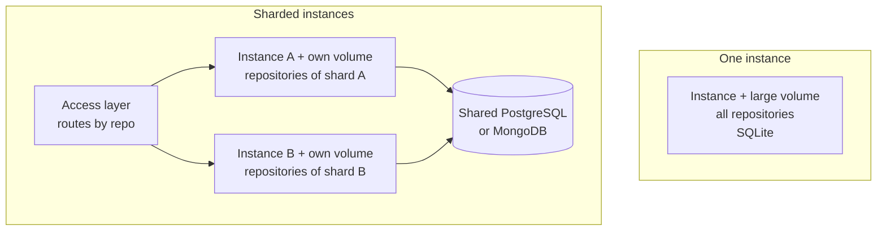

# Self-Hosting

<!-- context:section id="goal" -->
A Source Graph instance is one container or one process with a persistent data directory. The fastest way to try it is the Docker image built from the repository:

```bash
docker build -t context-sourcegraph .
docker volume create sourcegraph-data
docker run --rm -p 8080:8080 -v sourcegraph-data:/data \
  -e SOURCEGRAPH_ORIGIN=http://localhost:8080 \
  -e SOURCEGRAPH_SEED_DEMO=true \
  context-sourcegraph
```

Open `http://localhost:8080/sourcegraph/`. With `SOURCEGRAPH_SEED_DEMO=true` it registers two public example repositories; public GitHub repositories need no token, and a custom Git host can be added under Settings or in a startup file, as described in [Registering Repositories](registering-repositories.md#code-sources). Without sign-in providers the site is anonymous and read-only. Add Google or GitHub sign-in to administer it, as described in [Authentication and Access Control](authentication-and-access-control.md).

The image contains four binaries: the service `repo-service`, the command-line client `sourcegraph-cli`, the Git credential helper and the Zoekt search server. It runs as an unprivileged user with `/data` as its data root and port 8080 exposed.
<!-- /context:section -->

<!-- context:section id="source" -->
## Build from source

Building locally needs Go, Bun and Git, at the versions the repository's build files require:

```bash
bun install --frozen-lockfile
bun run build:web
bun run build
SOURCEGRAPH_DATA_ROOT="$PWD/.tmp/data" SOURCEGRAPH_ORIGIN=http://localhost:8080 output/bin/repo-service
```

`output/bin` then holds the same four binaries. The service starts the search server itself and manages background indexing; there is nothing else to run. Every setting is an environment variable, and code sources can also be overridden by the startup file that `SOURCEGRAPH_CONFIG_FILE` names; all are listed in [Configuration](../../product/reference/source-graph/configuration.md). Put credentials only in environment variables or your platform's secret store, never in the deployment JSON, source code or images.
<!-- /context:section -->

<!-- context:section id="topology" -->
## Choose a shape

Each instance owns its Git mirrors, search indexes and data directory on local disk, and a database holds the shared application state. Choosing a shape is therefore about disk and repository ownership, not about adding replicas.

| Question | One instance with a large disk | Sharded instances |
| --- | --- | --- |
| Repositories | Fit on one persistent volume, with Git mirrors plus indexes | More than one volume can hold, or you want to spread indexing load |
| Database | SQLite (default) is enough | PostgreSQL or MongoDB shared by every instance; SQLite cannot be shared |
| Routing | None; every request goes to the one instance | An access layer routes each request to the instance that owns its repository |
| Operations | One machine, one volume, one backup | One volume per instance, a stable repository mapping and a shared credential key |

Start with one instance unless you already know the repositories will not fit. Moving to sharding later means adding a shared database and an access layer; repositories moved to a new instance are fetched and indexed again there.

In both shapes, place instances in the same region as the Agents and services that call them. Search speed comes from local indexes, so cross-region calls add latency that a larger machine does not remove.


<!-- /context:section -->

<!-- context:section id="single" -->
## Running one instance

- **Size the volume for bare Git repositories plus their indexes.** Keep free space above `SOURCEGRAPH_MIN_FREE_BYTES`, 1 GiB by default, which is the floor below which fetching and indexing stop.
- **Run exactly one machine for the volume.** Two processes must never serve the same repositories or share one data directory, because index ownership is per process.
- **Keep the default SQLite database** unless you already operate PostgreSQL or MongoDB.
- **Measure before resizing.** Index memory and disk needs depend on repository size, so observe real indexing before changing capacity.
- **Expect brief interruptions on redeploy.** Restarting a single instance may interrupt requests and indexing for a moment; persisted tasks recover after the restart.
<!-- /context:section -->

<!-- context:section id="sharded" -->
## Running sharded instances

- **Share one PostgreSQL or MongoDB database** across all instances, and give each instance its own data volume.
- **Set the same `SOURCEGRAPH_CREDENTIAL_KEY` on every instance.** Otherwise each instance generates its own key on its volume and cannot decrypt credentials stored by the others.
- **Give each repository exactly one owner.** Assign repositories to instances with consistent hashing or an explicit repository-to-instance table, and keep that mapping stable.
- **Route by the repository named in the request:** the `repo` query parameter over HTTP and the `repo` argument of an MCP tool call, in `owner/repository` form. Requests not tied to one repository, such as listing repositories, may go to any instance.
- **Scale by adding shards, never replicas.** On Fly.io this means one App per shard behind your routing layer, not several Machines in one App, because Machines of one App would share repositories.
<!-- /context:section -->

<!-- context:section id="database" -->
## Choose a database

| Database | `SOURCEGRAPH_DATABASE` | Use when |
| --- | --- | --- |
| SQLite (default) | `sqlite` | One instance. The file defaults to `/data/sourcegraph.db`, with write-ahead logging and full synchronous commits |
| PostgreSQL | `postgres` | Shared state for sharded instances, or an existing managed database. Uses serializable transactions |
| MongoDB | `mongodb` | Shared state on MongoDB. Sign-in admission needs transactions, so use a replica set or a managed cluster |

Pass the connection in `DATABASE_URL`: a SQLite file path, a PostgreSQL DSN or a MongoDB URI. Changing the database does not migrate data, so start with an empty destination or run a separately reviewed export and import. An external database never replaces the instance's persistent volume, which still holds Git, indexes and the credential key.
<!-- /context:section -->

<!-- context:section id="fly" -->
## Example: Fly.io and the public demo

The repository's `fly.toml` deploys one instance with a `sourcegraph_data` volume mounted at `/data` and a platform health check on the liveness endpoint. To deploy your own, create the App and a volume of at least 20 GB, then deploy once:

```bash
fly apps create <app-name>
fly volumes create sourcegraph_data --region <region> --size 20 --app <app-name>
fly deploy --remote-only --ha=false
```

After a deployment, check liveness and readiness as described in [Operations](operations.md#health-and-status).

The Source Graph behind this documentation site is deployed this way. It is a demo, not a capacity recommendation: two Fly.io Apps in the `sin` region.

| App | Role | Machine |
| --- | --- | --- |
| Portal | nginx serving the home page, the Context documentation site and `llms.txt`, and reverse-proxying `/sourcegraph/` | One shared CPU, 256 MB, auto-stop off |
| Source Graph | One instance deployed from the repository's `fly.toml` | One shared CPU, 1 GB, auto-stop off, volume `sourcegraph_data` at `/data`, SQLite, demo seeding on |

The Portal forwards the whole `/sourcegraph/` prefix to the Source Graph App over the Fly private network, so the instance is reachable under the site's own domain, [https://context4ai.org/sourcegraph/](https://context4ai.org/sourcegraph/), without a second public hop. It is also reachable through each App's own Fly address:

- [https://context4ai-portal.fly.dev/sourcegraph/](https://context4ai-portal.fly.dev/sourcegraph/), through the Portal
- [https://context4ai-sourcegraph.fly.dev/sourcegraph/](https://context4ai-sourcegraph.fly.dev/sourcegraph/), on the Source Graph App itself

The MCP endpoint is `/sourcegraph/mcp` under every entrance. The demo serves four repositories anonymously and read-only, each following its `main` branch:

| Repository | How it got there |
| --- | --- |
| `context4ai/context`, `context4ai/sourcegraph` | Registered by demo seeding |
| `context4ai/portal`, `context4ai/agent-graph` | Registered by the maintainers |

Because `context4ai/portal` is this site's knowledge workspace, the demo serves the knowledge and the code it cites side by side: Agents can read both remotely, including through a plain MCP client as described in [Querying Through MCP in Your Agent](../querying-knowledge/querying-via-mcp.md). The demo repository's own pipeline deploys to Fly after a successful build of `main`.

If you put Source Graph behind another site, proxy the whole prefix while preserving query strings, cookies and authorization, keep the configured external origin fixed, and do not cache sign-in, API or MCP responses.
<!-- /context:section -->

<!-- context:section id="backup" -->
## Back up and restore

Source Graph has no built-in backup job. Back up four things outside the machine, with restricted access: the database, the credential encryption key, the runtime storage configuration and the repository metadata. Indexes and bare Git mirrors can be rebuilt from the remotes; identities, settings, credentials and their key cannot.

- **SQLite:** use the online backup API; never copy a live `sourcegraph.db` on its own. For example: `sqlite3 /data/sourcegraph.db '.backup /data/sourcegraph-backup.db'`, then copy the result and the key and configuration files away. Alternatively stop the service and copy the database with its write-ahead log.
- **PostgreSQL:** `pg_dump`. **MongoDB:** your replica-set or managed-cluster backup.

To restore, stop the instance, restore the database together with its matching key and configuration, start one instance, and check administrator access, repository metadata and index recovery. Rolling back the image and restoring the database are separate operations; keep a known-good image and take a backup before upgrades.
<!-- /context:section -->
