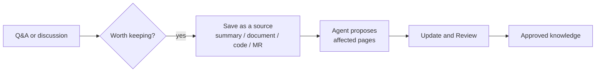

# Capturing from Conversations

<!-- context:section id="goal" -->
Answers worked out in conversation are easy to lose. When a Q&A or troubleshooting session settles something worth keeping, ask the Agent to capture it. What you bring becomes a source, the Agent plans which pages it affects, and the normal update flow turns it into reviewed knowledge.


<!-- /context:section -->

<!-- context:section id="what" -->
## What can become a source

| You have | It becomes |
| --- | --- |
| The conclusions of this conversation | A [session summary](../registering-sources/session-summaries.md), optionally linked to commits or merge requests |
| Text you paste or an excerpt you hold | A [note](../registering-sources/notes.md) |
| A new document | A [document](../registering-sources/document-directories.md) or [Lark](../registering-sources/lark-documents.md) source, captured |
| Specific code or a merge request | An update of the registered [repository](../registering-sources/code-repositories.md) to the merged commit |

```text
That explanation of the retry limits is right. Save this conversation as a
session summary linked to the merge request, and update the affected pages.
```
<!-- /context:section -->

<!-- context:section id="how" -->
## What the Agent does

1. Saves the material. A conversation is summarized — the problem, confirmed decisions, reasons and open questions — never stored as a transcript.
2. Proposes a plan: which existing pages to revise and whether a new page is warranted. A new topic goes through structure review first.
3. Runs the update with the saved source in the affected pages' scope, and brings the changed pages to Knowledge Review.

Saving a source alone starts no knowledge work, so you can also save now and update later. A summary that arrives after the code was already processed can still update a page; the code version is reused, not re-parsed.
<!-- /context:section -->

<!-- context:section id="when" -->
## When a question finds a gap

When querying shows that the knowledge is missing or out of date, the query Skill suggests an update with the affected page, the proposed change and the source scope — and starts nothing until you accept. On acceptance it hands the evidence to the production entry in the selected Context knowledge workspace. See [Asking Questions](../querying-knowledge/asking-questions.md).
<!-- /context:section -->

<!-- context:section id="boundaries" -->
## Boundaries

- Only material you supply or authorize is captured; the Agent does not scan its own history.
- A linked merge request records an association; it does not prove the change was merged or tested.
- Saving a conversation or approving knowledge does not approve any upstream change discussed in it.
<!-- /context:section -->
