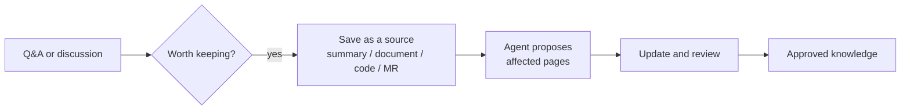

# Capturing from Conversations

<!-- context:section id="goal" -->
Answers worked out in conversation are easy to lose. When a Q&A or troubleshooting session settles something worth keeping — or shows that the knowledge is missing or out of date — ask the Agent to capture it. What you bring becomes a source, the Agent plans which pages it affects, and the normal [update](updating-knowledge.md) turns it into reviewed knowledge.


<!-- /context:section -->

<!-- context:section id="when" -->
## When a question finds a gap

When [asking a question](../querying-knowledge/asking-questions.md) shows that the knowledge is missing or stale, the Agent suggests an update: the affected page or gap, the proposed change and the sources involved. Nothing starts until you accept. Once you do, it carries the evidence it found into the selected knowledge workspace and the steps below run as usual.

In team chat the same works with a knowledge Bot; see [Using the Bot in Team Chat](../knowledge-service-agent/using-the-bot-in-team-chat.md#saving-what-you-learned).
<!-- /context:section -->

<!-- context:section id="what" -->
## What can become a source

| You have | It becomes |
| --- | --- |
| The conclusions of this conversation | A [conversation summary](../registering-sources/notes.md), optionally linked to commits or merge requests |
| Text you paste or an excerpt you hold | A [note](../registering-sources/notes.md) |
| A new document | A [document](../registering-sources/document-directories.md) or [Lark](../registering-sources/lark-documents.md) source |
| Specific code or a merge request | An update of the registered [repository](../registering-sources/code-repositories.md) to the merged commit |

```text
That explanation of the retry limits is right. Save this conversation as a
summary linked to the merge request, and update the affected pages.
```
<!-- /context:section -->

<!-- context:section id="how" -->
## What the Agent does

1. Saves the material. A conversation is summarized — the problem, confirmed decisions, reasons and open questions — never stored as a transcript.
2. Proposes which existing pages to revise and whether a new page is warranted; a new page is confirmed with you first.
3. Runs the update and brings the changed pages to review.

Saving a source alone starts no knowledge work, so you can save now and update later. A summary that arrives after the code was already processed can still update a page; the code is not processed again.
<!-- /context:section -->

<!-- context:section id="boundaries" -->
## Boundaries

- Only material you supply or authorize is captured; the Agent does not scan its own history.
- A linked merge request records an association; it does not prove the change was merged or tested.
- Saving a conversation or approving knowledge does not approve any upstream change discussed in it.
<!-- /context:section -->
