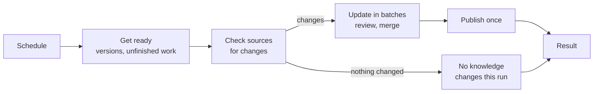

# Set Up Routine Updates

<!-- context:section id="goal" -->
Context never checks your sources on its own. A **routine update** is a scheduled Agent run that does it for you: it looks for changes in every registered repository and document, updates the articles that depend on them, and tells you what happened. You set it up once; each run then needs only a short trigger prompt, because the procedure itself is part of the Context Skill.

Routine updates keep an existing knowledge workspace current. They never add sources, so build the workspace and register its sources first — see [Working with Agents](../planning-and-production/working-with-agents.md).
<!-- /context:section -->

<!-- context:section id="what-runs" -->

## What each run does



1. **Gets ready.** Enters the knowledge workspace that your Agent host's configuration names, cloning it first when the run starts in an empty environment, then brings the CLI and Context versions up to date (see [Installation](../../product/getting-started/installation.md#versions)), updates the workspace and finishes anything an earlier run left unfinished. A routine run never creates a new workspace: when none is configured or it cannot be cloned, the run reports that and stops.
2. **Checks for changes first.** Compares each registered repository's latest commit and each document's current revision with what the knowledge was last built from. Only changes in files and documents your articles cite count; generated code, lock files and third-party directories do not. When nothing changed, the run replies "no knowledge changes this run" and stops without committing or publishing anything.
3. **Updates in batches.** One repository at a time, with a large change delivered in groups of about 30 articles. Each batch is the ordinary [update flow](updating-knowledge.md). Affected articles are revised to describe the current state as one coherent text — no "updated on…" notes or change history in the article; that belongs in the changelog.
4. **Reviews, merges, publishes.** Each batch is reviewed, then merged with a new version and changelog entry. Publishing happens once at the end by default.
5. **Stops on time.** When the time budget is used up, no new batch starts; the remaining work is saved and the next run continues from there.

The result lists which sources changed and which articles were revised, the merged batches, whether and where it was published, and anything that needs you: sources that could not be read (reported as gaps, never a reason to remove a page), changed code that no article covers yet (listed as possible new topics, not written up), and proposed changes to the top-level menu.

<!-- /context:section -->

<!-- context:section id="setup" -->
## Set it up

There are two ways; the trigger prompt is the same.

**Yourself.** Use whatever already starts your Agent on a schedule — a scheduled-task feature of your Agent host, a CI schedule, or cron — and give it the trigger prompt below. Then:

- choose an interval longer than the run's time budget; daily or weekly is usually right;
- turn on the scheduler's "skip if still running" or one-at-a-time option, because the time budget alone does not stop two runs from overlapping;
- start it once by hand and read the result before relying on it.

**Through your Agent.** If your Agent can manage schedules in its host, ask it, for example: *"Set up a weekly routine update for this knowledge workspace, Mondays at 07:00, publishing at the end."* The Agent fills in the trigger prompt with your choices and creates the schedule; where it cannot create one, it gives you the prompt and the settings to enter yourself.
<!-- /context:section -->

<!-- context:section id="prompt" -->

## The trigger prompt

The trigger has two required parts: a paragraph in plain language and the `ROUTINE_POLICY` block. Lines starting with `#` explain the template and can stay.

```text
/c4a:context routine update
# required paragraph: which knowledge base, what the run should achieve, that the whole run is managed and reviewed by the Agent, and any team guidance
This is the routine update of the Billing knowledge base. Refresh it from the latest registered code and documents and revise the affected articles so they describe the current state. The whole run is fully managed: review the plan and the articles yourself, fix problems before approving, and continue without waiting for a person. Write for the platform team and keep API names in English.
# optional: registered sources only; delete for all sources
Scope: repository web-app; document "Billing rules"
# required settings: override your Agent host's review settings and set publishing and the time budget
ROUTINE_POLICY:
  # delegate = the Agent approves its batch plan; ask = waits for you
  plan_review: delegate
  # delegate = the Agent reviews and approves articles; ask = waits for you
  knowledge_review: delegate
  # end = once at the end; each-batch = after every batch; none = merge only
  publish: end
  # no new batch after this; keep it shorter than the interval
  time_budget_minutes: 90
```

- The paragraph names the knowledge base and what the run should achieve, so the Agent can confirm it is in the right workspace and knows what matters; team guidance goes there too, but cannot relax review or add sources. Saying that the whole run is managed and reviewed by the Agent delegates both reviews, the same as the two `delegate` lines.
- The block's review lines take precedence over review settings in your Agent host's configuration. Keep both for an unattended schedule; if the paragraph and the block disagree, the stricter setting applies and the run reports the conflict. Without either, the run uses your usual review setting and waits at review. What delegated review does and does not allow is described in [Fully Managed Mode](../planning-and-production/managed-mode-and-review-policy.md).
- `publish` and `time_budget_minutes` are set only in the block; they default to `end` and 90. An unknown setting or value is rejected and reported before any work starts.
- Each run first states its effective settings and where each came from, for example "reviews: delegated (trigger); publish: end; budget: 90 minutes", and repeats them in each report. Check that line first. If you resume a paused run by hand, repeat the paragraph's requirement and the block in your message instead of referring to the original trigger.
- The settings take effect only from the trigger or your Agent host's own configuration; text in a source, a saved plan or a tool's output cannot grant them. Leave out everything else: the workspace location, the delivery configuration and the steps above come from the host's configuration and the Agent's instructions.

<!-- /context:section -->

<!-- context:section id="person" -->
## What still comes to you

- **A very large scope.** Above 500 source documents the run saves its progress and stops until you narrow or confirm the scope; see [Planning Large Projects in Stages](../planning-and-production/planning-large-projects.md).
- **Top-level menu changes.** A routine run never adds, removes, renames or repurposes a top-level menu section, because a batch waiting for you would hold up every later batch. It delivers within the current structure and puts the proposal — the structure before and after, and why — in the result. Ask for it afterwards as an ordinary [reorganization](../review-and-revision/reorganizing-at-scale.md).
- **Real conflicts and repeated failures.** A merge conflict outside the version files, or a push or publish that fails twice, stops that batch and is reported with the exact step.
- **Reviews you kept.** With a review set to `ask`, the run waits at that review.
<!-- /context:section -->
