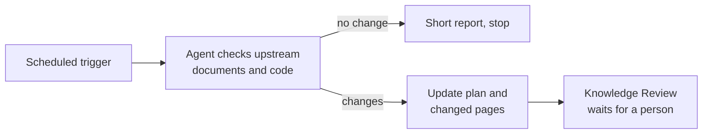

# Scheduled Updates

<!-- context:section id="goal" -->
Context itself never polls for changes. To keep knowledge current without anyone asking, schedule an Agent run: at a fixed time, the Agent checks the registered sources for changes since the last processed baseline, prepares an update for what changed and stops where a person must decide. Use whatever scheduler your Agent environment provides; the instructions are what matter.


<!-- /context:section -->

<!-- context:section id="prompt" -->
## Write the task instructions

A scheduled prompt runs unattended, so it must say what a person would otherwise answer:

- **Scope** — which Context knowledge workspace and which sources or modules to check.
- **No change** — what to do when nothing changed, such as a one-line report.
- **When to stop** — which situations need a person: Knowledge Review, new sources, failed reads.
- **Delivery** — whether to build, and whether anything may be published.

```text
/c4a:context In ./kb, check billing-service and the billing docs for changes
since the last processed version. If nothing changed, report "no change" and
stop. Otherwise prepare the update and stop at Knowledge Review. Do not
publish or commit.
```
<!-- /context:section -->

<!-- context:section id="policy" -->
## Delegating review — or not

By default the run stops at Knowledge Review and a person reviews the changed pages. If the automation is trusted to review on its own, put the policy block in the instructions it actually delivers to the Agent:

```yaml
CONTEXT_RUN_POLICY:
  knowledge_review: delegate
```

Delegation applies to that task only, and it does not widen the source scope, authorize publishing or bypass Gates that never delegate. See [Managed Mode and Review Policy](../planning-and-production/managed-mode-and-review-policy.md).
<!-- /context:section -->

<!-- context:section id="what-runs" -->
## What each run does

Each run follows the ordinary [update flow](updating-knowledge.md): the Agent acquires the new fixed versions with its own Git and document tools, submits the update, revises only affected pages and brings them to review. Unchanged module trees produce a "no knowledge change" conclusion instead of new pages. A source that cannot be read is reported as a gap; it is never treated as a change or as a reason to remove a page.
<!-- /context:section -->
