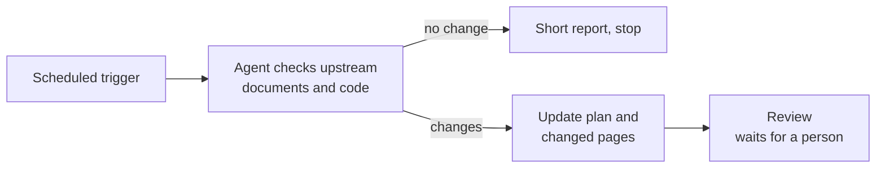

# Scheduled Updates

<!-- context:section id="goal" -->
Context itself never checks for changes on its own. To keep knowledge current without anyone asking, schedule an Agent run: at a fixed time, the Agent checks the registered sources for changes since the last processed version, prepares an update for what changed and stops where a person must decide. Use whatever scheduler your Agent environment provides; the instructions are what matter.


<!-- /context:section -->

<!-- context:section id="prompt" -->
## Write the task instructions

A scheduled prompt runs unattended, so it must say what a person would otherwise answer:

- **Scope** — which knowledge workspace and which sources or modules to check.
- **No change** — what to do when nothing changed, such as a one-line report.
- **When to stop** — which situations need a person: review, new sources, failed reads.
- **Outputs** — whether to build, and whether anything may be published or committed.

```text
/c4a:context In ./kb, check billing-service and the billing docs for changes
since the last processed version. If nothing changed, report "no change" and
stop. Otherwise prepare the update and stop at review. Do not publish or
commit.
```
<!-- /context:section -->

<!-- context:section id="policy" -->
## Letting the Agent review — or not

By default the run stops at review and a person reviews the changed pages. If you trust the automation to review on its own, add a task review policy (`CONTEXT_RUN_POLICY`) to the scheduled prompt itself; a setting that never reaches the Agent has no effect. The policy applies only to that task and is never assumed just because the run was scheduled.

When the Agent reviews, it performs the full review and fixes defects before approving — it does not approve unconditionally, widen the source scope or authorize publishing, and decisions that always belong to a person still stop the run. How to write the policy and what it can and cannot hand over is in [Fully Managed Mode](../planning-and-production/managed-mode-and-review-policy.md).
<!-- /context:section -->

<!-- context:section id="what-runs" -->
## What each run does

Each run follows the ordinary [update flow](updating-knowledge.md): the Agent fetches the new versions with its own Git and document tools, revises only affected pages and brings them to review. Unchanged modules produce a "no knowledge change" conclusion instead of new pages. A source that cannot be read is reported as a gap; it is never treated as a change or as a reason to remove a page.

A scheduled run is for routine, bounded inspections. When a scope grows very large, the task pauses until a person narrows it or explicitly keeps all of it, and a scheduled trigger cannot answer that; plan such work in stages instead — see [Planning Large Projects in Stages](../planning-and-production/planning-large-projects.md).
<!-- /context:section -->
