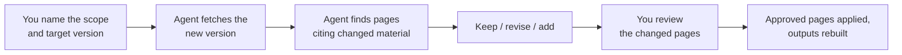

# Updating Knowledge

<!-- context:section id="goal" -->
Every approved page records which source version it was written from. When a repository moves on or a document is edited, an **update** compares the new version with the one the pages were written from, revises only the affected pages and then records the new version as processed. Unaffected pages are left alone.


<!-- /context:section -->

<!-- context:section id="ask" -->
## Ask for the update

Name the scope — a whole repository, some modules or specific documents — and, when it matters, the version:

```text
billing-service has moved to the release-2.4 merge. Locate the affected knowledge
and update it. Only the invoicing and refunds modules.
```

For a single page whose text is wrong, a [revision](../review-and-revision/revising-a-page.md) is the better tool. If other work is still unfinished in the knowledge workspace, the Agent tells you and asks whether to finish or roll it back before starting an independent update.
<!-- /context:section -->

<!-- context:section id="acquire" -->
## How the new version is chosen

Context does not watch platforms for changes; the Agent uses its own Git and document tools once, for the scope you named.

- For a branch or merge request, it works out the target branch, whether the change is merged and the actual commit on that branch. An unmerged proposal is not the mainline, and a squash or rebase can produce a different commit than the feature branch.
- Intervening commits that touch the registered modules are included; reverts are real changes.
- A new commit that leaves the registered modules unchanged can conclude "no knowledge change".
- If the old version is no longer available after a force push or history cleanup, the Agent says so and compares the current material with the approved knowledge instead.
- For documents, a read failure, a deletion and a move are reported differently; none of them is a reason to retire a page.
<!-- /context:section -->

<!-- context:section id="submit" -->
## Which pages change

The Agent first finds every page that cites the changed material. That is a deliberately wide net, not a list of pages that must change: it reads the change and each page, keeps what is still right, revises what changed and proposes new pages for genuinely new topics. New pages are shown to you for confirmation before they are written.

If you name no modules, the whole registered source is in scope.
<!-- /context:section -->

<!-- context:section id="review" -->
## Review and finishing

Changed pages appear in the review report with their changed blocks next to the previous text. Approve, comment or ask for changes as in [Reading Review Reports](../review-and-revision/reading-review-reports.md).

The update is finished when every selected revision is approved, the approved pages are applied and the outputs rebuilt — or when the Agent concludes that nothing needs to change. Only then is the new version recorded as processed. It is not recorded when the new version is fetched or after the first approved page, so an interrupted update can resume without losing track of what remains.

On pages that were kept as they are, citations whose text merely moved in the new version are updated automatically, so verification no longer reports them. If cited text actually changed or can no longer be confirmed, the Agent lists those pages when the update finishes; their citations still point to the previous locations. Correct each listed page that needs it with a [revision](../review-and-revision/revising-a-page.md).
<!-- /context:section -->

<!-- context:section id="only-needed" -->
## Only the sources the update needs

Unrelated repositories do not need to be checked out for an update. A note, a document-only change, a wording fix or a navigation change needs no code at all. When required code is missing, the Agent restores only that repository at its recorded commit; see [Code Repositories](../registering-sources/code-repositories.md#checkouts-on-another-machine).
<!-- /context:section -->
