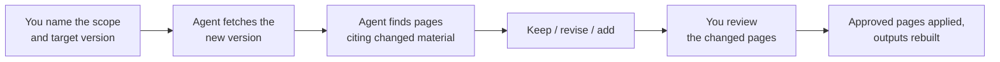

# Updating Knowledge

<!-- context:section id="goal" -->

Every approved page records which source version it was written from. When a repository moves on or a document is edited, an **update** compares the new version with the one the pages were written from, revises only the affected pages and then records the new version as processed. Unaffected pages are left alone.



If you have already moved a repository's pin with `context source add repo --ref <sha>`, the Agent processes it with `context update --pending`, which needs no other input. Only pages whose cited text changed are asked about one by one; every other page that cites the repository can still be revised in the same decision when an addition affects it, and the new commit is recorded once that decision and its revisions are done. When the source checkout does not have that commit yet, it is fetched first; if it cannot be fetched, the update stops and asks for the commit to be checked out instead of treating every citation as missing. In a partial clone, the update also downloads the contents of cited files the clone does not have yet, in one request per source; if they cannot be downloaded, it stops and names the source, the number of files and the reason. Only `--pending` uses the network: an update with an explicit input file reads what the checkouts already have and says so when a commit or contents are missing. Checking status or verifying never fetches anything.

<!-- /context:section -->

<!-- context:section id="ask" -->

## Ask for the update

Name the scope — a whole repository, some modules or specific documents — and, when it matters, the version:

```text
billing-service has moved to the release-2.4 merge. Locate the affected knowledge
and update it. Only the invoicing and refunds modules.
```

For a single page whose text is wrong, a [revision](../review-and-revision/revising-a-page.md) is the better tool. To have sources checked on a schedule instead of asking each time, [set up routine updates](scheduled-updates.md). If other work is still unfinished in the knowledge workspace, the Agent tells you and asks whether to finish or roll it back before starting an independent update.

<!-- /context:section -->

<!-- context:section id="acquire" -->
## How the new version is chosen

Context does not watch platforms for changes; the Agent uses its own Git and document tools once, for the scope you named.

- For a branch or merge request, it works out the target branch, whether the change is merged and the actual commit on that branch. An unmerged proposal is not the mainline, and a squash or rebase can produce a different commit than the feature branch.
- Intervening commits that touch the registered modules are included; reverts are real changes.
- A new commit that leaves the registered modules unchanged can conclude "no knowledge change".
- If the old version is no longer available after a force push or history cleanup, the Agent says so and compares the current material with the approved knowledge instead.
- For documents, a read failure, a deletion and a move are reported differently; none of them is a reason to retire a page.
<!-- /context:section -->

<!-- context:section id="submit" -->

## Which pages change

The Agent first finds the pages whose cited text no longer matches at the new version; citations whose text only moved follow it automatically and are not asked about. For a repository citation it also gets the lines the source diff moved the old text to, which saves working out new line numbers. Changed files that no page cites are listed as well, grouped by directory, so new modules, interfaces or settings are not missed. That list is a starting point, not a list of pages that must change: the Agent reads the change and each page, keeps what is still right and revises what changed. A revised page is rewritten to describe the current state as one coherent article, rather than collecting "updated" notes; the change history belongs in the [changelog](versions-and-changelog.md). Lasting knowledge from those uncited changes goes into an existing page, or, for a genuinely new topic, into a proposed new page, shown to you for confirmation before it is written.

If you name no modules, the whole registered source is in scope.

<!-- /context:section -->

<!-- context:section id="review" -->

## Review and finishing

Changed pages appear in the review report with their changed blocks next to the previous text. Approve, comment or ask for changes as in [Reading Review Reports](../review-and-revision/reading-review-reports.md). A revised page cannot keep a citation of the updated source that the new version no longer confirms, even in a paragraph the update did not rewrite; the Agent sees every such problem of a page at once, and the submission result lists the citations a section no longer carries.

The update is finished when every selected revision is approved, the approved pages are applied and the outputs rebuilt — or when the Agent concludes that nothing needs to change. Only then is the new version recorded as processed. It is not recorded when the new version is fetched or after the first approved page, so an interrupted update can resume without losing track of what remains.

On pages that were kept as they are, citations whose text merely moved in the new version are updated automatically, so verification no longer reports them. This also works in a fresh clone or on another machine: the cited text is read from the previously processed commit and is used only if it still matches. If cited text actually changed or can no longer be confirmed, the Agent lists those pages when the update finishes; their citations still point to the previous locations. Pages citing the project's own docs or Skills (same-repository content) are listed too when that text changed, even though their citations are updated to the current text — verification will not flag them later, so check them from the list. Correct each listed page that needs it with a [revision](../review-and-revision/revising-a-page.md). Finishing the update also leaves the knowledge structure current, so verification does not ask you to run Close again.

<!-- /context:section -->

<!-- context:section id="only-needed" -->
## Only the sources the update needs

Unrelated repositories do not need to be checked out for an update. A note, a document-only change, a wording fix or a navigation change needs no code at all. When required code is missing, the Agent restores only that repository at its recorded commit; see [Code Repositories](../registering-sources/code-repositories.md#checkouts-on-another-machine).
<!-- /context:section -->
