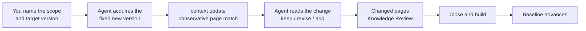

# Updating Knowledge

<!-- context:section id="goal" -->
Every approved page records which source version it was written from. When a repository moves on or a document is edited, an **update** compares the new version with that baseline, revises only the affected pages and then moves the baseline forward. Unaffected pages are left alone.


<!-- /context:section -->

<!-- context:section id="ask" -->
## Ask for the update

Name the scope — a whole repository, some modules or specific documents — and, when it matters, the version:

```text
billing-service has moved to the release-2.4 merge. Locate the affected knowledge
and update it. Only the invoicing and refunds modules.
```

For a single page whose text is wrong, a [revision](../review-and-revision/revising-a-page.md) is the better tool. The Agent also tells you when other work is still unfinished in the Context knowledge workspace and asks whether to finish or roll it back before starting an independent update.
<!-- /context:section -->

<!-- context:section id="acquire" -->
## How the new version is chosen

Context does not poll platforms or discover remote changes; the Agent uses its own Git and document tools once, for the scope you named.

- For a branch or merge request, it establishes the target branch, merge state and the actual commit on that branch. An unmerged proposal is not the mainline, and a squash or rebase can produce a different commit than the feature branch.
- Intervening commits that touch the registered modules are included; reverts are real changes.
- A new commit with unchanged module trees can conclude "no knowledge change".
- If the old baseline is unavailable after a force push or history cleanup, the Agent says so and compares the current material with approved knowledge instead.
- For documents, a read failure, a deletion and a move are reported differently; none of them is a reason to retire a page.
<!-- /context:section -->

<!-- context:section id="submit" -->
## The update request

```yaml
scopes:
  - requirement_ref: reader-guide
    source_ref: repo:20261012/billing-service
changes: The selected change adds one public option; inspect its explanation and examples.
```

The Agent submits this with `context update --input <file>`. Omitting module references selects the whole confirmed source. The returned candidate list is a conservative match of pages citing the changed material, not a list of pages that must change: the Agent reads the change and the current pages, keeps what is still right, revises what changed and proposes pages for genuinely new topics, which go through structure review first.
<!-- /context:section -->

<!-- context:section id="review" -->
## Review and the baseline

Changed pages appear in the review report with their changed blocks next to the previous text. The processed baseline advances only after every selected revision is approved, closed and built — or after an explicit conclusion that nothing needs to change. It does not move on acquisition or after the first approved page, so an interrupted update can resume without losing track of what remains.
<!-- /context:section -->

<!-- context:section id="only-needed" -->
## Only the sources the update needs

Unrelated repositories do not need to be checked out for an update. A note, a document-only change, a wording fix or a navigation change needs no code at all. When required code is missing, the Agent restores only that repository at its pinned commit; see [Code Repositories](../registering-sources/code-repositories.md#checkouts-on-another-machine).
<!-- /context:section -->
