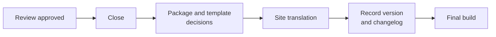

# Versions and Changelog

<!-- context:section id="goal" -->
A Context knowledge workspace has its own version: `package.json.version`, a SemVer. Each completed delivery records **one** new version with a short changelog, and the package, the website and LLM Docs all carry it. Intermediate batches and worker results never get their own version.


<!-- /context:section -->

<!-- context:section id="bump" -->
## Which number changes

| Change in the delivery | Increment |
| --- | --- |
| Added modules or material that expands coverage | Minor |
| Corrections, updates to existing modules, navigation, persistent status | Patch |
| Anything you explicitly call a major version | Major — only on your instruction |

The first version is `0.1.0` unless the knowledge workspace already has a higher one or you specify another. Temporary progress under `.tmp/` never changes the version.
<!-- /context:section -->

<!-- context:section id="record" -->
## How it is recorded

The Agent runs `context version inspect` to see the formal changes — article bodies, assets, structure, navigation and templates — then writes the entry and submits it with `context version record`:

```yaml
expected_digest: "<digest returned by inspect>"
version: 0.2.0
title: Add module recovery guidance
changes:
  - Document recovery conditions and the supported retry flow.
triggers:
  - kind: module
    description: Additional module material requested in this iteration.
```

Trigger kinds are `initial`, `note`, `sessions`, `mr`, `module`, `document`, `navigation`, `repair`, `dist`, `translation` and `other`. The optional `actor` defaults to the local Git `user.name`; the Agent never guesses an identity. Each entry stays within 1500 visible characters, compressed by merging related changes rather than truncated or split. Entries never contain credentials, raw transcripts, local absolute paths or private account IDs.

The CLI updates `package.json`, `changelog.yaml` and the generated `CHANGELOG.md` together. `version inspect --base <commit-or-tag>` compares against a specific Git point; by default it uses the current version's `v<version>` tag, or `HEAD`.
<!-- /context:section -->

<!-- context:section id="retries" -->
## Retries and republishing

A failed build reuses the recorded version; retrying does not bump it. If formal content has to change after a failed build, an unpublished version can be amended. Once content has been published, any further change needs a higher version. A local build alone does not seal a version, and recording one never commits, tags, uploads or deploys anything.
<!-- /context:section -->

<!-- context:section id="readers" -->
## Where readers see it

The website has a history page, `changelog.html`: cards newest first, the latest three expanded and older ones collapsed. The History button beside the theme switch and the footer's update time link to it. Knowledge packages and LLM Docs carry the same version and changelog.
<!-- /context:section -->

<!-- context:section id="restore" -->
## Going back to an earlier version

Ask the Agent to restore a version — *"restore the knowledge as of last Friday"* or *"go back to the previous version"*. It resolves that to a concrete commit and path scope, abandons unfinished task state, restores only the agreed knowledge workspace paths with Git, and restores the sources pinned by that version. It never resets the whole repository, and existing build output is stale until rebuilt. Nothing is committed or pushed automatically.
<!-- /context:section -->
