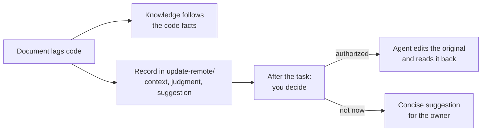

# Writing Back Upstream

<!-- context:section id="goal" -->
Production cross-checks sources, and documentation lagging behind code is the normal case. By default the Agent corrects the knowledge from the code facts, so the knowledge is right but the original document stays stale. If you want the originals fixed too, ask the Agent to collect the differences as it goes and handle them together at the end.


<!-- /context:section -->

<!-- context:section id="setup" -->
## Ask for it once

Add the instruction at the start of a task, or permanently in the `AGENTS.md` of the Context knowledge workspace:

```text
When a revision is caused by documentation lagging behind the code, record it
in update-remote/<date>-<topic>.md with the context, the judgment and the
suggested change. After the task, work through update-remote: find each
upstream document and either revise it or give a concise suggestion for me
to decide on.
```

Upstream documents then catch up promptly, and knowledge and originals do not drift apart for long.
<!-- /context:section -->

<!-- context:section id="judge" -->
## Is the original actually wrong?

Before proposing an upstream edit, the Agent distinguishes three cases:

| Case | What happens |
| --- | --- |
| The knowledge misunderstood correct source text | Only the local page is corrected |
| A confirmed decision has not reached the document | The decision can be saved as a local note while the upstream change is considered |
| The conclusion is still uncertain | It is not written anywhere as fact |
<!-- /context:section -->

<!-- context:section id="write" -->
## Making the edit

Neither approving knowledge nor fully managed mode authorizes a remote write. For each edit, the Agent shows the exact document, the affected passage, the before/after text, the reason and the knowledge it affects, and uses an authorization you have already given for that concrete edit or asks for one. It rereads the passage just before writing, adapts only within the authorized scope if someone else changed it, writes with its document tool and reads the result back.

The returned document then feeds the normal capture and update flow, so the local snapshot reflects what is really upstream. If the remote edit succeeded but the local build failed, the Agent resumes the local delivery rather than editing again. It does not post comments, notify groups or change permissions; when it lacks permission, it leaves you a concrete suggestion.
<!-- /context:section -->
