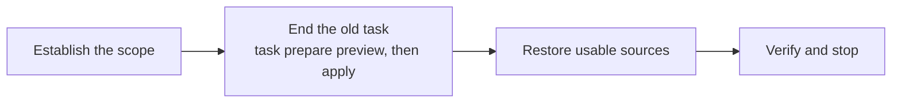

# Preparing a Workspace

<!-- context:section id="goal" -->
Preparing a Context knowledge workspace leaves it with **usable registered sources and no unfinished task**, while keeping approved knowledge and configuration. Ask for it explicitly — for example "prepare this workspace for the next task". A clear request authorizes the task-state cleanup it describes; the Agent asks only about an unresolved target or a loss you have not agreed to. The switch that governs this is `context.gate.workspace_reset_restore`.


<!-- /context:section -->

<!-- context:section id="capture" -->
## When you only want to capture documents

Capturing named documents and pausing is not preparation and does not start article production. The Agent registers the sources and stops after reporting what was captured; existing tasks, drafts, approved content and registrations are untouched, and no `task resume` is needed. Production resumes only when you ask for knowledge.
<!-- /context:section -->

<!-- context:section id="scope" -->
## 1. Establish the scope

The Agent locates the workspace with `context entry`, then looks at current work, running processes, Git changes and source registrations, and tells you which unfinished drafts and queued maintenance will be discarded. If a writer is still running, it waits for the result first. A broken `status` is investigated, not taken as proof that the workspace is empty.

Registered sources are not an active task. Preparation does not repair invalid snapshots or change which sources are registered, and leaving a source out of one task never deletes its registration or evidence.
<!-- /context:section -->

<!-- context:section id="end" -->
## 2. End the old task

```bash
context task prepare --format json
```

The command first **previews** exactly which Context-owned task files — production, Review and maintenance state — would be removed. Once you have agreed to discard that scope, the Agent runs the returned apply command with its plan digest. If interrupted, it reruns the preview and uses the resume command it returns.

| Removed | Always kept |
| --- | --- |
| Unfinished production stages, drafts, Review state and queued maintenance | Approved pages, source records and snapshots, project configuration, repository checkouts, other `.tmp` files and existing outputs |

Other caches are optional cleanup. Keep reports, unique material, unknown files and modified checkouts unless you agree to lose them; never delete locks, transaction records or active tool directories. Keep repository checkouts used by registered sources — removing them forces a costly clone on the next update — and keep source-region baselines, which let updates tell moved text from changed text.

Prepare **after** a successful delivery rather than straight after close: recording the version, building and retries may still need the current task. Delivery cleanup already removes completed drafts and Review state.
<!-- /context:section -->

<!-- context:section id="sources" -->
## 3. Restore usable sources

| Source | How it is restored |
| --- | --- |
| Repositories | `context source recovery-plan --format json` lists what is missing; a matching local checkout is reused, or `context source restore --input <file> --format json` clones it when authorized. Modules sharing a remote and commit are cloned once, at the registered commit — never a newer one. A dirty checkout you supplied is never reset. |
| Lark documents | The stored body and required attachments are checked against the source records and repaired with the document tools. If the current remote differs from the old snapshot, that is a source update to decide, not a recovery. |
| Notes, session summaries, local files | Formal source content is kept and its paths checked. Lost originals are never reconstructed from generated knowledge. |
<!-- /context:section -->

<!-- context:section id="finish" -->
## 4. Verify and stop

The workspace is ready when the preview shows no task files, no writer is running, the configuration loads, and the selected sources resolve to their registered versions and paths. The Agent reports any blockers with their next action and then stops — it does not start writing or recapture everything. To go back to an older version instead, see [Restoring a Version](./restoring.md).
<!-- /context:section -->
