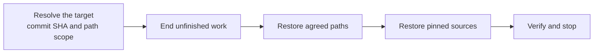

# Restoring a Version

<!-- context:section id="goal" -->
Restoring brings a Context knowledge workspace back to a saved state in Git: its files and the sources they need. It **does not** reset the whole repository, rewind source repositories, or bring back ignored runtime progress. An explicit restore request needs no second approval when the target and the affected files are clear.


<!-- /context:section -->

<!-- context:section id="target" -->
## 1. Resolve the target

The Agent inspects Git history for the workspace path and turns your request into a **concrete commit SHA and path scope**:

| You say | Target |
| --- | --- |
| Nothing specific | The latest commit that saved the workspace — this undoes uncommitted results |
| "The previous version" | The preceding saved state of the workspace, not simply `HEAD~1` of a large repository |
| A SHA | That SHA, after validation |
| A date | Interpreted in your timezone and meaning (for example, as of the end of that day); ambiguous candidates are confirmed with you |

It then compares the target with current tracked, untracked and staged files. Files added since the target are proposed for removal; unrelated files, existing staged work and ignored source checkouts are kept. Moves and renames are accounted for.
<!-- /context:section -->

<!-- context:section id="restore" -->
## 2. Restore files and sources

1. Wait for any running Context writer, then abandon unfinished work with the task-state preview and apply described in [Preparing a Workspace](./preparing.md). Old Routes are not reused afterwards.
2. Restore only the agreed paths, preserving branch history:

   ```bash
   git restore --source=<sha> --worktree -- <paths>
   ```

   Files added since the target are deleted explicitly. `reset --hard` and `clean -fdx` are never used as a shortcut.
3. Use the restored source records to restore pinned repository versions, module paths, document snapshots and attachments. Newer remote content cannot stand in for a lost old snapshot, and usable sources are not recloned.

Old build output does not describe the restored version. If you want output, the Agent runs the current close and build; until then it reports existing output as stale. It does not start full indexing just because the old configuration is back, and if the historical format is incompatible it reports the migration or tool-version choice instead of rewriting pages silently.
<!-- /context:section -->

<!-- context:section id="verify" -->
## 3. Verify and stop

The Agent compares the restored files with the target commit, confirms unrelated changes and index entries survived, and checks that sources are ready and no old task state remains. If only some sources could be restored, it reports partial completion with the missing access or version. Nothing is committed, rewritten or pushed automatically; commit the result separately with [Committing Results](./committing.md).
<!-- /context:section -->
